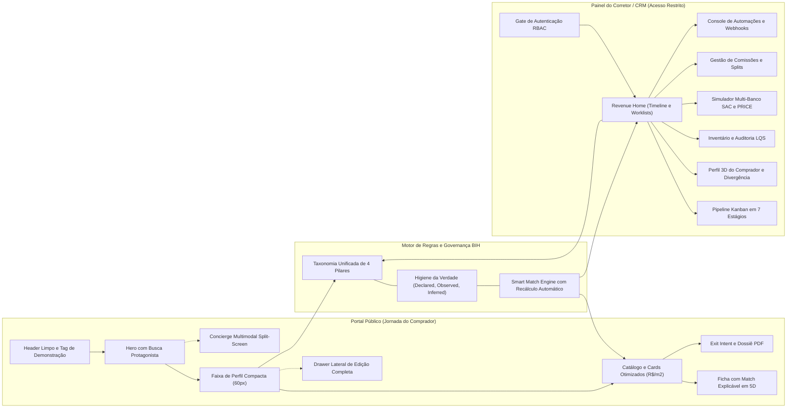
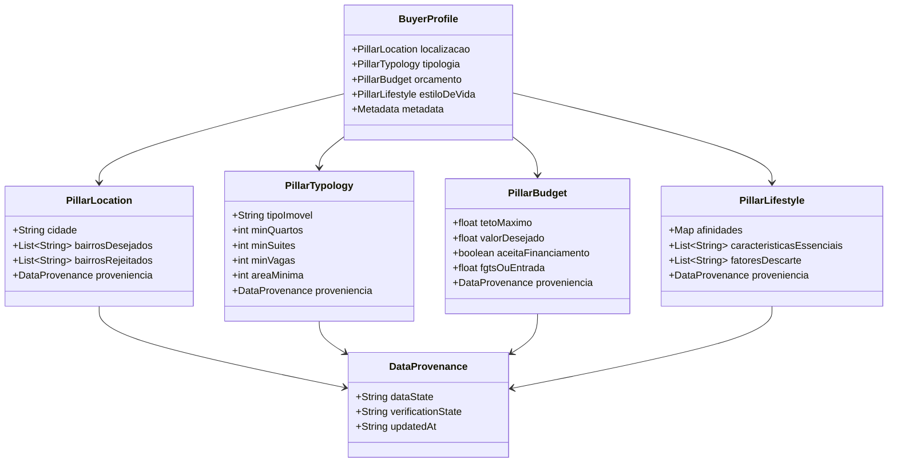

# Documento de Arquitetura e Plano de Implementação — Urban Real State (Imobiliária 3.0)

Este documento consolida a arquitetura técnica, modelo de dados, taxonomia de experiência do usuário e o plano de desenvolvimento faseado para a construção da plataforma **Urban Real State (Imobiliária 3.0)**, fundamentado nas 23 User Stories distribuídas nos 6 Épicos e na resolução dos 28 GAPs de UX e Engenharia.

---

## 1. Visão Geral do Produto e Pilares Estratégicos

A plataforma **Urban Real State** é uma solução imobiliária *White-Label Enterprise* concebida em duas grandes trilhas integradas:



### Princípios Inegociáveis de UX e Engenharia

1. **Arquitetura Anonymous-First:** O comprador explora, pesquisa, filtra e refina sem atrito ou login prévio. O perfil é salvo transparentemente em sessão/localStorage e promovido a lead apenas em pontos de conversão deliberados.

2. **Separação Estrita de Linguagem:** O comprador nunca visualiza jargões internos (*"CRM"*, *"Lead"*, *"Qualificado"*, *"Pipeline"*). A experiência pública comunica consultoria de alto padrão (*"Perfil salvo e compartilhado com seu consultor"*).

3. **Design System "Um Acento, Uma Função":** Cor primária de acento (`#C8431F`) reservada exclusivamente para o logotipo e a ação de conversão primária de cada tela. Tema claro como padrão (`--bg: #FAFAF8`), eliminação do arco-íris caótico de cores e conformidade **WCAG 2.1 AA** (contraste > 4.5:1, alvos ≥ 44px).

4. **Ergonomia e Respiro Visual:** Devolução de **~450px de altura** para as fotos do catálogo através da substituição dos blocos verticais acumulados por uma faixa de perfil compacta de ~60px e um drawer retrátil lateral com recálculo 100% automático via debounce (300ms a 500ms).

5. **Governança de Dados BIH V0 (Higiene da Verdade):** Classificação explícita de cada atributo do comprador em `DECLARED`, `OBSERVED`, `INFERRED` ou `SIMULATED`, com status de checagem documental (`VERIFIED` vs `NOT VERIFIED`).

---

## 2. Arquitetura de Software e Stack Tecnológica

### 2.1. Definição da Stack

| Camada | Tecnologia Escolhida | Justificativa Técnica |
| --- | --- | --- |
| **Framework Frontend** | **React 18 / 19 + Vite** | Alta velocidade de build, ecossistema maduro, renderização reativa ideal para split-screen e dashboards complexos. |
| **Estilização & UI** | **Tailwind CSS v3/v4 + CSS Variables** | Tokens de design puros, facilidade para white-label multi-inquilino, zero overhead de runtime e consistência de espaçamentos. |
| **Ícones & Microinterações** | **Lucide React + Canvas Confetti** | Ícones semânticos leves e celebrações sutis para micro-conversões. |
| **Mapas Interativos** | **Leaflet + React-Leaflet** | Visualização geoespacial leve de imóveis sem custo recorrente de API key para catálogo padrão. |
| **Motor Multimodal / IA** | **Web Speech API + Google Gemini API (**`@google/genai`**)** | Transcrição de voz nativa e síntese no browser com fallback sem bloqueio; extração semântica dos 4 pilares em JSON estruturado com IA. |
| **Banco de Dados & Auth** | **Supabase (PostgreSQL + Auth RBAC + Storage)** | Autenticação por JWT, controle de acesso a nível de linha (RLS), persistência segura de imóveis, leads e mídias. |
| **Camada Offline / Standalone** | **Adapter Layer Modular (**`db.js` **/ Fixtures BIH)** | Permite que a aplicação execute 100% autônoma em demonstrações comerciais com mocks realistas de alta fidelidade sem quebrar quando offline. |
| **Servidor de Integração** | **Node.js (Express / Edge Functions)** | Roteamento de Webhooks (Meta Ads Lead Gen, Google Ads), geração de Feeds XML para portais e simulação de WhatsApp Cloud API. |

---

### 2.2. Estrutura Modular de Pastas Proposta

```text
c:\DEV\Imobiliaria3.0\
├── public/                          # Assets estáticos, logos, imagens de imóveis
├── src/
│   ├── assets/                      # SVGs, ícones customizados, imagens de marca
│   ├── design-system/               # Tokens de design e componentes primitivos
│   │   ├── tokens.css               # --bg, --surface, --accent, --text-primary
│   │   ├── Button.jsx               # Botões primários, secundários, ghost (44px min)
│   │   ├── Modal.jsx                # Container de modal acessível com focus-trap
│   │   ├── Drawer.jsx               # Gaveta lateral ergonômica com animação fluida
│   │   ├── Stepper.jsx              # Contador numérico ergonômico [− 2 +]
│   │   ├── SliderRange.jsx          # Sliders de faixa de preço com formatação em R$
│   │   └── Tooltip.jsx              # Tooltips com suporte a leitores de tela
│   │
│   ├── portal/                      # Trilhas do Comprador (Portal Público)
│   │   ├── components/
│   │   │   ├── Header.jsx           # Header Limpo (Texto + Concierge destaque + Tag Demo)
│   │   │   ├── HeroSearch.jsx       # H1 2 linhas + Busca com microfone integrado
│   │   │   ├── ProfileCompactStrip.jsx # Faixa de ~60px com resumo dos 4 pilares
│   │   │   ├── ProfileDrawer.jsx    # Edição completa dos 4 pilares com recálculo automático
│   │   │   ├── PropertyCard.jsx     # Card otimizado (Foto limpa, Match %, Specs, R$/m²)
│   │   │   ├── PropertyGrid.jsx     # Grade responsiva de imóveis + paginação/infinite scroll
│   │   │   ├── PropertyMap.jsx      # Alternador de visualização em mapa interativo
│   │   │   ├── PropertyDetailModal.jsx # Ficha técnica completa, custos e match 5D
│   │   │   ├── SplitVoiceConcierge.jsx # Concierge multimodal (Chat + Voz + 4 Pilares ao vivo)
│   │   │   ├── CriticismModal.jsx   # Feedback de imóvel (calibração de perfil)
│   │   │   ├── ExitIntentModal.jsx  # Captura respeitosa com dossiê PDF de favoritos
│   │   │   └── ChatbotFloat.jsx     # Assistente de plantão discreto
│   │   └── pages/
│   │       └── PublicPortalPage.jsx # Composição da página pública
│   │
│   ├── crm/                         # Trilhas Internas (Painel do Corretor & Gestor)
│   │   ├── auth/
│   │   │   ├── AuthContext.jsx      # Contexto RBAC (Admin, Gestor, Corretor, Financeiro)
│   │   │   ├── ProtectedRoute.jsx   # Guard de rotas protegidas
│   │   │   └── LoginModal.jsx       # Gate de autenticação elegante
│   │   ├── dashboard/
│   │   │   ├── RevenueHome.jsx      # Dashboard executivo, KPIs de VGV e honorários
│   │   │   ├── LeadTimeline.jsx     # Feed cronológico de eventos reais do comprador
│   │   │   └── ActionableWorkList.jsx # Filas de trabalho priorizadas (High Fit, Stale)
│   │   ├── pipeline/
│   │   │   ├── KanbanBoard.jsx      # Pipeline em 7 estágios com drag-and-drop
│   │   │   ├── KanbanCard.jsx       # Card da oportunidade com SLA e atalho WhatsApp
│   │   │   └── OpportunityModal.jsx # Detalhes da negociação e histórico
│   │   ├── buyer-profile/
│   │   │   ├── BuyerProfile3D.jsx   # 4 Pilares (Local, Tipo, Orçamento, Estilo)
│   │   │   ├── DataTruthBadge.jsx   # Selos de proveniência (DECLARED/OBSERVED/INFERRED)
│   │   │   └── BudgetDivergence.jsx # Alerta de divergência (pretensão vs. histórico)
│   │   ├── inventory/
│   │   │   ├── InventoryTable.jsx   # Gestão de imóveis, status e fotos
│   │   │   ├── LqsAuditorModal.jsx  # Auditor de qualidade de anúncio (0 a 100)
│   │   │   └── PropertyBuyersMatch.jsx # Match Inverso (Imóvel -> Compradores compatíveis)
│   │   ├── finance/
│   │   │   ├── CreditSimulator.jsx  # Simulador Multi-Banco SAC vs. PRICE
│   │   │   └── CommissionSplits.jsx # Divisão de honorários e regras de split
│   │   └── integrations/
│   │       ├── AutoWorkflowConsole.jsx # Console retrátil de automações e gatilhos
│   │       ├── PortalSyncManager.jsx   # Exportação e status de feeds XML
│   │       ├── WebhooksMonitor.jsx     # Monitor de leads de Meta Ads e Google Ads
│   │       └── WhatsAppSimulator.jsx   # Simulador de mensagens e testes de templates
│   │
│   ├── context/                     # Estados Globais
│   │   ├── BuyerProfileContext.jsx  # Estado dos 4 Pilares e histórico de navegação
│   │   ├── PropertyContext.jsx      # Acervo de imóveis, filtros e favoritos
│   │   └── NotificationContext.jsx  # Toasts e alertas do sistema
│   │
│   ├── services/                    # Integrações & Regras de Negócio
│   │   ├── smartMatchEngine.js      # Motor explicável de compatibilidade 5D
│   │   ├── aiService.js             # Conexão Gemini e processamento de prompts
│   │   ├── voiceConciergeService.js # Gestão de Web Speech API / reconhecimento de voz
│   │   ├── lqsCalculator.js         # Algoritmo de Listing Quality Score
│   │   ├── mortgageCalculator.js    # Fórmulas matemáticas de amortização SAC e PRICE
│   │   ├── feedXmlGenerator.js      # Gerador de feeds padrão Zap / VivaReal / OLX
│   │   └── dataAdapter.js           # Camada de abstração Supabase vs Mock local
│   │
│   ├── data/                        # Dados iniciais, fixtures e contratos
│   │   ├── defaultProperties.json   # Base de imóveis de Curitiba/PR higienizada
│   │   └── mockBihCandidates.json   # Leads simulados para demonstração
│   │
│   ├── App.jsx                      # Roteamento e orquestração de módulos
│   ├── main.jsx                     # Ponto de entrada
│   └── index.css                    # Configuração Tailwind e tokens de raiz
│
├── server/                          # Servidor Node/Express auxiliar (Opcional/Webhook)
│   ├── routes/
│   │   ├── webhooks.js              # Endpoint para Meta Ads e WhatsApp
│   │   └── feeds.js                 # Rota GET para portais imobiliários
│   └── index.js
├── package.json
├── tailwind.config.js
└── vite.config.js
```

---

## 3. Modelo Unificado de Dados e Taxonomia de 4 Pilares

Para eliminar a inconsistência apontada no **GAP-07.1**, o mesmo modelo de 4 pilares regerá simultaneamente a experiência do Comprador e a visão do Corretor:



> **Valores de Proveniência (Higiene da Verdade BIH V0):**
> - `dataState`: `DECLARED` (declarado pelo usuário), `OBSERVED` (navegação/ações), `INFERRED` (inferência algorítmica) ou `SIMULATED` (massa de teste).
> - `verificationState`: `VERIFIED` (validado documentalmente/humano) ou `NOT_VERIFIED` (pendente de checagem).

---

## 4. Mapeamento dos 6 Épicos e Rastreabilidade das User Stories

| Épico | User Stories Cobertas | Entregáveis de Software |
| --- | --- | --- |
| **EPIC-01: Portal Público e Descoberta** | • **US-01:** Anonymous-First & Header<br>• **US-02:** Concierge de Voz & Split<br>• **US-03:** Busca Semântica & Faixa Compacta<br>• **US-04:** Catálogo & Cards Otimizados | Header sem poluição, busca no hero com mic integrado, faixa de perfil de 60px com drawer lateral, cards de imóveis com R$/m² e plural correto, alternância grade/mapa, tela dividida para o Concierge com transcrição de voz. |
| **EPIC-02: Detalhe do Imóvel e Conversão** | • **US-05:** Ficha & Match Explicável<br>• **US-06:** Listing Quality Score (LQS)<br>• **US-07:** Feedback & Refinamento<br>• **US-08:** Exit Intent & Dossiê PDF<br>• **US-09:** Chatbot Contínuo | Modal de detalhe rico com cálculo de custos fixos (IPTU + Condomínio), explicação de afinidades positivas e atritos, modal de crítica que refina o perfil, popup de saída não invasivo gerando dossiê de imóveis e widget de atendimento 24/7. |
| **EPIC-03: Autenticação, Governança & Configuração** | • **US-10:** Autenticação RBAC<br>• **US-11:** Sistema Visual & White-Label | Gate seguro de login para corretores, ocultação de links internos para o visitante anônimo, Design System com tokens (`#C8431F`, `--bg: #FAFAF8`), acessibilidade WCAG 2.1 AA e suporte a personalização de marca. |
| **EPIC-04: CRM, Pipeline e Gestão de Leads** | • **US-12:** Revenue Home Executivo<br>• **US-13:** Pipeline Kanban em 7 Fases<br>• **US-14:** Perfil 3D do Comprador<br>• **US-15:** Smart Matching & Pitch WhatsApp<br>• **US-16:** Distribuição Automática de Leads | Torre de controle com timeline de eventos reais do comprador, kanban drag-and-drop com alertas de estagnação de 5 dias, análise de divergência orçamentária, geração de pitch para WhatsApp em 1 clique e motor de distribuição por rodízio/SLA. |
| **EPIC-05: Gestão de Estoque e Simuladores** | • **US-17:** Gestão de Inventário & LQS<br>• **US-18:** Simulador Multi-Banco SAC/PRICE<br>• **US-19:** Gestão de Comissões & Splits | Tabela de estoque com auditoria automática de qualidade das fotos e dados (LQS 0-100), calculadora financeira de parcelas e juros vinculável à oportunidade, painel de comissões e rateio de honorários da equipe. |
| **EPIC-06: Integrações Multicanal e Automação** | • **US-20:** Sincronização de Portais (XML)<br>• **US-21:** Webhooks Meta/Google Ads<br>• **US-22:** Simulador WhatsApp Cloud API<br>• **US-23:** Console de Automações & Gatilhos | Endpoints e geradores de XML para Zap/VivaReal/OLX, endpoint de webhook para ingestão imediata de leads externos com SLA < 5 min, interface de teste de templates do WhatsApp e console retrátil de regras/gatilhos automáticos. |

---

## 5. Cronograma e Plano de Implementação em 4 Fases

O desenvolvimento será executado de maneira incremental e auditável, garantindo que cada fase resulte em software funcional e testado:

### Fase 1: Fundação do Projeto, Design System & Modelo de Dados (Semana 1)

- [ ] Inicialização do repositório limpo do `Imobiliaria3.0` com Vite, React, Tailwind CSS e dependências.

- [ ] Configuração de Design Tokens e variáveis CSS corporativas (`tokens.css`, temas claro/escuro, tipografia).

- [ ] Criação dos componentes primitivos de interface acessíveis (Buttons, Inputs, Steppers `[− 2 +]`, Sliders com debounce, Modais com focus-trap e Drawers).

- [ ] Implementação da camada de dados (`dataAdapter.js`, `smartMatchEngine.js` e mock sanitizado de imóveis e leads).

- [ ] Estruturação do `BuyerProfileContext` e `PropertyContext` com suporte à persistência em localStorage e taxonomia unificada de 4 pilares.

### Fase 2: Portal Público do Comprador, Busca & Concierge Multimodal (Semanas 2 a 3)

- [ ] **Entrega 1 (Header Limpo & Hero Protagonista):** Header com navegação em texto, um único botão de destaque para o Concierge, remoção de ícones confusos de CRM e tag de demonstração neutra; Hero com H1 direto em 2 linhas e campo de busca amplo com microfone embutido (US-01).

- [ ] **Entrega 2 (Faixa de Perfil Compacta & Drawer):** Faixa de \~60px que devolve 450px de altura para as fotos dos imóveis; drawer lateral de edição ergonômica com recálculo 100% automático (US-03).

- [ ] **Entrega 3 (Catálogo & Cards Otimizados):** Grade de imóveis com cards limpos (sem tarja preta), score de match na foto com tooltip explicativo, specs em texto em linha única com plural correto, R$/m² e link "Analisar pré-requisitos" no rodapé; alternador de mapa Leaflet (US-04).

- [ ] **Entrega 4 (Ficha Técnica, LQS & Conversão):** Modal de detalhes do imóvel com custos transparentes (IPTU/condomínio), explicação do match em 5 dimensões, modal de crítica do imóvel (US-05, US-06, US-07).

- [ ] **Entrega 5 (Concierge Multimodal em Tela Dividida):** Split-screen dando o mesmo peso para Voz e Chat, transcrição contínua via Web Speech API / Gemini e preenchimento dos 4 pilares em tempo real à direita com edição manual (US-02).

- [ ] **Entrega 6 (Exit Intent & Assistente 24/7):** Modal de saída suave oferecendo dossiê dos imóveis favoritados em PDF/impressão e widget de chatbot contínuo (US-08, US-09).

### Fase 3: Autenticação RBAC, Painel do Corretor & CRM Operacional (Semanas 4 a 5)

- [ ] **Entrega 7 (Gate RBAC & Separação de Visibilidade):** Proteção de rotas do CRM, login seguro e exibição do botão "Painel do Corretor" exclusivamente para usuários autenticados (US-10, US-11).

- [ ] **Entrega 8 (Revenue Home & Timeline de Eventos):** Dashboard com KPIs de VGV, worklists priorizadas de alta conversão e timeline cronológica com ações reais do comprador no portal público (US-12).

- [ ] **Entrega 9 (Pipeline Kanban & Perfil 3D):** Quadro kanban em 7 estágios com drag-and-drop, detecção de estagnação de 5 dias, atalho para WhatsApp, e visualização dos 4 pilares com selos `DECLARED`, `OBSERVED`, `INFERRED` e alertas de divergência orçamentária (US-13, US-14, US-16).

- [ ] **Entrega 10 (Smart Matching Inverso & Pitch WhatsApp):** Seleção de imóvel para identificação de compradores compatíveis da carteira e geração de roteiro persuasivo pronto para envio (US-15).

- [ ] **Entrega 11 (Inventário, Simulador SAC/PRICE & Comissões):** Tabela de estoque com cálculo automático de Listing Quality Score (LQS), calculadora de financiamento com comparativo de parcelas e módulo de divisão de honorários e splits de corretagem (US-17, US-18, US-19).

### Fase 4: Integrações Multicanal, Webhooks & Automações (Semana 6)

- [ ] **Entrega 12 (Feeds XML para Portais):** Gerador e exportador de feeds compatíveis com os layouts dos grandes portais imobiliários (Zap, VivaReal, OLX) (US-20).

- [ ] **Entrega 13 (Webhooks de Tráfego Pago):** Receptores para captação automática de leads originados de formulários do Meta Ads e campanhas do Google (US-21).

- [ ] **Entrega 14 (Simulador WhatsApp Cloud & Console de Automação):** Módulo de simulação e disparo de mensagens padronizadas e console retrátil de regras de negócio e gatilhos (US-22, US-23).

---

## 6. Governança e Critérios de Aceite para Início dos Trabalhos

Para iniciarmos a implementação do código na pasta `Imobiliaria3.0`, validaremos:

1. **Confirmação do Escopo e Stack:** Aprovação da stack React 18+ / Vite / Tailwind / Context API com arquitetura híbrida (Modo Standalone com Mock de alta fidelidade + conectores prontos para Supabase/IA).
2. **Prioridade Inicial de Construção:** Iniciar imediatamente pela **Fase 1 (Estrutura, Design Tokens e Componentes Base)** seguida pela **Fase 2 (Portal do Comprador com o Header Limpo, Faixa Compacta e Concierge)**.