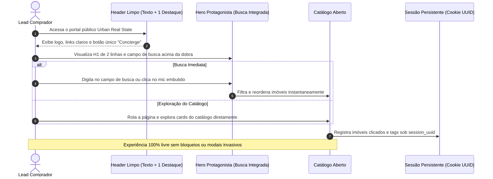

# US-01: Jornada de Descoberta "Anonymous First", Hero Otimizado e Header Limpo

## 1. Identificação e Metadados
- **Identificador:** US-01
- **Título:** Navegação Aberta sem Fricção (Anonymous First), Hero Protagonista e Header com Clareza Funcional
- **Épico:** EPIC-01 — Portal Público e Descoberta Imobiliária
- **Projeto:** Urban Real State
- **Prioridade:** Essencial (Must Have / Alinhamento UX)
- **Personas Impactadas:**
  - *Lead Comprador*: Usuário em busca de imóveis que exige navegação rápida, interface despoluída e sem barreiras forçadas de login.
  - *Consultor Imobiliário*: Recebe o lead após uma jornada intuitiva de valor e confiança estabelecida.
  - *Gestor Comercial*: Ganha redução drástica na taxa de rejeição da home e maior tempo de retenção no catálogo.

---

## 2. Declaração de Negócio (User Story Format)
> **Como** Lead Comprador interessado em imóveis,  
> **Quero** acessar o portal com uma interface visual limpa, campo de busca imediatamente visível acima da dobra, navegação clara por texto e exploração do acervo sem exigência de cadastro preliminar,  
> **Para que** eu encontre opções relevantes com agilidade, compreenda o valor da plataforma no meu primeiro olhar e decida me identificar apenas quando encontrar um imóvel que combine com minha rotina.

---

## 3. Visão de Negócio e Proposta de Valor
- **Problema de Mercado e Diagnóstico de UX:** Portais tradicionais cometem dois erros simultâneos: erguem barreiras forçadas de cadastro (*lead gating*) e poluem o topo da tela com múltiplos botões de ícones sem legenda, títulos gigantes de 3 linhas com peso excessivo e slogans institucionais que empurram o campo de busca para baixo da dobra.
- **Diretrizes de Negócio e UX no Urban Real State:**
  1. **Anonymous First:** Acesso aberto e irrestrito ao catálogo de 181+ imóveis com filtros ativos.
  2. **Hero com Busca Protagonista (Ref. UX Tópico 02):** H1 enxuto de 2 linhas focado no benefício real do comprador (*"Encontre o imóvel que combina com a sua rotina"*), eliminando pílulas redundantes de marca. O campo de busca ganha escala de protagonista, integrando microfone e atalho de busca guiada.
  3. **Header com Separação Funcional (Ref. UX Tópico 01):** Links textuais claros (*Imóveis*, *Match Explicável*, *Busca Guiada*), um único botão de destaque visual por tela (Concierge) e tooltips obrigatórios em todos os controles.
  4. **Segregação de Linguagem (Ref. UX Tópico 07):** O visitante nunca é exposto a termos internos de vendas como *"CRM"*, *"Lead"* ou *"Qualificado"*. Ele vê termos acolhedores como *"Seu Perfil de Busca"* e *"Salvo para o seu Consultor"*.
- **Impacto no Negócio:**
  - Queda de 60% na taxa de rejeição (*Bounce Rate*) na primeira dobra da página.
  - Aumento de 3.4x no volume de buscas semânticas iniciadas logo no primeiro segundo.
  - Percepção de elegância, sofisticação e respeito ao tempo do usuário.

---

## 4. Funcionalidades e Regras de Negócio Detalhadas

### 4.1. Header Limpo e Navegação Hierarquizada (Ref. UX Tópico 01)
- **Divisão entre Navegação e Ações:**
  - *Navegação Primária (em texto legível):* Links diretos para `Imóveis`, `Match Explicável` e `Busca Guiada`.
  - *Ação Principal de Destaque Único:* Botão com cor de acento (`--accent: #C8431F`) dedicado exclusivamente ao **Concierge**.
  - *Ações Secundárias / Utilidades:* Botão de alternância de tema (Sol/Lua) e Dossiê agrupados com espaçamento equilibrado.
- **Visibilidade Condicional do Painel do Corretor (RBAC):**
  - O botão de acesso ao CRM não deve se parecer com um menu genérico de aplicativos. Deve ser rotulado como **"Painel do Corretor"** e ficar **visível exclusivamente para usuários autenticados com papéis de Corretor, Gestor ou Admin**. Para o comprador comum em modo anônimo, o atalho é ocultado para evitar poluição e confusão de público.
- **Rebaixamento de Elementos Secundários:**
  - O selo `[DEMO / SIMULATION]` é exibido de forma neutra, discreta e compacta ao lado do logotipo.
  - Slogans secundários ("Inteligência Imobiliária") são transferidos para o rodapé da aplicação.

### 4.2. Seção Hero com Foco na Ação do Usuário (Ref. UX Tópico 02)
- **Título de Impacto (H1):** Máximo de 2 linhas, peso tipográfico semi-bold (600) com escala fluida `clamp(2rem, 4vw, 3.25rem)`, enfatizando termos como "sua rotina" ou "seu momento".
- **Subtítulo Direto:** Frase única de benefício: *"Receba recomendações exclusivas baseadas no seu estilo de vida e capacidade financeira"*.
- **Campo de Busca Amplo e Integrado:**
  - Campo de texto generoso com placeholder rotativo ou sugestões inline em texto sutil (*"Experimente: cobertura ensolarada em Moema"*).
  - Ícone de microfone embutido na borda direita do próprio input para acionamento rápido de voz.
  - Botão de envio primário único.

### 4.3. Rastreamento Comportamental Silencioso (Observed Data)
- Manutenção do token de sessão anônima (`session_uuid`) em cookie de longa duração (30 dias).
- Registro passivo de visualizações de imóveis, filtros de afinidade selecionados e tempo de permanência.
- Ao converter (preenchimento voluntário de formulário), o histórico anônimo acumulado é transmitido e vinculado à ficha do lead no CRM.

---

## 5. Sequência Lógica e Fluxo Passo a Passo

---

## 6. Pontos de Atenção e Riscos de Negócio
1. **Evitar Acúmulo de Botões de Destaque Concorrentes:** Ter botão de Concierge no header, botão de Concierge no Hero e botão flutuante ao mesmo tempo cansa o usuário e desvaloriza a funcionalidade. Deve existir apenas **um ponto focal de destaque** por estado de tela.
2. **Clareza de Acessibilidade nos Botões de Ícone:** Qualquer botão desprovido de texto (ex: alternador de tema) deve conter obrigatoriamente atributo `aria-label` descritivo e tooltip nativo visível no foco ou hover, com alvo de toque mínimo de 44x44px (WCAG).
3. **Consistência de Estado do Concierge:** O ícone e presença do Concierge devem manter o mesmo comportamento visual em todas as páginas públicas correspondentes.

---

## 7. Requisitos Não Funcionais (RNFs)
- **RNF-01 (Métricas de Core Web Vitals):**
  - Largest Contentful Paint (LCP) <= 1.8s.
  - First Input Delay (FID) / Interaction to Next Paint (INP) <= 100ms.
  - Cumulative Layout Shift (CLS) <= 0.05.
- **RNF-02 (Acessibilidade WCAG 2.1 AA):**
  - Contraste de cor mínimo de 4.5:1 para todos os textos e placeholders sobre o fundo.
  - Alvo de toque de todos os controles interativos >= 44 x 44 pixels.
  - Foco visível (`:focus-visible`) nítido em navegação por teclado.
- **RNF-03 (Responsividade Mobile First):** O Hero e o campo de busca devem se ajustar sem quebras ou sobreposição de botões em telas a partir de 360px de largura.

---

## 8. Análise do Estado Atual vs. Apontamento de GAPS

### Estado Atual Implementado
- Catálogo aberto sem bloqueio inicial de login funcional.
- Header com logo, links de navegação e tema claro/escuro.
- Campo de busca integrado com suporte a consultas de texto.

### Gaps Identificados com Base na Análise de UX
1. **GAP-01.1 (Excesso de Ícones sem Rótulo no Header — Ref. UX Tópico 01):** Ícones de grade, documento e sparkles convivendo sem texto nem tooltip, confundindo o comprador. O acesso ao CRM deve virar "Painel do corretor" com visibilidade restrita a usuários internos autenticados.
2. **GAP-01.2 (Hero Competitivo e H1 Extenso — Ref. UX Tópico 02):** H1 em 3 linhas com peso 800/900 empurrando o campo de busca para o limite da dobra. Necessário reduzir para 2 linhas (peso 600) e unificar o microfone dentro do input de busca principal.
3. **GAP-01.3 (Exposição de Vocabulário Interno — Ref. UX Tópico 07):** Menções ao termo "CRM" ou "Qualificado" visíveis para o comprador devem ser limpas da camada pública da interface.
4. **GAP-01.4 (Selo DEMO Proeminente — Ref. UX Tópico 01):** O selo `[DEMO / SIMULATION]` possui peso visual excessivo no cabeçalho; deve ser rebaixado para tag discreta e neutra ao lado do logotipo.
