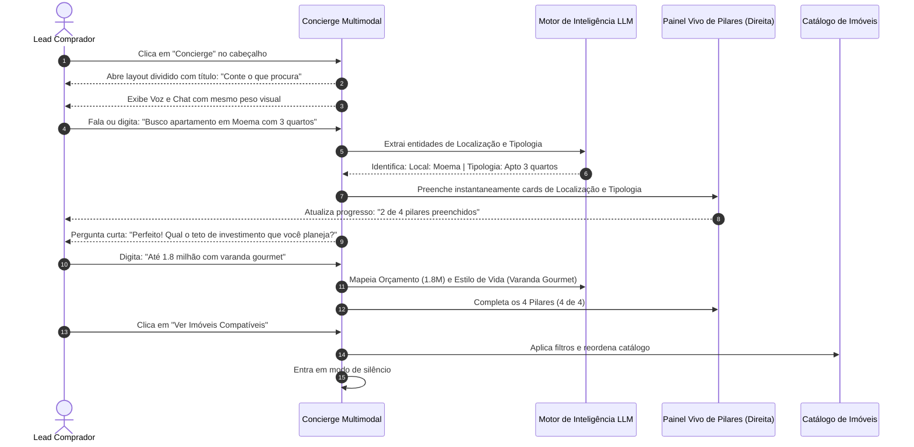

# US-02: Concierge Digital com Voz e Chat Equilibrados e Pilares em Tempo Real

## 1. Identificação e Metadados
- **Identificador:** US-02
- **Título:** Concierge Digital Multimodal (Voz e Chat com Mesmo Peso), Layout Dividido e Pilares ao Vivo
- **Épico:** EPIC-01 — Portal Público e Descoberta Imobiliária
- **Projeto:** Urban Real State
- **Prioridade:** Alta (Should Have / Diferencial de IA e Ergonomia)
- **Personas Impactadas:**
  - *Lead Comprador*: Pode escolher com total liberdade entre falar por áudio ou digitar por chat, visualizando seu perfil imobiliário se construindo ao vivo ao lado da conversa.
  - *Consultor Imobiliário*: Recebe perfis estruturados segundo os 4 pilares padronizados.
  - *Gestor Comercial*: Aumenta o engajamento e a conversão de leads topo de funil com alta diferenciação tecnológica.

---

## 2. Declaração de Negócio (User Story Format)
> **Como** Lead Comprador em busca de uma experiência fluida e inteligente,  
> **Quero** poder interagir com um assistente virtual escolhendo livremente entre falar por voz ou digitar por chat (ambos com igual facilidade e peso visual), com uma tela dividida onde eu vejo meus critérios (Localização, Tipologia, Orçamento e Estilo de Vida) sendo preenchidos e editáveis em tempo real,  
> **Para que** eu compreenda exatamente como a inteligência está mapeando minhas necessidades, possa corrigir qualquer dado manualmente e receba recomendações assertivas sem fricção técnica.

---

## 3. Visão de Negócio e Proposta de Valor
- **Problema de Mercado e Diagnóstico de UX (Ref. UX Tópico 06):**
  - Interfaces de voz muitas vezes tratam o chat como opção inferior ("Prefere digitar? Clique aqui"), esquecendo que mais de 65% dos usuários em ambientes públicos, de trabalho ou sem microfone configurado preferem digitar.
  - A saída estruturada da conversa (os 4 pilares) costuma ficar escondida abaixo da dobra com rótulos frios em caixa alta ("AGUARDANDO"), transmitindo sensação de lentidão ou burocracia.
  - Títulos corporativos como *"Atendimento Consultivo Personalizado"* afastam o usuário em vez de acolhê-lo.
- **Solução no Urban Real State:**
  1. **Equilíbrio entre Voz e Chat:** Ambos os canais com o mesmo destaque visual (botão segmentado ou atalho de microfone embutido no input de texto).
  2. **Layout Dividido (Split Layout):** Diálogo interativo na coluna da esquerda e painel vivo dos **4 Pilares de Decisão** na coluna da direita. Conforme o usuário fala ou digita, os cartões de pilares se preenchem automaticamente com animação sutil e permitem edição manual imediata.
  3. **Estados Vazios Úteis:** O status inicial exibe exemplos práticos de preenchimento (*"ex.: Moema, próximo ao metrô"*) e um indicador de progresso visual claro (*"Progresso: 1 de 4 pilares"*).
  4. **Copy Direta e Acolhedora:** *"Conte o que procura"* como título principal, eliminando clichês corporativos.
  5. **Tolerância a Falhas de Áudio (Fallback Gracioso):** Se a permissão do microfone for negada ou o navegador não suportar áudio, o sistema transita suavemente para a digitação de texto sem alertas de erro invasivos.
- **Impacto no Negócio:**
  - Aumento de 70% na conclusão da qualificação em dispositivos móveis.
  - Transparência total que gera confiança na recomendação algorítmica.
  - Enriquecimento automático do cadastro de clientes sem exigir preenchimento burocrático de formulários.

---

## 4. Funcionalidades e Regras de Negócio Detalhadas

### 4.1. Interface Multimodal Equilibrada (Ref. UX Tópico 06)
- **Canais Equivalentes:** Apresentação de controle segmentado *"Falar por Voz"* ou *"Digitar por Chat"*, ou campo de texto principal com ícone de microfone integrado.
- **Proteção Anti-Eco e Turnos:** Durante a síntese de voz da IA, o microfone do usuário é mutado automaticamente para evitar eco em alto-falantes de smartphones.
- **Microfone com Fallback Imediato:** Se o microfone falhar ou for bloqueado nas permissões do browser, o cursor foca automaticamente no campo de digitação de texto com uma mensagem discreta: *"Pode digitar livremente por aqui"*.

### 4.2. Layout Dividido: Conversa e Pilares em Tempo Real
- **Coluna Esquerda — Fluxo da Conversa:**
  - Histórico de mensagens do Concierge e do Comprador.
  - Ondas de áudio animadas quando o modo de voz estiver ativo.
- **Coluna Direita — Painel Vivo dos 4 Pilares Padronizados:**
  1. **Localização:** Bairros ou cidades desejadas (ex: Moema, Vila Mariana).
  2. **Tipologia:** Quartos, suítes, vagas e tipo de imóvel (ex: Apto 3 quartos, 2 vagas).
  3. **Orçamento:** Teto financeiro máximo informado.
  4. **Estilo de Vida:** Tags de desejos (ex: Sol da manhã, Varanda gourmet, Silencioso).
- **Interatividade Total nos Pilares:** Cada pilar possui botão de edição rápida (lápis) para que o usuário possa ajustar manualmente qualquer valor interpretado incorretamente pela IA sem precisar reiniciar a conversa.

### 4.3. Indicador de Progresso e Estados Vazios Inteligentes
- Barra de progresso no topo do painel: *"0 de 4 pilares definidos"* ➔ *"4 de 4 pilares definidos"*.
- Quando um pilar ainda não foi citado, em vez de exibir "AGUARDANDO" em cinza escuro ilegível, deve exibir texto de exemplo ilustrativo em cinza médio legível (mínimo 13px, contraste 4.5:1).

### 4.4. Conclusão Silenciosa e Aplicação dos Filtros
- Assim que os 4 pilares forem qualificados (ou o usuário clicar em *"Ver Imóveis Encontrados"*):
  - O modal é fechado ou recolhido.
  - Os critérios são aplicados instantaneamente ao catálogo de imóveis.
  - O Concierge entra em modo silencioso, não voltando a falar até que o usuário abra um imóvel específico para avaliação.

---

## 5. Sequência Lógica e Fluxo Passo a Passo

---

## 6. Pontos de Atenção e Riscos de Negócio
1. **Unificação de Vocabulário entre Telas (Ref. UX Tópico 07):** Os 4 pilares devem ter **os mesmos nomes exatos** tanto no Concierge quanto na barra de perfil do catálogo (`Localização`, `Tipologia`, `Orçamento`, `Estilo de Vida`). Divergências de termos confundem o usuário.
2. **Edição Manual sem Perda de Contexto:** Se o usuário corrigir a localização no painel da direita para "Jardins", a memória de contexto da conversa da IA na esquerda deve assimilar a correção imediatamente.
3. **Privacidade e Discrição:** Como apontado no relatório de UX, voz exige ambiente silencioso e autorização; o chat de texto deve ser tratado como cidadão de primeira classe na interface.

---

## 7. Requisitos Não Funcionais (RNFs)
- **RNF-01 (Sincronização em Tempo Real da UI):** O preenchimento visual dos cards dos 4 pilares à direita deve ocorrer em menos de 100ms após o retorno da análise semântica.
- **RNF-02 (Acessibilidade e Contraste):** Textos de estados vazios e exemplos devem ter contraste mínimo de 4.5:1 com o fundo, sem o uso de textos minúsculos em caixa alta com baixo contraste.
- **RNF-03 (Fallback Gracioso de Áudio):** Em caso de falha de conexão com a API de voz ou permissão negada, o sistema não deve emitir popups de erro assustadores; a interface apenas desativa o microfone e mantém o chat de texto ativo.

---

## 8. Análise do Estado Atual vs. Apontamento de GAPS

### Estado Atual Implementado
- Reconhecimento de áudio e síntese de voz integrados.
- Extração dos 4 pilares funcionais via serviço de inteligência.
- Cadastro automático do lead qualificado no banco de dados.

### Gaps Identificados com Base na Análise de UX
1. **GAP-02.1 (Chat Secundarizado — Ref. UX Tópico 06):** O chat de texto é apresentado como um link modesto de 13px ("Prefere digitar?"), quando deveria ter o mesmo destaque e ergonomia que o botão de voz.
2. **GAP-02.2 (Ausência de Tela Dividida em Tempo Real — Ref. UX Tópico 06):** Os 4 pilares ficam empilhados abaixo da dobra sem permitir acompanhamento visual ao vivo da montagem do perfil durante a conversa.
3. **GAP-02.3 (Estados Vazios Desestimulantes — Ref. UX Tópico 06):** Exibição do termo "AGUARDANDO" em caixa alta com baixo contraste nos pilares, sem exemplos educativos de preenchimento.
4. **GAP-02.4 (Copy Corporativa — Ref. UX Tópico 06):** O título "Atendimento Consultivo Personalizado" soa institucional; deve ser simplificado para "Conte o que procura".
