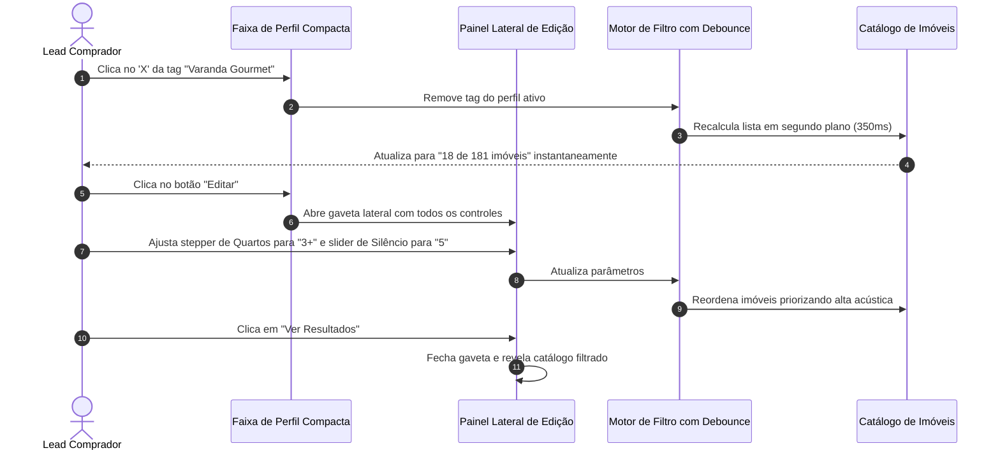

# US-03: Faixa de Perfil Compacta, Filtros Unificados e Busca Semântica

## 1. Identificação e Metadados
- **Identificador:** US-03
- **Título:** Faixa de Perfil Compacta com Drawer Lateral, Filtros de Afinidade Unificados e Recálculo Automático
- **Épico:** EPIC-01 — Portal Público e Descoberta Imobiliária
- **Projeto:** Urban Real State
- **Prioridade:** Essencial (Must Have / Redução de Fricção e Espaço Útil)
- **Personas Impactadas:**
  - *Lead Comprador*: Ganha mais de 450px de espaço vertical útil na tela, visualizando os primeiros imóveis do catálogo imediatamente sem rolagem excessiva.
  - *Consultor Imobiliário*: Visualiza critérios de busca precisos e ajustados em tempo real sem botões manuais de recálculo.
  - *Gestor Comercial*: Aumenta o engajamento com a vitrine ao eliminar confusão de controles redundantes.

---

## 2. Declaração de Negócio (User Story Format)
> **Como** Lead Comprador navegando no catálogo de imóveis,  
> **Quero** uma faixa compacta e elegante no topo da lista resumindo meu perfil ativo com opção de remoção rápida de tags e um botão "Editar" que abre um painel lateral completo com sliders e steppers,  
> **Para que** a lista de imóveis fique visível de imediato na tela e qualquer alteração de critério recalcule os resultados automaticamente sem me exigir cliques em botões manuais de "Recalcular".

---

## 3. Visão de Negócio e Proposta de Valor
- **Problema de Mercado e Diagnóstico de UX (Ref. UX Tópicos 03 e 05):**
  - Interfaces imobiliárias sofrem de obesidade de controles no topo da página: cinco blocos empilhados (barra de perfil, card de métricas com dois subcards, botões de redefinir, chips de estilo de vida e barra de resultados), consumindo mais de 600px de altura antes que o primeiro imóvel apareça.
  - Ações duplicadas geram paralisia de escolha (*Paradoxo de Hick*): botões simultâneos de *"Redefinir Perfil"* e *"Nova Consulta"*; *"Editar"*, *"Adicionar Tag"* e *"Personalizar Match"*; além de textos dizendo que o cálculo é em tempo real ao lado de um botão *"Recalcular Todo o Catálogo"*.
  - Estados desonestos: a interface anunciava *"Perfil Qualificado"* quando o orçamento estava *"Sem Limite"*, tipologia *"Todas"* e 176 de 181 imóveis apareciam como *"aderentes"*, descredibilizando o motor de inteligência.
- **Solução no Urban Real State:**
  1. **Faixa de Perfil Compacta (Compact Profile Strip):** Linha única horizontal e minimalista:
     `Orçamento: até 1.8M · Quartos: 3+ · Varanda Gourmet × · Sol da Manhã × · 24 de 181 imóveis · [Editar Critérios]`
     - Devolve cerca de **450px de altura diretamente para as fotos dos imóveis**.
  2. **Drawer / Painel Lateral de Edição:** O botão "Editar" abre uma gaveta lateral suave com controles ergonômicos e um único botão *"Nova Consulta"*.
  3. **Recálculo 100% Automático:** Atualização instantânea com debounce de 300 a 500ms e indicador sutil *"Atualizando..."* na lista, eliminando qualquer botão manual de recálculo.
  4. **Estados Honestos e Transparentes:** Exibição do progresso real (*"Perfil: 2 de 4 pilares preenchidos"*). Se não houver restrição, exibe honestamente: *"Todos os 181 imóveis disponíveis"*.
  5. **Controles Ergonômicos no Painel Lateral:**
     - Teto de orçamento como slider de faixa com valores mínimo e máximo.
     - Steppers numéricos (`− 2 +`) para Quartos, Suítes e Vagas (escrevendo "Quartos" em vez de "Dorms").
     - Escala de 1 a 5 para calibrar o peso de cada afinidade/estilo de vida em vez do incompreensível "(100%)".
- **Impacto no Negócio:**
  - Visualização imediata dos primeiros cartões de imóveis logo acima da dobra em desktops e celulares.
  - Redução de cliques e abandono por confusão de controles.
  - Alta percepção de sofisticação e honestidade algorítmica.

---

## 4. Funcionalidades e Regras de Negócio Detalhadas

### 4.1. Faixa de Perfil Compacta (Ref. UX Tópico 05)
- Uma única barra horizontal posicionada acima do catálogo:
  - Resumo dos 4 pilares: Localização, Orçamento e Tipologia em texto sutil.
  - Chips de tags ativas de estilo de vida com ícone de exclusão individual (`×`).
  - Botão de link sutil `+ Adicionar Desejo`.
  - Contagem honesta de resultados: ex: *"24 de 181 imóveis compatíveis"*.
  - Botão de ação secundária *"Editar"* com ícone de ajuste.

### 4.2. Painel Lateral de Edição Completa (Drawer)
- Ao clicar em "Editar", desliza um painel lateral organizado por seções:
  - **Pilar Localização:** Seleção de cidades/bairros em lista limpa.
  - **Pilar Orçamento:** Slider de valor com limites e presets rápidos (ex: Até 800k, 1.5M, 3M, Sem Limite).
  - **Pilar Tipologia:** Controles de stepper (`− 1 +`, `− 2 +`, `− 3 +`) para Quartos, Suítes e Vagas.
  - **Pilar Estilo de Vida com Escala 1 a 5:** Lista de tags de vocação onde cada tag possui um slider de importância de 1 (Desejável) a 5 (Imprescindível).
  - **Ação Única de Redefinição:** Um único botão no rodapé do drawer: *"Redefinir Todos os Critérios"*.

### 4.3. Unificação de Filtros e Tags (Ref. UX Tópico 03)
- As tags do perfil e os filtros de catálogo passam a ser tratados como um **único estado global unificado**.
- Sugestões de busca deixam de ser chips duplicados e passam a ser exibidas como texto de apoio com links discretos (*"Experimente: Vila Mariana com churrasqueira"*).

### 4.4. Recálculo Automático com Debounce
- Toda e qualquer alteração de filtro ou slider dispara recálculo automático após 350ms de pausa do usuário.
- Durante o recálculo, a grade de imóveis aplica opacidade suave (90%) e badge discreto de *"Atualizando..."*, sem saltos visuais ou travamentos de tela.

---

## 5. Sequência Lógica e Fluxo Passo a Passo

---

## 6. Pontos de Atenção e Riscos de Negócio
1. **Transparência na Contagem de Imóveis:** Se o teto for "Sem Limite" e a tipologia for "Todas", a contagem deve exibir *"181 de 181 imóveis"*, e nunca um número menor arbitrário que passe a impressão de erro de contagem.
2. **Escala de Afinidade Intuitiva (1 a 5):** Explicar de forma visual a escala de 1 a 5 (1 = Pouco Relevante, 3 = Importante, 5 = Decisivo), para que o comprador compreenda o impacto da ponderação sobre o Match Score.
3. **Ergonomia do Drawer em Telas Móveis:** No smartphone, o drawer lateral deve cobrir 100% da tela em forma de modal com botão "Fechar" e "Aplicar" fixos na base.

---

## 7. Requisitos Não Funcionais (RNFs)
- **RNF-01 (Debounce de Alta Performance):** O temporizador de debounce deve ser calibrado entre 300ms e 400ms para evitar requisições redundantes durante o arraste de sliders.
- **RNF-02 (Altura da Faixa de Perfil):** A faixa compacta não deve ultrapassar 64px de altura em telas desktop normais, garantindo economia real de espaço.
- **RNF-03 (Acessibilidade de Steppers e Sliders):** Todos os controles devem ser operáveis por teclado (setas para cima/baixo para steppers e esquerda/direita para sliders) com leitor de tela anunciando os valores selecionados.

---

## 8. Análise do Estado Atual vs. Apontamento de GAPS

### Estado Atual Implementado
- Barra de perfil funcional com capacidade de edição de teto, especificações e tags individuais.
- Busca semântica integrada e cálculo de percentuais de afinidade operante.

### Gaps Identificados com Base na Análise de UX
1. **GAP-03.1 (Excesso de Blocos Verticais — Ref. UX Tópico 05):** A tela atual empilha 5 blocos (~600px) antes do primeiro imóvel, empurrando as fotos para longe. Necessário condensar em uma faixa compacta de 60px com gaveta lateral de edição.
2. **GAP-03.2 (Duplicidade de Ações de Edição e Reset — Ref. UX Tópico 05):** Convivem botões concorrentes de "Redefinir Perfil" e "Nova Consulta"; "Editar", "Adicionar Tag" e "Personalizar Match"; e botão manual de "Recalcular". Necessário unificar em um único fluxo de edição.
3. **GAP-03.3 (Estados Desonestos / Ilusão de Qualificação — Ref. UX Tópico 05):** Exibição de "Perfil Qualificado" quando nada está restrito. Substituir por progresso real dos 4 pilares (ex: "1 de 4 pilares").
4. **GAP-03.4 (Controles Rígidos de Specs — Ref. UX Tópico 05):** Dormitórios, suítes e vagas usam chips tracejados de 11px; substituir por steppers numéricos (`− 2 +`) com o termo correto "Quartos" em vez de "Dorms".
5. **GAP-03.5 (Ponderação Criptográfica "(100%)" — Ref. UX Tópico 05):** O percentual "(100%)" ao lado das tags não explica nada ao comprador; substituir por slider de importância de 1 a 5.
