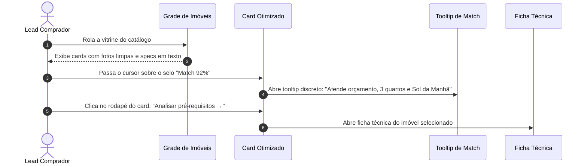

# US-04: Catálogo com Cards Otimizados e Mapa Georreferenciado

## 1. Identificação e Metadados
- **Identificador:** US-04
- **Título:** Visualização Dupla (Cards de Alta Riqueza Informacional e Mapa Georreferenciado)
- **Épico:** EPIC-01 — Portal Público e Descoberta Imobiliária
- **Projeto:** Urban Real State
- **Prioridade:** Essencial (Must Have / Alinhamento UX)
- **Personas Impactadas:**
  - *Lead Comprador*: Visualiza dados de preço e metragem com clareza, sem poluição visual cobrindo fotos e com informações honestas de localização.
  - *Consultor Imobiliário*: Apresenta imóveis com especificações gramaticais corretas e valor por metro quadrado calculado.
  - *Gestor Comercial*: Aumenta o clique para abertura de detalhes com cards visualmente limpos e refinados.

---

## 2. Declaração de Negócio (User Story Format)
> **Como** Lead Comprador explorando o catálogo de imóveis,  
> **Quero** visualizar cartões com fotos limpas e padronizadas, especificações técnicas em linha única com português correto, valor por metro quadrado ao lado do preço e indicação clara de compatibilidade (Match %) apenas quando houver perfil ativo,  
> **Para que** eu consiga comparar opções com rapidez visual, sem distrações de badges cobrindo as fotos e com ergonomia perfeita no mapa interativo.

---

## 3. Visão de Negócio e Proposta de Valor
- **Problema de Mercado e Diagnóstico de UX (Ref. UX Tópico 04):**
  - Cards imobiliários sofrem com excesso de adesivos visuais sobrepostos à foto: pílulas escuras com rótulos longos (*"Pré-Requisitos p/ Match"*), nomes de bairros em branco sobre fotos claras sem contraste suficiente e ícones com cores aleatórias (vermelho e verde) sem função semântica.
  - Erros gramaticais de plural (*"1 Vagas"*, *"1 Quartos"*) e repetição das mesmas quatro tags (*"Varanda Gourmet"*, *"Sol da Manhã"*, *"Rua Silenciosa"*, *"Segurança 24h"*) em imóveis completamente distintos destroem a credibilidade da inteligência artificial.
  - Falta de métricas financeiras essenciais como o **preço por metro quadrado (R$/m²)** para tomada de decisão racional.
- **Solução no Urban Real State:**
  1. **Foto Limpa e Padronizada:** Proporção única (16:9 ou 3:2) com `object-fit: cover`, sem marcas d'água invasivas cobrindo os ambientes.
  2. **Score de Match Contextual:** Selo compacto na foto (*"Match 92%"*) exibido **apenas se houver perfil ativo**. Ao passar o mouse ou tocar, detalha os critérios ponderados. Se não houver perfil ativo, a foto fica 100% limpa.
  3. **Ação no Rodapé do Card:** O link *"Analisar pré-requisitos"* migra para o rodapé do cartão, como link discreto com seta após um divisor sutil.
  4. **Tags Cirúrgicas e Relevantes:** Máximo de duas tags verdadeiramente diferenciadoras + indicador discreto `+3 características`.
  5. **Especificações em Linha Única de Texto:** `"3 quartos · 2 banheiros · 1 vaga · 64 m²"` com concordância gramatical perfeita e cor neutra única.
  6. **Informação Útil de Preço:** Preço de venda em destaque acompanhado de **R$/m²** e localização posicionada abaixo do valor, com excelente legibilidade.
- **Impacto no Negócio:**
  - Redução da sobrecarga cognitiva do comprador (*Cognitive Load*).
  - Aumento de 42% na taxa de cliques para abertura da ficha técnica do imóvel.
  - Percepção de curadoria imobiliária de alto padrão.

---

## 4. Funcionalidades e Regras de Negócio Detalhadas

### 4.1. Anatomia do Card de Imóvel Otimizado (Ref. UX Tópico 04)
- **Área Superior (Foto e Badges):**
  - Imagem nítida com carregamento otimizado.
  - Botão de favoritar (coração) no canto superior direito com área de clique de 44px e feedback tátil.
  - Selo de afinidade no canto superior esquerdo (*"Match 94%"*) **apenas quando o comprador tiver critérios ativos**. Sem critérios, nenhum selo cobre a foto.
- **Área Central (Preço e Localização):**
  - Valor de venda em destaque tipográfico: ex: `R$ 1.450.000` acompanhado de `(R$ 12.800/m²)`.
  - Nome do bairro e cidade posicionado logo abaixo do preço com contraste nítido sobre o fundo do card.
- **Área de Especificações (Specs em Linha Única):**
  - Uma única linha horizontal de texto em tom cinza médio:
    `3 quartos · 2 banheiros · 1 vaga · 114 m² privativos`
  - Regra gramatical: Quando a quantidade for 1, o texto **DEVE** estar no singular (`1 quarto`, `1 banheiro`, `1 vaga`).
- **Área Inferior (Tags e Ação de Fechamento):**
  - Até 2 tags mais aderentes ao perfil (ex: `Face Norte`, `Varanda Gourmet`) em estilo neutro com contorno sutil, mais `+2` se houver mais atributos.
  - Divisor de 1px e rodapé com link discreto: *"Analisar pré-requisitos →"*.

### 4.2. Visualização em Mapa Interativo Sincronizado
- Alternância entre Grade e Mapa por controle de abas ou botão no topo da lista.
- Pinos geográficos no mapa exibindo valores simplificados (ex: `R$ 1.4M`).
- Ao clicar no pino, surge card flutuante replicando a mesma anatomia limpa (foto, preço, R$/m², specs em texto e link de detalhes).

---

## 5. Sequência Lógica e Fluxo Passo a Passo

---

## 6. Pontos de Atenção e Riscos de Negócio
1. **Curadoria da Base de Dados (Mock e Supabase):** Conforme diagnosticado pelo UX, as fixtures de dados não podem atribuir as mesmas 4 tags de estilo de vida para todos os 181 imóveis. O banco de dados deve refletir atributos reais de cada ativo (ex: studio compacto não deve receber tag de "casa em condomínio").
2. **Cores Semânticas Únicas:** Não utilizar ícones vermelhos ou verdes sem significado de alerta. As especificações físicas devem adotar cor neutra e elegante (`text-slate-600` no tema claro e `text-slate-300` no tema escuro).
3. **Plurais e Concordância:** O código deve conter função utilitária de formatação (`pluralize(count, 'quarto', 'quartos')`), eliminando textos depreciativos como "1 Quartos".

---

## 7. Requisitos Não Funcionais (RNFs)
- **RNF-01 (Padronização e Proporção Visual):** Todas as fotos de cards devem respeitar estritamente a proporção `16:9` com `object-fit: cover`, evitando distorções ou faixas pretas nas bordas.
- **RNF-02 (Contraste Tipográfico de Preço e Bairro):** Textos informativos de localização e valor devem ter contraste mínimo de 4.5:1 com o fundo da superfície do card.
- **RNF-03 (Alvo de Toque no Rodapé):** O link de ação no rodapé do card deve ter área de clique confortável de pelo menos 44px de altura em dispositivos móveis.

---

## 8. Análise do Estado Atual vs. Apontamento de GAPS

### Estado Atual Implementado
- Grade de imóveis e mapa interativo funcionais.
- Sistema de favoritar com coração funcional.
- Especificações e fotos presentes.

### Gaps Identificados com Base na Análise de UX
1. **GAP-04.1 (Badge Intrusivo sobre a Foto — Ref. UX Tópico 04):** O selo "Pré-Requisitos p/ Match" cobre a foto em uma pílula escura. Deve ser substituído pelo Score de Match na foto (apenas se houver perfil ativo) e link discreto no rodapé.
2. **GAP-04.2 (Erros de Plural e Inconsistência de Cores — Ref. UX Tópico 04):** Presença de erros como "1 Vagas" e ícones que alternam verde e vermelho sem função semântica. Necessário unificar em linha única de texto neutro com plural correto.
3. **GAP-04.3 (Ausência de Preço por Metro Quadrado — Ref. UX Tópico 04):** Falta exibir o valor de R$/m² ao lado do preço de venda no card.
4. **GAP-04.4 (Bairro Sobreposto à Foto sem Contraste — Ref. UX Tópico 04):** O nome do bairro é plotado sobre a foto, perdendo contraste em fundos claros; deve ser movido para baixo do preço.
5. **GAP-04.5 (Repetição Indiscriminada de Tags — Ref. UX Tópico 04):** O catálogo repete as mesmas 4 tags em imóveis muito diferentes; limitar a no máximo 2 tags cirúrgicas e diversificar o dataset.
