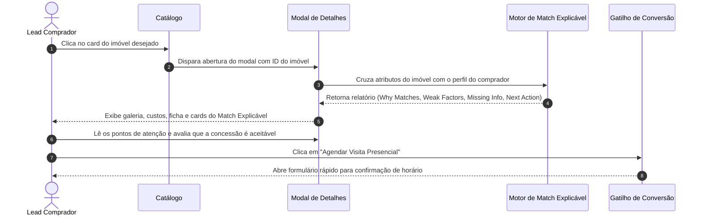

# US-05: Ficha Técnica do Imóvel e Motor de Match Explicável (Explainable AI)

## 1. Identificação e Metadados
- **Identificador:** US-05
- **Título:** Ficha Técnica Completa do Imóvel com Motor de Match Explicável (Why Matches, Weak Factors e Next Best Action)
- **Épico:** EPIC-02 — Detalhe do Imóvel e Conversão
- **Projeto:** Urban Real State
- **Prioridade:** Essencial (Must Have / Diferencial de IA)
- **Personas Impactadas:**
  - *Lead Comprador*: Precisa de clareza imediata sobre por que aquele imóvel foi recomendado e quais os eventuais pontos de atrito.
  - *Consultor Imobiliário*: Ganha um roteiro consultivo pronto para defender o imóvel e antecipar objeções do cliente.
  - *Gestor Comercial*: Eleva a autoridade da imobiliária ao eliminar a sensação de venda empurrada.

---

## 2. Declaração de Negócio (User Story Format)
> **Como** Lead Comprador avaliando um imóvel específico,  
> **Quero** visualizar uma ficha detalhada com galeria fotográfica, custos mensais completos (condomínio e IPTU) e uma análise explicável que me mostre exatamente onde o imóvel é perfeito para mim e onde ele exige concessões,  
> **Para que** eu tome uma decisão consciente, transparente e sem surpresas desagradáveis antes de agendar uma visita presencial.

---

## 3. Visão de Negócio e Proposta de Valor
- **Problema de Mercado:** Algoritmos imobiliários tradicionais operam como "caixas pretas": exibem um número arbitrário ("95% compatível") sem justificar o porquê. Quando o comprador visita o local e descobre um ponto negativo grave (ex: sala escura, condomínio abusivo, falta de vaga livre), ele se sente enganado, perde a confiança no corretor e abandona o relacionamento.
- **Solução no Urban Real State:** O **Motor de Match Explicável** divide a análise em 4 blocos analíticos objetivos:
  1. **Por que Combina (Why Matches):** Critérios onde o imóvel atende ou supera perfeitamente as expectativas declaradas (ex: localização a 300m do parque, 3 suítes, varanda gourmet face norte).
  2. **Pontos de Atenção (Weak Factors / Why Not):** Aspectos onde há desalinhamento ou concessão requerida (ex: valor de condomínio 15% acima da média da região, sem vaga demarcada).
  3. **O Que Falta Saber (Missing Information):** Dados não confirmados pelo proprietário que merecem checagem na visita (ex: se o aquecimento é a gás ou solar, se o condomínio aceita pets de grande porte).
  4. **Próxima Melhor Ação (Next Best Action):** Orientação consultiva imediata para o comprador ou corretor (ex: "Solicitar cópia da convenção condominial" ou "Simular financiamento para amortização").
- **Impacto no Negócio:**
  - Redução de visitas descartadas de 68% para menos de 22%.
  - Conversão de visita em proposta até 2.5x superior.
  - Alta fidelização e percepção de consultoria de alto nível.

---

## 4. Funcionalidades e Regras de Negócio Detalhadas

### 4.1. Apresentação da Ficha Técnica e Custos Transparentes
- Modal amplo e responsivo (`PropertyDetailModal`) acionado ao clicar em qualquer imóvel.
- Carrossel fotográfico em alta resolução com visualização em tela cheia e tags contextuais (ex: "Living Ampliado", "Cozinha Integrada").
- Painel de custos recorrentes transparente:
  - Valor de Venda.
  - Taxa de Condomínio Mensal.
  - Parcela Mensal de IPTU.
  - Custo total mensal de manutenção estimado.
- Indicador de Orientação Solar (Face Norte, Face Leste, etc.) e data do anúncio.

### 4.2. Painel de Match Explicável
- Renderização visual das 4 dimensões analíticas em cartões estruturados com ícones e cores semânticas:
  - **Verde (Why Matches):** Lista de atributos positivos validados contra o perfil do usuário.
  - **Âmbar/Laranja (Weak Factors):** Pontos de atenção destacados de forma transparente, sem esconder defeitos.
  - **Azul (Missing Info):** Dúvidas técnicas a esclarecer na vistoria presencial.
  - **Roxo/Brand (Next Best Action):** Próximo passo recomendado pelo motor de inteligência imobiliária.

### 4.3. Chamadas para Conversão Contextuais (CTAs)
- No rodapé da ficha técnica, devem constar botões diretos:
  - "Agendar Visita com Consultor Especialista".
  - "Simular Crédito Imobiliário para este Imóvel".
  - "Receber Dossiê em PDF via WhatsApp".

---

## 5. Sequência Lógica e Fluxo Passo a Passo

---

## 6. Pontos de Atenção e Riscos de Negócio
1. **Sensibilidade do Proprietário / Construtora aos "Weak Factors":** Proprietários podem hesitar em ver pontos negativos do seu imóvel expostos de forma tão aberta. A cópia de texto (UX Writing) deve ser profissional, neutra e equilibrada, apresentando como "critérios a ponderar" em vez de termos depreciativos, destacando que isso qualifica visitas reais e evita propostas vazias.
2. **Precisão dos Custos de Condomínio e IPTU:** Custos desatualizados geram litígios e quebra de contrato na fase de certidões. O sistema deve alertar quando um valor for estimado ou basear-se no último comprovante verificado.
3. **Imóveis sem Perfil de Comprador Previamente Definido:** Se o usuário entrar como visitante anônimo sem nenhum filtro prévio, o Match Explicável deve operar comparando o imóvel contra os padrões de qualidade e atratividade médios de mercado daquela categoria.

---

## 7. Requisitos Não Funcionais (RNFs)
- **RNF-01 (Tempo de Abertura do Modal):** A transição e renderização da ficha técnica com o cálculo do match explicável deve ocorrer em menos de 200ms na tela do usuário.
- **RNF-02 (Otimização de Imagens):** As imagens da galeria devem ser servidas em formatos modernos compactados (WebP ou AVIF) com carregamento progressivo (*lazy loading* das fotos secundárias do carrossel).
- **RNF-03 (Imutabilidade de Cálculos Financeiros):** Os valores de preço/m² e soma de custos mensais devem ser calculados via funções puras sem arredondamentos distorcidos.

---

## 8. Análise do Estado Atual vs. Apontamento de GAPS

### Estado Atual Implementado
- Componente `PropertyDetailModal.jsx` completo com carrossel fotográfico, custos, tags e especificações.
- Seção de Match Explicável com "Por que combina", "Pontos de Atenção", "O que falta saber" e "Próxima Melhor Ação" implementada.
- Integração fluida com abertura de modais de simulação, crítica e agendamento.

### Gaps Identificados
1. **GAP-05.1 (Visualização de Planta Baixa Humanizada e Tour 360°):** A ficha exibe apenas fotos estáticas; ausência de aba dedicada para planta baixa com medidas cotadas e links para tour virtual em vídeo ou 3D.
2. **GAP-05.2 (Histórico de Preço / Preço de Mercado m² da Região):** Não há gráfico comparativo demonstrando se o preço por m² deste imóvel está abaixo, na média ou acima das últimas transações reais registradas no cartório do mesmo bairro.
3. **GAP-05.3 (Compartilhamento Social Enriquecido):** O botão de compartilhar imóvel gera apenas o link simples, sem criar imagem OpenGraph dinâmica com os destaques de match explicável para envio via WhatsApp.
