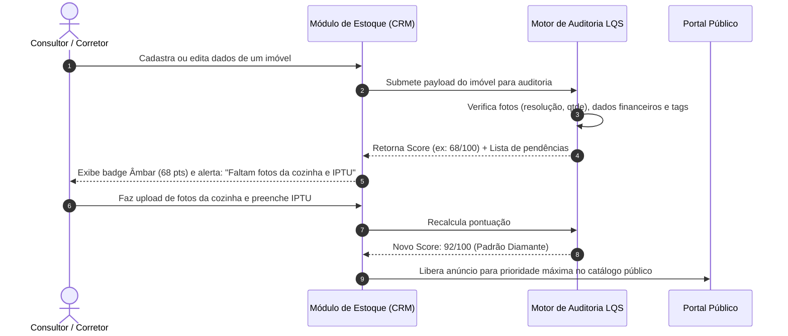

# US-06: Listing Quality Score (LQS) — Auditoria e Higiene da Qualidade do Anúncio

## 1. Identificação e Metadados
- **Identificador:** US-06
- **Título:** Listing Quality Score (LQS) — Avaliação Determinística da Qualidade e Confiabilidade do Anúncio
- **Épico:** EPIC-02 — Detalhe do Imóvel e Conversão
- **Projeto:** Urban Real State
- **Prioridade:** Alta (Should Have / Governança de Dados)
- **Personas Impactadas:**
  - *Lead Comprador*: Identifica a confiabilidade e integridade das informações antes de despender tempo em uma visita.
  - *Lead Proprietário*: Recebe feedback claro sobre o que precisa melhorar no anúncio para vender mais rápido.
  - *Consultor Imobiliário*: Sabe quais imóveis estão prontos para divulgação agressiva e quais precisam de saneamento.
  - *Gestor Comercial*: Controla a qualidade do acervo da imobiliária e prioriza a captação de dados faltantes.

---

## 2. Declaração de Negócio (User Story Format)
> **Como** Consultor Imobiliário ou Gestor Comercial da plataforma Urban Real State,  
> **Quero** que o sistema audite automaticamente a completude, clareza das fotos, precisão cadastral e vocação de cada imóvel gerando uma pontuação de 0 a 100 (Listing Quality Score - LQS) com apontamentos de correção,  
> **Para que** a imobiliária publique apenas anúncios com alto padrão de conversão, atraia mais compradores qualificados e reduza o tempo do imóvel no estoque.

---

## 3. Visão de Negócio e Proposta de Valor
- **Problema de Mercado:** O mercado imobiliário sofre com "anúncios fantasmas" ou de péssima qualidade: fotos escuras na vertical, descrições genéricas cheias de clichês ("lindo apartamento"), ausência de valor de condomínio, falta de especificação de vaga ou orientação solar. Isso queima a reputação da imobiliária e despenca a taxa de conversão nos portais.
- **Solução no Urban Real State:** Um algoritmo determinístico de **Listing Quality Score (LQS)** que analisa continuamente 4 pilares de higiene do anúncio:
  1. **Qualidade e Quantidade Visual (30% do score):** Resolução das imagens, presença de fotos de todos os cômodos essenciais (sala, cozinha, banheiros, fachada), ordem estética e ausência de marcas d'água poluentes.
  2. **Completude Descritiva e Atributos Técnicos (25% do score):** Metragem privativa vs. total, número de suítes, vagas livres vs. presas, posição solar, andar e infraestrutura do prédio.
  3. **Higiene Financeira e Jurídica (25% do score):** Exibição de IPTU mensal, taxa condominial exata, compatibilidade com financiamento bancário e situação documental.
  4. **Vocação Subjetiva e Tags de Estilo de Vida (20% do score):** Mapeamento de afinidades reais (pet friendly, home office, acústica, mobilidade).
- **Impacto no Negócio:**
  - Aumento de 35% no posicionamento orgânico e visualizações dos anúncios com score > 85.
  - Redução de tempo médio de venda (Days on Market) em até 28%.
  - Roteiro claro de melhoria para os corretores de captação.

---

## 4. Funcionalidades e Regras de Negócio Detalhadas

### 4.1. Cálculo Automático do LQS
- O cálculo deve ser executado no momento do cadastro ou edição de qualquer imóvel e recalculado caso novas informações sejam inseridas.
- A pontuação final varia de 0 a 100 pontos, categorizada em faixas:
  - **90 a 100 (Excelente / Padrão Diamante):** Anúncio completo, fotos profissionais e dados fiscais verificados.
  - **70 a 89 (Bom / Publicável):** Anúncio consistente, com pequenas melhorias sugeridas.
  - **50 a 69 (Regular / Necessita Revisão):** Faltam dados críticos (ex: IPTU ou fotos da área íntima).
  - **Abaixo de 50 (Crítico / Rascunho):** Não elegível para campanhas de mídia paga nem destaque na home.

### 4.2. Apontamentos Acionáveis de Melhoria (Checklist de Correção)
- O sistema deve detalhar explicitamente os fatores que retiraram pontos do anúncio:
  - *"Adicionar pelo menos mais 3 fotos da área íntima e banheiros (+10 pts)"*.
  - *"Preencher o valor da parcela mensal de IPTU (+8 pts)"*.
  - *"Informar a orientação solar do living (+5 pts)"*.
  - *"Incluir descrição com vocação de estilo de vida (+7 pts)"*.

### 4.3. Exibição Diferenciada por Persona
- **No Portal Público (Lead Comprador):** Exibição discreta em forma de selo de transparência ("Informações 100% Verificadas" ou "Anúncio Auditado").
- **No CRM / Backoffice (Corretor e Gestor):** Painel analítico completo com barra de progresso colorida, checklist interativo de pendências e botão "Saneador Rápido de Anúncio".

---

## 5. Sequência Lógica e Fluxo Passo a Passo

---

## 6. Pontos de Atenção e Riscos de Negócio
1. **Resistência dos Corretores de Captação:** Corretores acostumados a cadastros rápidos ("preguiçosos") podem reclamar da exigência de dados. A interface deve transformar a auditoria em gamificação positiva, demonstrando que anúncios nota 90+ recebem 4x mais leads e comissões mais rápidas.
2. **Validação Automática de Imagens:** Fotos duplicadas, plantas baixas ilegíveis ou imagens com baixa luminosidade podem enganar checagens puramente numéricas de quantidade de arquivos. Uma camada de visão computacional leve para validar categorias de fotos agrega imenso valor.
3. **Não Bloqueio Operacional:** O LQS deve orientar e priorizar, mas não deve travar a operação imobiliária se uma informação específica (ex: número da inscrição do IPTU) estiver pendente de emissão pelo proprietário.

---

## 7. Requisitos Não Funcionais (RNFs)
- **RNF-01 (Processamento em Tempo Real):** O cálculo do score do LQS não deve demorar mais de 80ms após a alteração de qualquer campo do formulário de cadastro.
- **RNF-02 (Determinismo e Reprodutibilidade):** O mesmo conjunto de atributos de imóvel deve sempre gerar exatamente a mesma pontuação, sem variações estocásticas ou aleatórias.
- **RNF-03 (Auditoria Histórica):** As alterações no score e a data de saneamento devem ser registradas em log de auditoria interno do CRM.

---

## 8. Análise do Estado Atual vs. Apontamento de GAPS

### Estado Atual Implementado
- Regras de cálculo determinístico de pontuação do anúncio com base em atributos e fotos.
- Exibição de diagnóstico de qualidade e conformidade cadastral na ficha de detalhes e no CRM.
- Apontamento de dados faltantes (Missing Information) integrado ao motor de análise.

### Gaps Identificados
1. **GAP-06.1 (Inspeção de Resolução e Enquadramento por IA Visual):** O sistema apenas conta a quantidade de URLs de fotos, sem avaliar se a foto está embaçada, escura ou se é uma duplicata de outro cômodo.
2. **GAP-06.2 (Gamificação de Captação com Bônus para Corretores):** Falta atrelar o LQS médio da carteira do corretor a premiações de comissão ou prioridade na fila da roleta de distribuição de novos leads.
3. **GAP-06.3 (Exportação de Relatório de Higiene para o Proprietário):** Ausência de um botão "Enviar Relatório de Qualidade ao Proprietário" via PDF/WhatsApp, demonstrando o que a imobiliária fez para valorizar o patrimônio dele.
