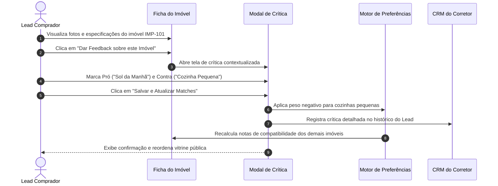

# US-07: Feedback Ativo, Crítica de Imóvel e Refinamento Contínuo do Perfil

## 1. Identificação e Metadados
- **Identificador:** US-07
- **Título:** Coleta de Crítica e Feedback do Imóvel para Refinamento Dinâmico do Buyer Profile
- **Épico:** EPIC-02 — Detalhe do Imóvel e Conversão
- **Projeto:** Urban Real State
- **Prioridade:** Média-Alta (Should Have)
- **Personas Impactadas:**
  - *Lead Comprador*: Sente que o sistema realmente "aprende" com o que ele desaprova ou elogia em cada visita virtual.
  - *Consultor Imobiliário*: Evita o constrangimento de continuar enviando imóveis que possuem características que o cliente já rejeitou expressamente.
  - *Gestor Comercial*: Enriquece o banco de dados de inteligência de mercado com as reais dores e motivos de rejeição do público comprador.

---

## 2. Declaração de Negócio (User Story Format)
> **Como** Lead Comprador navegando pela ficha de um imóvel,  
> **Quero** poder registrar rapidamente o que eu mais gostei e o que não gostei naquela opção (ex: "adorei a varanda, mas a cozinha é pequena e o condomínio está caro"),  
> **Para que** a plataforma Urban Real State atualize meu perfil de busca em tempo real e pare de me recomendar imóveis com os mesmos defeitos, priorizando opções mais assertivas.

---

## 3. Visão de Negócio e Proposta de Valor
- **Problema de Mercado:** O processo de busca imobiliária tradicional é frustrante porque é estático. O cliente diz ao corretor que não quer imóvel no térreo ou sem varanda, mas continua recebendo opções inadequadas. A maioria dos CRMs armazena apenas "Lead quer apto de 3 dorms", ignorando o aprendizado incremental obtido após cada imóvel visualizado ou visitado.
- **Solução no Urban Real State:** O modal interativo de **Crítica de Imóvel (`PropertyCriticismModal`)** permite que o comprador, em menos de 15 segundos, selecione tags rápidas ou digite/fale os pontos positivos e negativos do imóvel avaliado. Esses feedbacks alimentam diretamente:
  - O **Buyer Profile** (Camada Inferred Data e Observed Data).
  - O recálculo instantâneo das notas de match para os demais imóveis do catálogo.
  - Alertas prioritários na tela do corretor ("Atenção: Este cliente rejeitou imóveis sem iluminação matinal").
- **Impacto no Negócio:**
  - Aumento da sensação de personalização e cuidado no atendimento.
  - Redução drástica do envio de sugestões irrelevantes via WhatsApp.
  - Banco de inteligência sobre quais atributos de imóveis são mais penalizados pelo mercado (ex: banheiros sem ventilação natural).

---

## 4. Funcionalidades e Regras de Negócio Detalhadas

### 4.1. Gatilhos de Abertura do Modal de Feedback
- Botão "O que achou deste imóvel?" presente na ficha técnica de detalhes.
- Gatilho inteligente contextual acionado após o usuário navegar por mais de 45 segundos na mesma ficha ou visualizar todas as fotos do carrossel.
- No modo com Concierge de voz ativo, a IA pergunta amigavelmente: *"O que você mais gostou e o que não gostou neste imóvel para que eu continue aperfeiçoando seu match?"*.

### 4.2. Interface de Coleta Rápida (Micro-Interação Fluida)
- **O que você gostou (Prós):** Botões de seleção rápida (ex: "Iluminação Natural", "Planta Ampla", "Condomínio Clube", "Localização Perfeita", "Preço Justo").
- **O que você não gostou (Contras):** Botões de rejeição rápida (ex: "Condomínio Alto", "Poucas Vagas", "Sem Suíte", "Rua Barulhenta", "Cozinha Fechada").
- **Campo Livre de Comentário:** Campo de texto opcional para o usuário descrever em suas próprias palavras ou gravar áudio curto.

### 4.3. Processamento e Ajuste Dinâmico de Afinidades
- Ao enviar o feedback, o sistema executa:
  - Inclusão dos prós como novas tags de prioridade positiva no perfil do usuário.
  - Inclusão dos contras como filtros negativos ou penalizadores de pontuação para imóveis semelhantes.
  - Envio do evento estruturado ao CRM do corretor responsável com notificação push ou alerta em tela.
- Notificação de sucesso amigável: *"Perfil atualizado! Seus próximos matches serão mais precisos."*.

---

## 5. Sequência Lógica e Fluxo Passo a Passo

---

## 6. Pontos de Atenção e Riscos de Negócio
1. **Fadiga de Formulário (Survey Fatigue):** Solicitar feedback em todos os imóveis que o lead abre pode tornar a navegação cansativa e irritante. O gatilho automático deve respeitar um intervalo mínimo de exibição (ex: no máximo 1 vez a cada 3 imóveis explorados a fundo).
2. **Interpretação Semântica Correta:** Se o usuário digitar "o preço está alto para essa metragem", o sistema deve entender que o problema é a relação custo/benefício (preço/m²) e não necessariamente que ele não tem capacidade financeira para o valor absoluto.
3. **Sincronização com o Corretor Humano:** O corretor humano deve ter acesso fácil aos feedbacks registrados antes de ligar para o lead, garantindo que o atendimento comece exatamente pelo que o cliente aprovou ou desaprovou.

---

## 7. Requisitos Não Funcionais (RNFs)
- **RNF-01 (Agilidade de Envio):** O salvamento do feedback e recálculo das afinidades não deve demorar mais de 300ms, sem travar a navegação do usuário.
- **RNF-02 (Persistência Offline / Local First):** Se o usuário estiver com instabilidade de rede no celular, o feedback deve ser salvo na fila local do navegador (`IndexedDB`/`localStorage`) e sincronizado com o backend assim que a conexão for restabelecida.
- **RNF-03 (Clareza Visual e Acessibilidade):** Botões de "Gostei" e "Não Gostei" devem utilizar cores semânticas distintas e contraste alto com ícones intuitivos (dedo para cima / para baixo ou check / x).

---

## 8. Análise do Estado Atual vs. Apontamento de GAPS

### Estado Atual Implementado
- Componente `PropertyCriticismModal.jsx` construído com suporte a seleção de aspectos positivos, negativos e campo aberto de observações.
- Sincronização do feedback com a sessão e log no console de automações do CRM.
- Design harmonizado nos temas claro e escuro.

### Gaps Identificados
1. **GAP-07.1 (Extração de Sentimento e Entidades por PLN na Crítica Aberta):** O texto digitado livremente no campo de observações ainda é armazenado apenas como string pura, sem passar por uma LLM para extrair novas tags estruturadas automaticamente.
2. **GAP-07.2 (Relatório Consolidado de Desejos para o Proprietário do Imóvel):** O proprietário do imóvel avaliado não recebe um sumário anônimo ("3 compradores acharam seu condomínio alto e 5 elogiaram a vista"), o que seria fundamental para negociar redução de preço da captação.
3. **GAP-07.3 (Sugestão Imediata de Imóvel Alternativo):** Ao criticar o imóvel, o sistema poderia imediatamente disparar um pop-up com *"Vimos que você não gostou da cozinha. Que tal este outro imóvel no mesmo quarteirão com cozinha americana integrada?"*.
