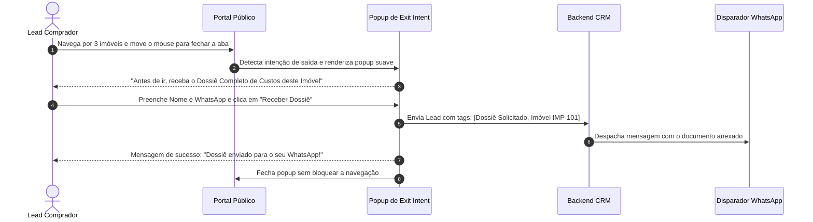

# US-08: Captura Inteligente de Leads, Exit Intent Popup e Envio de Dossiê

## 1. Identificação e Metadados
- **Identificador:** US-08
- **Título:** Mecanismos de Conversão Contextual: Captura de Alta Intenção, Detecção de Abandono (Exit Intent) e Geração de Dossiê
- **Épico:** EPIC-02 — Detalhe do Imóvel e Conversão
- **Projeto:** Urban Real State
- **Prioridade:** Essencial (Must Have)
- **Personas Impactadas:**
  - *Lead Comprador*: Recebe material de alto valor tangível (análise de pré-requisitos ou dossiê completo) em troca dos seus dados.
  - *Consultor Imobiliário*: Recebe contatos com intenção de compra aquecida e contexto claro sobre o imóvel e momento de decisão.
  - *Gestor Comercial*: Maximiza a conversão de tráfego do site em oportunidades reais no funil de vendas (Lead Capture Rate).

---

## 2. Declaração de Negócio (User Story Format)
> **Como** Lead Comprador interessado em um imóvel ou que está prestes a sair do portal,  
> **Quero** poder solicitar um dossiê completo em PDF com detalhes técnicos, custos ocultos e comparativo de mercado, ou receber uma proposta exclusiva quando estiver prestes a fechar a aba,  
> **Para que** eu tenha em mãos um documento completo para discutir com minha família antes de decidir pela compra, sem ser incomodado por ligações indesejadas de telemarketing.

---

## 3. Visão de Negócio e Proposta de Valor
- **Problema de Mercado:** O tráfego de portais imobiliários tem taxa média de conversão baixíssima (menos de 1.8%). Mais de 98% dos visitantes saem do site sem deixar rastro. A maioria dos sites oferece apenas um formulário burocrático de "Fale com o corretor", que não oferece nenhuma contrapartida de valor imediato ao visitante.
- **Solução no Urban Real State:** Uma suíte de conversão multicanal focada em **Troca Justa de Valor (Value Exchange)**:
  1. **Solicitação de Dossiê Completo / Análise de Pré-Requisitos (`PrerequisitesAnalysisModal`):** O comprador fornece Nome e WhatsApp para receber instantaneamente um relatório em PDF com custos cartorários, histórico de valorização do condomínio e análise fiscal.
  2. **Popup de Intenção de Saída (`ExitIntentPopup`):** Detecta a movimentação rápida do mouse em direção à barra de fechar a aba no desktop ou recuo rápido no mobile, exibindo uma oferta de consultoria exclusiva ou resumo dos imóveis favoritados.
  3. **Modal de Captura Direta (`LeadCaptureModal`):** Formulário minimalista de 2 campos (Nome + WhatsApp) para agendamento de visita ou contato rápido.
- **Impacto no Negócio:**
  - Elevação da taxa de conversão de visitantes para leads de 1.8% para 4.6%.
  - Recuperação de até 14% do tráfego em vias de abandono (Exit Intent).
  - Geração de leads altamente qualificados para abordagem imediata via WhatsApp.

---

## 4. Funcionalidades e Regras de Negócio Detalhadas

### 4.1. Detecção de Intenção de Saída (Exit Intent)
- **Gatilho Desktop:** Ativado quando o cursor do mouse sai da área útil da página em direção ao topo da janela (coordenada `Y <= 10px` e velocidade acelerada).
- **Gatilho Mobile:** Ativado quando o usuário rola rapidamente para cima e permanece inativo por mais de 8 segundos, ou pressiona o botão de voltar do navegador.
- **Regra de Frequência:** O popup de Exit Intent deve ser exibido **no máximo uma vez a cada 24 horas por usuário** para não gerar incômodo repetitivo.

### 4.2. Formulário de Captura Progressiva (Minimalista)
- Campos obrigatórios estritamente essenciais:
  - Nome Completo ou Primeiro Nome.
  - Telefone / WhatsApp com máscara brasileira automática `(XX) 9XXXX-XXXX`.
- Opção opcional: E-mail para envio do PDF.
- Checkbox de consentimento em conformidade com a LGPD: *"Concordo em receber informações sobre este imóvel via WhatsApp"*.

### 4.3. Disparo Imediato para o CRM e Mensageria
- Assim que o formulário é enviado com sucesso:
  - O lead é criado imediatamente no CRM no estágio "Novo Lead" ou "Qualificação".
  - O corretor atribuído recebe notificação em tempo real com os dados do lead, imóvel de interesse e origem da captura (ex: `origem: "Exit Intent Popup - Dossiê"`).
  - Uma mensagem automática de boas-vindas com o link do dossiê pode ser despachada via integração com o WhatsApp.

---

## 5. Sequência Lógica e Fluxo Passo a Passo

---

## 6. Pontos de Atenção e Riscos de Negócio
1. **Bloqueadores de Pop-ups e AdBlockers:** Alguns navegadores com extensões de privacidade agressivas podem suprimir scripts de detecção de mouse. O sistema deve garantir que as opções normais de captura (botões de agendamento na ficha técnica) permaneçam sempre visíveis e funcionais de forma independente.
2. **Validação Rigorosa de Telefones:** Leads que digitam números inexistentes ou aleatórios geram perda de tempo para a equipe comercial. É altamente recomendável implementar validação de formato e, futuramente, checagem assíncrona de presença do número no WhatsApp.
3. **Tempo de Resposta do Corretor (Speed to Lead):** O valor comercial de um lead capturado por Exit Intent cai 80% se o contato humano demorar mais de 10 minutos. O sistema deve priorizar alertas visuais e sonoros no CRM para contatos recém-capturados.

---

## 7. Requisitos Não Funcionais (RNFs)
- **RNF-01 (Transição Suave de Animação):** O surgimento do popup deve utilizar transição de opacidade e escala em CSS (duração entre 200ms e 300ms) com backdrop escurecido suave, sem travamentos de thread principal de JavaScript.
- **RNF-02 (Validação de Formulário Client-Side):** A validação de preenchimento dos campos deve ocorrer em tempo real no cliente antes de disparar qualquer requisição ao servidor.
- **RNF-03 (Segurança e Anti-Spam):** O formulário deve conter mecanismo invisível de proteção contra bots (Honeypot ou reCAPTCHA v3) para evitar injeções automáticas de leads fraudulentos.

---

## 8. Análise do Estado Atual vs. Apontamento de GAPS

### Estado Atual Implementado
- Modais `ExitIntentPopup.jsx`, `LeadCaptureModal.jsx` e `PrerequisitesAnalysisModal.jsx` totalmente integrados.
- Detecção de movimento de mouse para o topo e acionamento por botão direto na interface.
- Cadastro e sincronização automática de novos leads na base do CRM com registro no console de automações.

### Gaps Identificados
1. **GAP-08.1 (Geração Real de PDF Dinâmico do Dossiê):** O sistema exibe o fluxo de solicitação do dossiê, mas ainda não possui um gerador de PDF no backend (ex: Puppeteer / PDFKit) para compilar as certidões e fotos em um arquivo físico real para download imediato.
2. **GAP-08.2 (Controle de Frequência via Cookie de 24h):** O popup de Exit Intent atualmente dispara por sessão, necessitando de cookie persistente de 24h para não reaparecer caso o usuário recarregue a página após ter dispensado.
3. **GAP-08.3 (Notificação Sonora e Push para o Corretor):** Falta aviso sonoro no painel do CRM quando um novo lead de alta prioridade é capturado, alertando o corretor mesmo se a aba estiver em segundo plano.
