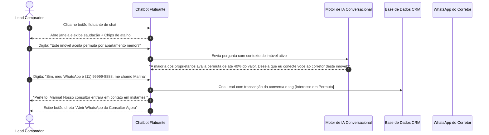

# US-09: Chatbot Flutuante de Atendimento Contínuo e Resolução de Dúvidas

## 1. Identificação e Metadados
- **Identificador:** US-09
- **Título:** Widget de Atendimento em Chat Texto com IA (Chatbot Flutuante) e Respostas Imediatas
- **Épico:** EPIC-02 — Detalhe do Imóvel e Conversão
- **Projeto:** Urban Real State
- **Prioridade:** Média (Nice to Have)
- **Personas Impactadas:**
  - *Lead Comprador*: Prefere tirar dúvidas pontuais por texto (ex: "aceita permuta?", "tem taxa de condomínio inclusa?") em silêncio e sem falar ao microfone.
  - *Consultor Imobiliário*: Recebe o histórico completo da conversa transcrita antes de iniciar o atendimento humano.
  - *Gestor Comercial*: Garante atendimento 24 horas por dia, 7 dias por semana, sem custos de plantão noturno.

---

## 2. Declaração de Negócio (User Story Format)
> **Como** Lead Comprador navegando no portal em horários alternativos ou em ambiente silencioso,  
> **Quero** poder abrir um chat flutuante de texto em qualquer página do portal para fazer perguntas rápidas sobre imóveis, financiamento ou bairros,  
> **Para que** eu esclareça dúvidas de imediato sem precisar ligar ou falar em voz alta, mantendo o controle da minha privacidade.

---

## 3. Visão de Negócio e Proposta de Valor
- **Problema de Mercado:** Muitas pessoas realizam pesquisas imobiliárias tarde da noite, no ambiente de trabalho ou no transporte público, situações onde a interação por voz (Concierge de Áudio) é inadequada ou embaraçosa. Se a única opção de contato for ligação telefônica ou formulário sem resposta imediata, o lead esfria e procura outro portal.
- **Solução no Urban Real State:** Um **Widget de Chatbot Flutuante (`ChatbotWidget.jsx`)** localizado no canto inferior direito da tela, capaz de:
  - Esclarecer dúvidas gerais sobre os imóveis do acervo.
  - Explicar processos de documentação e financiamento.
  - Agendar visitas com consultores humanos.
  - Registrar dados de contato de forma conversacional e amigável.
- **Impacto no Negócio:**
  - Cobertura ininterrupta de atendimento (noites e finais de semana).
  - Canal adicional de captura de leads com baixa fricção.
  - Redução de perguntas repetitivas para a equipe comercial humana.

---

## 4. Funcionalidades e Regras de Negócio Detalhadas

### 4.1. Widget Flutuante e Indicador de Presença
- Botão flutuante no canto inferior direito com ícone de mensagem e badge de presença verde ("Online").
- Animação sutil de pulso para atrair a atenção do usuário após 10 segundos de inatividade.
- Abertura de janela compacta de chat responsiva, com cabeçalho contendo identificação do assistente virtual e botão de minimizar/fechar.

### 4.2. Fluxo de Conversação com Respostas Rápidas (Chips de Sugestão)
- Mensagem de boas-vindas inicial oferecendo sugestões comuns em botões de 1 clique:
  - *"Quero simular financiamento"*.
  - *"Como funciona o processo de compra?"*.
  - *"Quero falar com um consultor humano"*.
  - *"Busco imóveis de 3 dormitórios em Moema"*.
- Campo de digitação livre com envio por tecla `Enter` ou botão de aviãozinho.
- Indicador visual de digitação ("Assistente digitando...") para transmitir naturalidade na interação.

### 4.3. Transbordo para Atendimento Humano (Handover)
- Se o usuário solicitar explicitamente atendimento humano ou se a IA detectar que a dúvida exige intervenção técnica complexa:
  - O chatbot solicita Nome e WhatsApp.
  - Registra a transcrição da conversa no CRM.
  - Oferece redirecionamento direto para o WhatsApp do corretor de plantão via link com mensagem pré-preenchida.

---

## 5. Sequência Lógica e Fluxo Passo a Passo

---

## 6. Pontos de Atenção e Riscos de Negócio
1. **Alucinação da IA sobre Preços e Condições:** O chatbot nunca deve prometer descontos, aceitação definitiva de propostas ou garantias jurídicas que dependam da anuência do proprietário. O prompt do sistema deve ser estritamente instruído a condicionar qualquer negociação à aprovação formal.
2. **Conflito Visual com Outros Elementos Flutuantes:** Em telas móveis, o botão do chat não pode sobrepor botões críticos de ação (como "Ver Telefone" ou barra inferior de navegação).
3. **Privacidade de Conversas:** As mensagens trocadas no chat devem ser tratadas como dados pessoais protegidos sob a LGPD.

---

## 7. Requisitos Não Funcionais (RNFs)
- **RNF-01 (Tempo de Resposta Conversacional):** A geração de respostas textuais pelo chatbot deve ser iniciada em menos de 1,2 segundos após o envio da pergunta pelo usuário.
- **RNF-02 (Memória de Contexto de Sessão):** O histórico da conversa deve ser preservado na aba do navegador enquanto o usuário navega entre diferentes páginas do portal.
- **RNF-03 (Design Responsivo e Escala de Texto):** A janela de chat deve ocupar no máximo 380px de largura no desktop e 100% da largura em telas móveis com altura adaptável ao teclado virtual do smartphone.

---

## 8. Análise do Estado Atual vs. Apontamento de GAPS

### Estado Atual Implementado
- Componente `ChatbotWidget.jsx` funcional com histórico de mensagens, botões de ação rápida e interface nos temas claro e escuro.
- Integração com respostas pré-programadas e suporte a inteligência contextual básica.
- Captura de contatos e transbordo simulado para o WhatsApp.

### Gaps Identificados
1. **GAP-09.1 (RAG com Base de Conhecimento do Imóvel):** O chatbot atual responde com regras e templates gerais. Não há um pipeline de Retrieval-Augmented Generation (RAG) consultando a íntegra da matrícula, convenção de condomínio e manual do proprietário do imóvel específico.
2. **GAP-09.2 (Notificação Push Web para Novas Mensagens):** Se o usuário minimizar o chat ou mudar de aba enquanto aguarda resposta, não há notificação nativa do navegador alertando que o assistente respondeu.
3. **GAP-09.3 (Painel de Atendimento Humano em Tempo Real no CRM):** O corretor não consegue assumir o chat diretamente pela mesma janela (Live Chat) enquanto o cliente ainda está no site.
