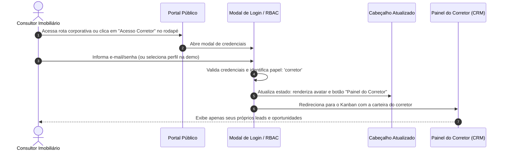

# US-10: Autenticação Segura, Controle de Acesso (RBAC) e Painel do Corretor

## 1. Identificação e Metadados
- **Identificador:** US-10
- **Título:** Autenticação de Usuários Internos, Controle de Acesso por Níveis (RBAC) e Visibilidade Restrita do Painel do Corretor
- **Épico:** EPIC-03 — Autenticação, Governança e Configuração
- **Projeto:** Urban Real State
- **Prioridade:** Essencial (Must Have / Governança e UX)
- **Personas Impactadas:**
  - *Lead Comprador*: Não vê ícones confusos de CRM nem conceitos de backoffice na sua experiência pública de navegação.
  - *Consultor Imobiliário / Corretor*: Acessa seu painel de trabalho de forma direta e segura, visualizando apenas seus próprios clientes e tarefas.
  - *Gestor Comercial*: Acessa relatórios da equipe e controla permissões.
  - *Administrador do Sistema*: Controle total sobre papéis e segurança.

---

## 2. Declaração de Negócio (User Story Format)
> **Como** Consultor Imobiliário ou Gestor Comercial da plataforma Urban Real State,  
> **Quero** um ponto de acesso claro ao meu painel de trabalho ("Painel do Corretor"), devidamente autenticado e visível apenas para usuários internos autorizados,  
> **Para que** o comprador comum desfrute de um portal 100% focado em imóveis e a equipe interna opere com sigilo de dados, ferramentas corporativas e separação estrita de privilégios (RBAC).

---

## 3. Visão de Negócio e Proposta de Valor
- **Problema de Mercado e Diagnóstico de UX (Ref. UX Tópicos 01 e 07):**
  - Muitos portais imobiliários que possuem CRM integrado colocam um ícone genérico de grade (tipo menu de apps) no cabeçalho público sem legenda nem tooltip. O comprador clica pensando que é um catálogo ou menu e cai em uma tela de login de CRM, gerando estranhamento.
  - A linguagem interna de vendas ("Leads", "Funil", "Qualificado") vaza para a interface pública, quebrando a sensação de consultoria acolhedora.
- **Solução no Urban Real State:**
  1. **Separação Rigorosa de Papéis e Visibilidade:**
     - Para o visitante público/comprador anônimo, o atalho para o CRM **não é exibido no cabeçalho**.
     - A transição para o backoffice ocorre via link discreto de rodapé ("Acesso Corretor") ou login direto pela rota corporativa.
  2. **Rótulo Claro e Acessível:** Ao autenticar-se, o botão passa a ser exibido claramente com o rótulo **"Painel do Corretor"** ou através do menu do avatar do usuário logado, com tooltip e `aria-label` descritivo.
  3. **Matriz RBAC Determinística:**
     - *Corretor:* Acessa seus próprios leads, inventário e simulações.
     - *Gestor:* Acessa toda a equipe, regras de roleta e relatórios de receita.
     - *Admin:* Configurações de sistema, integrações e governança.
- **Impacto no Negócio:**
  - Experiência do comprador 100% preservada de jargões corporativos.
  - Proteção total de dados confidenciais e conformidade estrita com a LGPD.
  - Clareza na operação da equipe de vendas.

---

## 4. Funcionalidades e Regras de Negócio Detalhadas

### 4.1. Gate de Autenticação Protegido (`CrmAuthLoginModal`)
- Modal de login seguro acionado ao acessar rotas administrativas (`#dashboard`, `#clients`, etc.).
- Preservação da rota de destino pretendida (`pendingTabTarget`) para redirecionamento imediato após sucesso.

### 4.2. Visibilidade Condicional do Cabeçalho (Ref. UX Tópico 01)
- O cabeçalho público remove qualquer ícone de grade sem rótulo.
- Quando o usuário estiver autenticado como Corretor/Gestor:
  - Exibição de avatar com nome do usuário e papel ativo.
  - Menu suspenso com links diretos: *"Painel do Corretor"*, *"Dossiê PDF"* e *"Alternar Tema"*.
- Quando for visitante anônimo:
  - O header exibe apenas a navegação pública e o botão de destaque do Concierge.

### 4.3. Matriz de Permissões RBAC
- Bloqueio físico em nível de código (JSX e rotas):
  - Corretores comuns não visualizam comissões de colegas nem configurações de webhooks.
  - Apenas Gestores e Admins podem reatribuir leads e alterar a regra da roleta.

---

## 5. Sequência Lógica e Fluxo Passo a Passo

---

## 6. Pontos de Atenção e Riscos de Negócio
1. **Não Bloquear Demonstrações:** No ambiente de demo/treinamento, o seletor rápido de usuários deve permitir que investidores e gestores alternem entre "Visão do Corretor" e "Visão do Gestor" para comprovar a eficácia do RBAC.
2. **Sessão Segura:** Em ambiente de produção, tokens JWT devem ser armazenados em cookies `HttpOnly` com flag `SameSite=Strict`.

---

## 7. Requisitos Não Funcionais (RNFs)
- **RNF-01 (Acessibilidade de Controles de Acesso):** Todos os botões de menu e avatar devem conter `aria-haspopup="true"`, `aria-expanded` dinâmico e suporte completo a navegação por teclado (`Tab`, `Enter`, `Escape`).
- **RNF-02 (Tempo de Validação de Permissão):** A verificação de permissão de visualização de componentes na tela deve ser síncrona e executar em menos de 5ms.

---

## 8. Análise do Estado Atual vs. Apontamento de GAPS

### Estado Atual Implementado
- Modal `CrmAuthLoginModal.jsx` com seleção de perfis e verificação de papéis funcional.
- Bloqueio de rota no `App.jsx` para acesso não autenticado.

### Gaps Identificados com Base na Análise de UX
1. **GAP-10.1 (Ícone Enigmático de CRM no Header — Ref. UX Tópicos 01 e 07):** O ícone de grade no header convive sem rótulo e visível para o comprador comum. Deve ser renomeado para "Painel do corretor" e exibido apenas para usuários internos autorizados.
2. **GAP-10.2 (Autenticação Formal com Tokens JWT no Backend):** Integração definitiva com Supabase Auth em produção para aposentar a seleção em memória.
