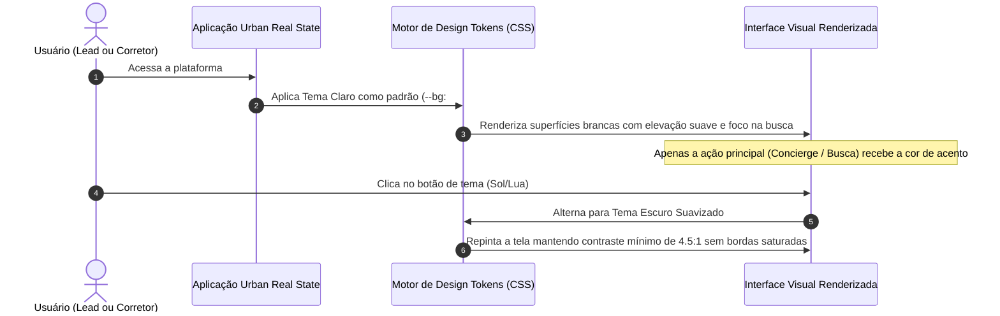

# US-11: Sistema Visual, Tokens de Design, Acessibilidade e White-Label

## 1. Identificação e Metadados
- **Identificador:** US-11
- **Título:** Sistema de Design Tokens, Hierarquia Visual (Um Acento, Uma Função), Tema Claro como Padrão e Acessibilidade WCAG
- **Épico:** EPIC-03 — Autenticação, Governança e Configuração
- **Projeto:** Urban Real State
- **Prioridade:** Essencial (Must Have / Alinhamento UX e Design System)
- **Personas Impactadas:**
  - *Lead Comprador*: Vivencia uma interface elegante, com fotos em destaque, alto respiro visual, contraste confortável e sem poluição de cores.
  - *Gestor Comercial / Diretor Imobiliário*: Aplica a identidade de marca da sua imobiliária sobre um design system robusto e profissional.
  - *Consultor Imobiliário*: Trabalha no CRM com ergonomia visual reduzindo cansaço ocular.

---

## 2. Declaração de Negócio (User Story Format)
> **Como** Lead Comprador ou Consultor Imobiliário da plataforma Urban Real State,  
> **Quero** uma interface moderna com tema claro como padrão, contraste acessível garantido (mínimo 4.5:1), cartões com elevação sutil sem bordas pesadas e uma cor de destaque única para a ação principal de cada tela,  
> **Para que** a navegação seja fluida, visualmente sofisticada e confortável aos olhos tanto em desktops quanto em smartphones.

---

## 3. Visão de Negócio e Proposta de Valor
- **Problema de Mercado e Diagnóstico de UX (Ref. UX Tópicos 08 e 09):**
  - Interfaces imobiliárias escuras e saturadas cansam os olhos e diminuem a luminosidade natural das fotos dos imóveis.
  - Uso caótico de cores: numa mesma tela chegam a conviver laranja, verde, azul, roxo e vermelho sem função semântica clara. O laranja, que deveria sinalizar a ação primária, aparece simultaneamente em slogans, tags, ícones, badges e botões secundários.
  - Poluição de bordas escuras em todos os elementos, textos minúsculos de 11px em caixa alta com baixo contraste e botões de ícone sem acessibilidade (sem `aria-label`).
- **Solução no Urban Real State:**
  1. **Princípio "Um Acento, Uma Função":** A cor de destaque (`--accent: #C8431F`) é reservada com exclusividade para:
     - Logotipo institucional.
     - Ação primária da tela (ex: botão do Concierge no portal ou botão de envio no CRM).
     - Estado ativo selecionado.
     - *Eliminação do arco-íris de cores conflitantes em favor de uma base neutra e elegante.*
  2. **Tema Claro como Padrão (Light Mode by Default):** Fundo quente/off-white (`--bg: #FAFAF8`), superfícies brancas (`--surface: #FFFFFF`) e cartões com elevação sutil (`--shadow-card`) sem bordas pesadas, valorizando o protagonismo das fotos. O tema escuro permanece disponível com contraste suavizado.
  3. **Acessibilidade Universal (WCAG 2.1 AA):** Rótulo acessível em todos os botões de ícone, alvo de toque mínimo de 44x44px, foco visível (`:focus-visible`) e eliminação de dependência de cor para transmitir significado.
  4. **Padronização Gramatical:** Correção de plurais e termos técnicos ("Quartos" em vez de "Dorms", singular correto para "1 vaga").
- **Impacto no Negócio:**
  - Posicionamento estético de altíssimo padrão imobiliário (comparável às melhores referências internacionais de design).
  - Conformidade com padrões de acessibilidade e legislação web.
  - Aumento da conversão ao guiar o olhar do usuário diretamente para a ação principal sem distrações.

---

## 4. Funcionalidades e Regras de Negócio Detalhadas

### 4.1. Design Tokens Corporativos Padronizados (Ref. UX Tópico 08)
O sistema deve implementar os tokens CSS fundamentais:
```css
:root {
  --bg: #FAFAF8;                                                   /* Fundo suave com respiro */
  --surface: #FFFFFF;                                              /* Superfície dos cards */
  --text: #14181F;                                                 /* Texto principal com alto contraste */
  --muted: #5B6472;                                                /* Texto de apoio legível */
  --line: rgba(20, 24, 31, 0.10);                                  /* Divisores sutis */
  --accent: #C8431F;                                               /* Contraste 4.9:1 com texto branco */
  --accent-soft: rgba(200, 67, 31, 0.08);                          /* Destaques suaves */
  --radius-card: 20px;                                             /* Cantos modernos nos cards */
  --radius-pill: 999px;                                            /* Pílulas de seleção */
  --shadow-card: 0 1px 2px rgba(20,24,31,.04), 0 6px 20px rgba(20,24,31,.05); /* Elevação suave sem borda dura */
}
```

### 4.2. Cards de Imóvel sem Bordas Pesadas
- Eliminação de bordas sólidas grossas nos cards do catálogo.
- Uso de elevação sutil de superfície (`box-shadow: var(--shadow-card)`), conferindo leveza, sofisticação e amplitude visual.

### 4.3. Requisitos de Acessibilidade e Ergonomia (Ref. UX Tópico 09)
- **Controles por Ícone:** Todo botão sem texto (favoritar, alternador de tema, fechar modal, microfone) **DEVE** conter atributo `aria-label` e tooltip textual explicativo.
- **Área Mínima de Toque:** Todo elemento interativo deve garantir área útil clicável de no mínimo `44 x 44 pixels`.
- **Independência de Cor:** Informações de status ou métricas não devem depender unicamente de verde ou vermelho; devem sempre ser acompanhadas de texto ou ícone explícito.
- **Tipografia e Caixa Alta:** Redução drástica de textos em caixa alta com tracking aberto, restringindo-os exclusivamente a pequenos rótulos de apoio de até duas palavras.

---

## 5. Sequência Lógica e Fluxo Passo a Passo



---

## 6. Pontos de Atenção e Riscos de Negócio
1. **Contraste em Cores White-Label Personalizadas:** Caso uma imobiliária parceira configure uma cor primária corporativa própria (ex: amarelo claro), o sistema deve calcular a luminância e forçar o texto do botão primário para preto, mantendo o índice mínimo de 4.5:1.
2. **Harmonia de Imagens Reais:** Fotos com fundos muito claros não devem perder a visibilidade dos dados; as informações de preço e specs devem estar na superfície do card abaixo da foto, e não sobre a imagem.

---

## 7. Requisitos Não Funcionais (RNFs)
- **RNF-01 (Contraste Mínimo Acessível):** 100% dos textos normais devem ter taxa de contraste igual ou superior a 4.5:1 contra seus fundos imediatos (WCAG 2.1 nível AA).
- **RNF-02 (Navegação por Teclado e Foco Visível):** Todos os componentes interativos devem exibir anel de foco evidente (`:focus-visible`) em tom de acento ao navegar pela tecla `Tab`.
- **RNF-03 (Consistência de Tokens):** Nenhum estilo em linha (*inline style*) com cores hexadecimais soltas deve existir no código; todos os componentes devem herdar as variáveis do Design System.

---

## 8. Análise do Estado Atual vs. Apontamento de GAPS

### Estado Atual Implementado
- Suporte a tema claro e escuro funcional via classes Tailwind e variáveis de tema.
- Seletor de cores customizadas no `ThemeSwitcher.jsx`.

### Gaps Identificados com Base na Análise de UX
1. **GAP-11.1 (Dispersão e Conflito de Cores — Ref. UX Tópico 08):** Convivência de verde, azul, roxo e vermelho numa mesma tela; necessário adotar a regra "Um Acento, Uma Função", reservando a cor de destaque apenas para a ação primária e logo.
2. **GAP-11.2 (Bordas Excessivas e Peso Visual — Ref. UX Tópico 08):** Uso de bordas saturadas em cartões; adotar elevação suave de superfície com `--shadow-card`.
3. **GAP-11.3 (Botões de Ícone sem Rótulo Acessível — Ref. UX Tópico 09):** Múltiplos botões sem atributo `aria-label` nem alvos mínimos de 44px de toque.
4. **GAP-11.4 (Inconsistências de Plural e Nomenclatura — Ref. UX Tópico 09):** Ocorrências de "1 Vagas", "1 Quartos" e termo "Dorms"; padronizar para "Quartos" e plural automático.
