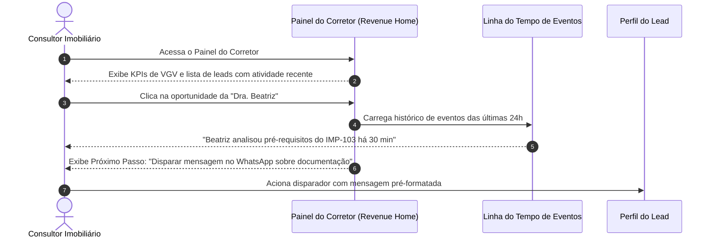

# US-12: Revenue Home — Dashboard Executivo, Linha do Tempo e Painel do Corretor

## 1. Identificação e Metadados
- **Identificador:** US-12
- **Título:** Painel Executivo de Gestão de Vendas, Linha do Tempo de Atividades e Demonstração Concreta de Valor
- **Épico:** EPIC-04 — CRM, Pipeline de Vendas e Inteligência do Comprador
- **Projeto:** Urban Real State
- **Prioridade:** Essencial (Must Have / Alinhamento UX)
- **Personas Impactadas:**
  - *Gestor Comercial / Diretor Imobiliário*: Acompanha métricas de faturamento, negócios estagnados e governança de dados.
  - *Consultor Imobiliário / Corretor*: Visualiza o painel operacional com leads priorizados por atividade recente e próximos passos sugeridos.
  - *Lead Comprador*: Não é impactado diretamente pela linguagem interna corporativa.

---

## 2. Declaração de Negócio (User Story Format)
> **Como** Consultor Imobiliário ou Gestor Comercial da plataforma Urban Real State,  
> **Quero** um painel de trabalho consolidado com KPIs financeiros (VGV, honorários previstos e estagnação), acompanhado de uma visão acionável de cada comprador (pilares preenchidos, favoritos, pré-requisitos analisados e próximo passo sugerido),  
> **Para que** eu comprove o valor prático do CRM na conversão de vendas, priorize contatos com atividade recente e elimine a dispersão operacional.

---

## 3. Visão de Negócio e Proposta de Valor
- **Problema de Mercado e Diagnóstico de UX (Ref. UX Tópicos 01 e 07):**
  - Painéis de CRM tradicionais perdem tempo com dezenas de tabelas estáticas que mostram apenas dados de cadastro, sem orientar o corretor sobre **o que fazer a seguir**.
  - No ambiente de demonstração, o selo `[DEMO / SIMULATION]` muitas vezes ganha tamanho e cores chamativas que competem com os próprios números de negócio.
  - Falta de conexão entre a navegação do comprador e a ação do corretor: o sistema sabe que o comprador navegou e favoritou, mas não exibe isso de forma sintética para o corretor agir no momento certo.
- **Solução no Urban Real State:**
  1. **Painel do Corretor Estruturado (Ref. UX Tópico 07):** Um card analítico por oportunidade combinando:
     - Nome do comprador e orçamento disponível.
     - Pilares preenchidos (Localização, Tipologia, Orçamento e Estilo de Vida).
     - Imóveis favoritados e pré-requisitos analisados no portal.
     - **Score de Intenção e Próximo Passo Sugerido (Next Best Action).**
  2. **Registro de Eventos e Linha do Tempo (Timeline):** Registro cronológico com data/hora para cada ação do lead (ex: *"Favoritou IMP-101 há 2 horas"*, *"Analisou pré-requisitos de financiamento há 40 minutos"*), permitindo priorização comercial por calor de interação.
  3. **Higiene e Rebaixamento do Selo de Demo (Ref. UX Tópico 01):** O selo `[DEMO / SIMULATION]` é apresentado de forma discreta, neutra e compacta ao lado do logotipo institucional, mantendo a honestidade sem poluição visual.
- **Impacto no Negócio:**
  - Foco dos corretores nos clientes com atividade nas últimas 24 horas.
  - Redução de tempo na preparação do atendimento presencial.
  - Demonstração comercial irrefutável do valor do software para donos de imobiliárias.

---

## 4. Funcionalidades e Regras de Negócio Detalhadas

### 4.1. Torre de Controle de Receita (Revenue KPIs)
- Exibição limpa em cartões com elevação sutil:
  - **VGV Total no Pipeline.**
  - **Comissão Ponderada Prevista.**
  - **Leads com Atividade Recente.**
  - **Alertas de Estagnação (Inativos há mais de 5 dias).**

### 4.2. Visão Consolidada de Oportunidades do Corretor (Ref. UX Tópico 07)
- Cada oportunidade no painel deve apresentar de relance:
  - Identificação do Lead e Faixa de Orçamento.
  - Status dos 4 Pilares (quantos estão preenchidos).
  - Miniaturas dos imóveis favoritados pelo cliente no portal público.
  - Tag indicando se o lead solicitou análise de pré-requisitos ou dossiê.
  - Recomendação acionável em destaque: *"Sugerir visita presencial para o imóvel IMP-101 via WhatsApp"*.

### 4.3. Linha do Tempo de Atividades Recentes (Event Log)
- Aba ou painel lateral exibindo o feed de interações do comprador:
  - `[Hoje 14:20] Marina favoritou o imóvel IMP-102 (Duplex Moema).`
  - `[Hoje 14:25] Marina clicou em "Analisar pré-requisitos" do imóvel IMP-102.`
  - `[Ontem 18:00] Marina atualizou sua preferência de Sol da Manhã com peso 5.`

---

## 5. Sequência Lógica e Fluxo Passo a Passo

---

## 6. Pontos de Atenção e Riscos de Negócio
1. **Linguagem Separada (Ref. UX Tópico 07):** Toda e qualquer menção a "Funil", "Lead", "CRM" e "Estágio" pertence exclusivamente a este painel interno do corretor. Nunca expor esses termos para o comprador.
2. **Priorização por Calor (Decay de Interesse):** Um lead com evento registrado há 30 minutos tem 10x mais valor comercial do que um lead com evento de 5 dias atrás. O painel deve ordenar os contatos por atividade recente decrescente.

---

## 7. Requisitos Não Funcionais (RNFs)
- **RNF-01 (Desempenho de Carga do Feed de Eventos):** A consulta e renderização da timeline de atividades de um comprador deve ocorrer em menos de 150ms.
- **RNF-02 (Selo de Transparência Neutro):** O componente `DataTruthBadge` deve respeitar os tokens de cor neutros, sem bordas vermelhas alarmistas no modo de demonstração.

---

## 8. Análise do Estado Atual vs. Apontamento de GAPS

### Estado Atual Implementado
- `DashboardModule.jsx` funcional com VGV e contadores.
- `DataTruthBadge.jsx` presente e funcional.

### Gaps Identificados com Base na Análise de UX
1. **GAP-12.1 (Ausência de Linha do Tempo de Eventos do Lead — Ref. UX Tópico 07):** O sistema registra apenas o estado final do lead, sem exibir para o corretor a ordem cronológica de imóveis favoritados e pré-requisitos analisados.
2. **GAP-12.2 (Selo de Demo Visualmente Pesado — Ref. UX Tópico 01):** O badge de DEMO possui destaque excessivo; deve ser rebaixado para estilo neutro e compacto ao lado do logotipo.
3. **GAP-12.3 (Falta de Visão Sintética de Oportunidades com Next Best Action):** Falta card resumido de oportunidade compilando pilares, favoritos e próximo passo acionável na mesma visão.
