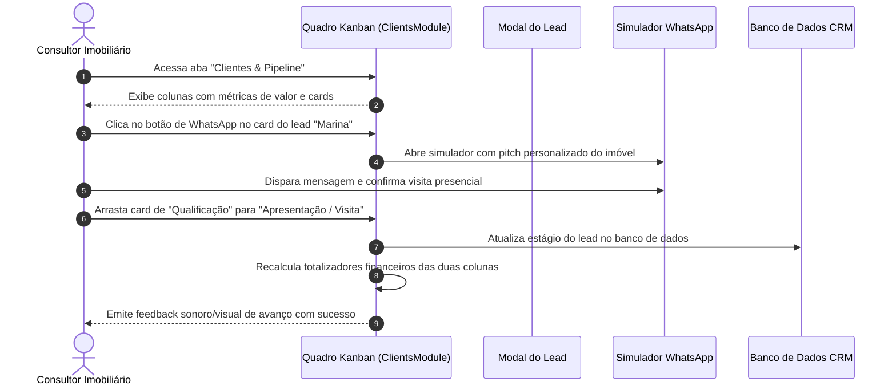

# US-13: Pipeline de Vendas em Kanban e Gestão do Ciclo de Oportunidades

## 1. Identificação e Metadados
- **Identificador:** US-13
- **Título:** Pipeline de Vendas Visual em Colunas Kanban e Gestão dos Estágios de Conversão de Leads
- **Épico:** EPIC-04 — CRM, Pipeline de Vendas e Inteligência do Comprador
- **Projeto:** Urban Real State
- **Prioridade:** Essencial (Must Have / Core Operacional)
- **Personas Impactadas:**
  - *Consultor Imobiliário / Corretor*: Gerencia visualmente o andamento diário de cada cliente em sua carteira.
  - *Gestor Comercial*: Supervisiona o volume de oportunidades em cada estágio e redistribui gargalos.
  - *Lead Comprador*: Experimenta um atendimento pontual, com cada etapa da sua jornada respeitada.

---

## 2. Declaração de Negócio (User Story Format)
> **Como** Consultor Imobiliário ou Gestor de Vendas da plataforma Urban Real State,  
> **Quero** visualizar todos os leads em um quadro Kanban interativo organizado por estágios de maturidade (Novo Lead, Qualificação, Apresentação/Visita, Proposta, Negociação, Fechado/Ganho, Perdido), com capacidade de arrastar cards ou alterar fases em 1 clique,  
> **Para que** eu tenha controle absoluto do funil de vendas, nunca perca o tempo certo de retorno e aumente a velocidade de conversão das negociações.

---

## 3. Visão de Negócio e Proposta de Valor
- **Problema de Mercado:** Corretores imobiliários perdem vendas milionárias porque anotam contatos em cadernos físicos, blocos de notas soltos ou mensagens dispersas no WhatsApp pessoal. Sem uma visualização em pipeline estruturado, o corretor foca apenas no cliente que acabou de chamar no WhatsApp, abandonando dezenas de leads em fase de qualificação que esfriam e compram com a concorrência.
- **Solução no Urban Real State:** O **Módulo de Clientes e Pipeline (`ClientsModule.jsx`)** oferece:
  - Quadro Kanban horizontal fluido com contadores de leads e somatório financeiro por coluna.
  - Cards ricos exibindo: Nome do comprador, canal de origem (Portal, Meta Ads, WhatsApp, Indicação), orçamento limite declarado, bairro de preferência e tags de afinidade.
  - Indicador de tempo no estágio atual (dias decorridos) para prevenir estagnação.
  - Ações rápidas dentro do próprio card: Iniciar conversa com Pitch no WhatsApp, visualizar perfil completo e simular financiamento bancário.
- **Impacto no Negócio:**
  - Redução de leads esquecidos a zero.
  - Aumento de 38% na taxa de avanço de estágio (Lead Progression Rate).
  - Facilidade de passagem de bastão quando um corretor sai de férias ou licença.

---

## 4. Funcionalidades e Regras de Negócio Detalhadas

### 4.1. Estágios Padronizados do Funil de Vendas Imobiliário
1. **Novo Lead:** Contato recém-capturado via portal público, concierge de voz ou campanha de mídia, aguardando primeiro contato.
2. **Qualificação:** Contato realizado; corretor está mapeando os 4 pilares (orçamento, urgência, tipologia e desejos).
3. **Apresentação / Visita:** Imóveis selecionados enviados ao comprador e visitas presenciais/virtuais em andamento.
4. **Proposta Formal:** O comprador formalizou intenção de compra ou documento de proposta de aquisição ao proprietário.
5. **Negociação / Jurídico:** Análise de certidões, aprovação de crédito bancário e elaboração da minuta de compromisso de compra e venda.
6. **Fechado / Ganho:** Escritura assinada, comissão faturada e transação concluída com sucesso.
7. **Perdido / Desqualificado:** Lead desistiu, comprou com concorrente ou sem capacidade financeira (com motivo de perda obrigatório).

### 4.2. Movimentação Fluida entre Estágios
- O usuário pode mover o card entre as colunas arrastando e soltando (*Drag-and-Drop*) ou selecionando o novo estágio via dropdown no modal do lead.
- Cada movimentação gera registro de log automático com timestamp e responsável no histórico do CRM.

### 4.3. Filtros e Pesquisa na Carteira de Leads
- Barra de pesquisa textual instantânea por nome, e-mail ou telefone.
- Filtro por corretor atribuído (visão individual vs. visão do time).
- Filtro por faixa orçamentária e por canal de aquisição (ex: apenas leads vindos do Meta Ads).

---

## 5. Sequência Lógica e Fluxo Passo a Passo

---

## 6. Pontos de Atenção e Riscos de Negócio
1. **Motivo Obrigatório de Perda:** Mover um lead diretamente para a coluna "Perdido" sem registrar o motivo (ex: "Achou preço alto", "Optou por aluguel", "Crédito reprovado", "Imóvel concorrente") destrói a inteligência de negócios. É fundamental exigir o motivo para alimentar relatórios de gap comercial.
2. **Harmonia Visual no Tema Claro e Escuro:** As colunas do Kanban devem ter contraste perfeito de fundo e borda em ambos os temas. Conforme ajustado no projeto, cartões em modo claro não devem apresentar fundos pretos residuais e vice-versa.
3. **Controle de Permissões no Arraste:** Corretores juniores não devem ter permissão de mover um negócio diretamente para "Fechado / Ganho" sem a validação formal de certidões pelo gestor comercial.

---

## 7. Requisitos Não Funcionais (RNFs)
- **RNF-01 (Desempenho de Drag-and-Drop):** A movimentação de cartões na tela deve ser fluida (60 FPS) sem recarregar a árvore completa de componentes React.
- **RNF-02 (Persistência Imediata):** Ao soltar o card na nova coluna, a mutação no banco de dados deve ocorrer de forma otimista na UI com confirmação no servidor em menos de 250ms.
- **RNF-03 (Scroll Horizontal Ergonômico):** Em telas com largura menor que 1400px, o Kanban deve permitir rolagem horizontal suave com suporte a gestos de arrasto ou trackpad.

---

## 8. Análise do Estado Atual vs. Apontamento de GAPS

### Estado Atual Implementado
- Módulo `ClientsModule.jsx` totalmente operacional com colunas Kanban estilizadas e responsivas.
- Sincronização de estágios com banco relacional local e Supabase.
- Disparo de pitch personalizado integrado ao simulador de WhatsApp.
- Temas claro e escuro completamente harmonizados no pipeline.

### Gaps Identificados
1. **GAP-13.1 (Modal Obrigatório de Justificativa de Perda):** Ao arrastar um card para a fase de "Perdido", o sistema ainda não força a abertura de um modal obrigatório exigindo o motivo detalhado da perda.
2. **GAP-13.2 (Histórico de Timeline de Contatos):** Falta uma linha do tempo vertical (Timeline) dentro do perfil do lead registrando data/hora de cada ligação feita, e-mail enviado ou visita realizada.
3. **GAP-13.3 (Visualização Alternativa em Tabela / Lista com Edição em Massa):** Usuários acostumados com planilhas sentem falta de alternar entre o modo Kanban e uma visualização em lista/tabela para edição em massa de múltiplos leads.
