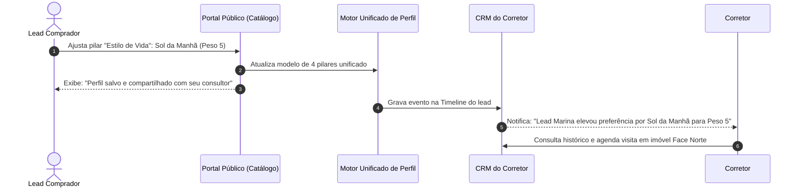

# US-14: Perfil Tridimensional do Comprador (Modelo Unificado de 4 Pilares e Timeline)

## 1. Identificação e Metadados
- **Identificador:** US-14
- **Título:** Modelo Unificado de Perfil do Comprador (4 Pilares Padronizados, 3 Dimensões de Dados e Linha do Tempo)
- **Épico:** EPIC-04 — CRM, Pipeline de Vendas e Inteligência do Comprador
- **Projeto:** Urban Real State
- **Prioridade:** Alta (Should Have / Inteligência de Vendas e UX)
- **Personas Impactadas:**
  - *Consultor Imobiliário / Corretor*: Tem uma visão de raio-X do cliente antes de dar o primeiro "bom dia", integrando o que ele diz, o que ele faz e o que a IA infere.
  - *Lead Comprador*: Sente que o sistema respeita suas preferências com consistência e sem divergência de termos.
  - *Gestor Comercial*: Enriquece o patrimônio de dados da imobiliária com inteligência preditiva.

---

## 2. Declaração de Negócio (User Story Format)
> **Como** Consultor Imobiliário da plataforma Urban Real State,  
> **Quero** que o perfil do comprador adote exatamente a mesma taxonomia dos 4 Pilares estruturados no Concierge e no Catálogo (Localização, Tipologia, Orçamento e Estilo de Vida com escala de 1 a 5), associado a uma linha do tempo de eventos de navegação,  
> **Para que** eu compreenda a evolução do interesse do cliente de forma intuitiva, identifique contradições entre seu discurso e comportamento real e monte abordagens comerciais cirúrgicas.

---

## 3. Visão de Negócio e Proposta de Valor
- **Problema de Mercado e Diagnóstico de UX (Ref. UX Tópicos 05 e 07):**
  - **Divergência de Taxonomia:** A tela do Concierge falava em "Localização", "Tipologia", "Orçamento" e "Desejos". Na listagem de imóveis, esses termos mudavam para "Teto", "Tipologia", "Specs" e "Afinidades", e a Localização simplesmente sumia do perfil. Essa inconsistência quebrava a continuidade mental do usuário.
  - **Exposição de Linguagem Interna:** O sistema exibia para o comprador avisos como *"Perfil Qualificado"* e *"Atualiza seu perfil no CRM"*, expondo conceitos restritos ao funil de vendas.
  - **Percentuais Criptográficos:** O uso de percentuais estáticos como *"Varanda Gourmet (100%)"* não explicava se aquilo era um requisito obrigatório ou desejável.
- **Solução no Urban Real State:**
  1. **Modelo Único de Perfil (Taxonomia Consistente):** Tanto no Concierge quanto no portal e no CRM, os 4 pilares têm **rigorosamente a mesma nomenclatura**:
     - **Pilar 1:** *Localização* (Bairros e cidades selecionadas).
     - **Pilar 2:** *Tipologia* (Quartos, suítes, vagas e tipo de imóvel com steppers `− 2 +`).
     - **Pilar 3:** *Orçamento* (Teto e faixa financeira com slider de valores).
     - **Pilar 4:** *Estilo de Vida* (Afinidades com escala de importância de 1 a 5).
  2. **Separação de Linguagem (Ref. UX Tópico 07):**
     - O comprador vê: *"Perfil salvo e compartilhado com seu consultor especialista"*.
     - Termos como *"CRM"*, *"Lead"* e *"Qualificado"* ficam confinados estritamente à interface interna do corretor.
  3. **3 Dimensões Analíticas de Inteligência:**
     - **Dados Declarados (Declared):** O que o lead informou explicitamente nos 4 pilares.
     - **Dados Observados (Observed):** Linha do tempo de eventos (imóveis clicados, tempo de permanência, pré-requisitos analisados e favoritos).
     - **Dados Inferidos (Inferred):** Conclusões preditivas da IA (elasticidade orçamentária até +25%, preferência oculta por sol da manhã e urgência de compra).
- **Impacto no Negócio:**
  - Consistência cognitiva total entre a jornada pública e interna.
  - Abordagens no WhatsApp que impressionam o cliente pela relevância.
  - Redução de tempo na qualificação manual de novos contatos.

---

## 4. Funcionalidades e Regras de Negócio Detalhadas

### 4.1. Taxonomia Unificada dos 4 Pilares
- O componente de visualização do perfil deve ser idêntico em todas as telas:
  - **Localização:** Chips limpos de bairros/cidades.
  - **Tipologia:** Quartos (singular/plural correto), suítes e vagas.
  - **Orçamento:** Faixa em Reais com formatação monetária padrão.
  - **Estilo de Vida:** Tags de vocação acompanhadas do valor de relevância escolhido na escala de 1 a 5 (ex: `Sol da Manhã (Peso 5/5)`).

### 4.2. Linha do Tempo de Eventos de Navegação (Observed Data)
- Registro cronológico com data e hora de cada evento relevante:
  - Evento `FAVORITE_ADDED`: ID e título do imóvel adicionado aos favoritos.
  - Evento `SPECS_ANALYZED`: Clique em "Analisar pré-requisitos".
  - Evento `TAG_WEIGHT_CHANGED`: Alteração do slider de relevância de estilo de vida.
  - Evento `SIMULATION_COMPLETED`: Cálculo realizado no simulador financeiro.

### 4.3. Painel de Inteligência Inferred Data
- Alertas visuais discretos no CRM alertando sobre dissonâncias:
  - *"Divergência de Preço: Lead declarou teto de R$ 1.2M, mas 80% dos imóveis navegados na última semana custam entre R$ 1.6M e R$ 1.9M. Sugestão: apresentar simulação com entrada facilitada nesta faixa superior"*.

---

## 5. Sequência Lógica e Fluxo Passo a Passo

---

## 6. Pontos de Atenção e Riscos de Negócio
1. **Linguagem Amigável sem Ruído Técnico:** O comprador jamais deve sentir que está sendo "vigiado por um robô". O texto deve ser sempre afetuoso e focado no benefício pessoal do comprador.
2. **Mesmo Componente de Código (Single Source of Truth):** O modelo de dados do perfil não deve ter esquemas diferentes no Concierge e na listagem; deve consumir e emitir o mesmo objeto TypeScript/JavaScript em ambos os locais.

---

## 7. Requisitos Não Funcionais (RNFs)
- **RNF-01 (Consistência Semântica):** O esquema de dados do perfil deve ser validado via esquema padrão compartilhado (ex: Zod schema), garantindo que os 4 pilares tenham exatamente os mesmos tipos de dados em todas as rotas.
- **RNF-02 (Escala de Afinidade Visual):** Os sliders de 1 a 5 devem ser acompanhados de saídas de texto legíveis (`<output>`) para leitores de tela e pessoas com baixa visão.

---

## 8. Análise do Estado Atual vs. Apontamento de GAPS

### Estado Atual Implementado
- Dados declarados, observados e tags de estilo de vida persistidos no `db.js`.
- Matching e tags integrados.

### Gaps Identificados com Base na Análise de UX
1. **GAP-14.1 (Taxonomia Divergente entre Telas — Ref. UX Tópico 07):** O Concierge utiliza "Localização", "Tipologia", "Orçamento" e "Desejos", enquanto a tela de imóveis utiliza "Teto", "Tipologia", "Specs" e "Afinidades", sumindo com a Localização. Necessário unificar rigorosamente no mesmo modelo de 4 pilares em ambos os módulos.
2. **GAP-14.2 (Vazamento de Jargões Internos — Ref. UX Tópico 07):** Mensagens ao comprador dizendo "Perfil Qualificado" e "atualiza no CRM". Substituir por linguagem focada no comprador: "Perfil salvo e compartilhado com seu consultor".
3. **GAP-14.3 (Percentual Estático Incompreensível — Ref. UX Tópico 05):** Substituir o rótulo "(100%)" por um slider intuitivo de 1 a 5.
4. **GAP-14.4 (Falta de Linha do Tempo de Atividades Recentes — Ref. UX Tópico 07):** Armazenar cada evento de navegação com data/hora em vez de salvar apenas o estado final do lead.
