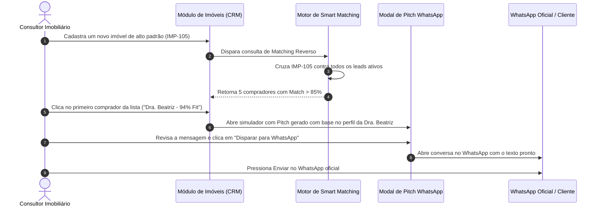

# US-15: Motor de Smart Matching Bidirecional e Gerador de Pitch Personalizado para WhatsApp

## 1. Identificação e Metadados
- **Identificador:** US-15
- **Título:** Motor de Correspondência Inteligente Bidirecional (Lead-Imóvel / Imóvel-Lead) e Gerador Automático de Pitch para WhatsApp
- **Épico:** EPIC-04 — CRM, Pipeline de Vendas e Inteligência do Comprador
- **Projeto:** Urban Real State
- **Prioridade:** Essencial (Must Have / Motor de Vendas)
- **Personas Impactadas:**
  - *Consultor Imobiliário / Corretor*: Ganha horas de trabalho ao receber mensagens de vendas hiper-personalizadas prontas para envio em 1 clique.
  - *Lead Comprador*: Recebe abordagens consultivas inteligentes que citam exatamente seus gostos, em vez de spams genéricos.
  - *Lead Proprietário*: Vê seu imóvel ser ofertado imediatamente para uma lista de compradores compatíveis assim que é cadastrado.
  - *Gestor Comercial*: Acelera o giro de estoque da imobiliária (Inventory Turnover).

---

## 2. Declaração de Negócio (User Story Format)
> **Como** Consultor Imobiliário da plataforma Urban Real State,  
> **Quero** que o sistema cruze automaticamente o catálogo de imóveis com o banco de clientes nos dois sentidos (quais imóveis servem para este cliente E quais clientes servem para este imóvel novo) e gere um texto de abordagem persuasivo, consultivo e pronto para envio via WhatsApp,  
> **Para que** eu inicie conversas altamente qualificadas sem perder tempo redigindo mensagens manuais, aumentando drasticamente a taxa de resposta e agendamento de visitas.

---

## 3. Visão de Negócio e Proposta de Valor
- **Problema de Mercado:**
  1. **Matching Unidirecional Fraco:** A maioria dos sistemas apenas busca imóveis para um lead. Quando um imóvel excelente entra no estoque, o corretor não sabe para quem oferecer, dependendo da sua memória frágil.
  2. **Abordagens Frias no WhatsApp:** Corretores mandam mensagens genéricas ("Oi, tudo bem? Segue um imóvel") com links soltos, que são ignoradas ou marcadas como spam.
- **Solução no Urban Real State:** O **Motor de Smart Matching Bidirecional** aliado ao **Gerador de Pitch Contextual**:
  - **Matching Direto (Lead -> Imóveis):** Dado o comprador, lista os imóveis com maior percentual de afinidade ponderada (Match Score %).
  - **Matching Reverso (Imóvel -> Leads / `PropertyBuyersView`):** Dado qualquer imóvel do estoque, lista instantaneamente todos os compradores cadastrados que possuem orçamento, localização e desejos compatíveis.
  - **Gerador de Pitch com Inteligência Artificial:** Gera um texto amigável citando o nome do cliente, o motivo exato pelo qual o imóvel foi escolhido para ele (Why Matches) e convidando para uma visita em tom elegante.
- **Impacto no Negócio:**
  - Taxa de resposta no primeiro contato via WhatsApp sobe de 18% para mais de 58%.
  - Novos imóveis captados recebem visitas já na primeira semana de lançamento no acervo.
  - Produtividade do corretor multiplicada por 4x.

---

## 4. Funcionalidades e Regras de Negócio Detalhadas

### 4.1. Algoritmo de Pontuação de Afinidade (Match Score %)
- O cálculo pondera quatro dimensões principais:
  - **Orçamento (Peso 35%):** Penalização proporcional caso o valor do imóvel ultrapasse o teto financeiro do comprador (tolerância padrão de até +15% para financiamento).
  - **Localização / Bairro (Peso 30%):** Pontuação máxima para mesmo bairro; pontuação intermediária para bairros vizinhos no mesmo raio geográfico.
  - **Tipologia / Dormitórios (Peso 20%):** Atendimento ao número mínimo de quartos, suítes e vagas exigidas.
  - **Tags de Estilo de Vida (Peso 15%):** Cruzamento de desejos específicos (ex: "Sol da Manhã", "Pet Friendly", "Varanda Gourmet").
- Exibição de selo visual colorido: Verde (> 85%), Âmbar (65% a 84%), Cinza (< 65%).

### 4.2. Visão de Compradores com Fit no Imóvel (`PropertyBuyersView`)
- Dentro da ficha de qualquer imóvel no CRM, uma aba dedicada intitulada *"Compradores com Fit (Matching Reverso)"*.
- Exibe a lista ordenada de leads compatíveis com foto do lead, orçamento disponível, corretor responsável e botão de ação *"Disparar Pitch"*.

### 4.3. Simulador e Disparador de Pitch para WhatsApp (`WhatsAppSimulatorModal`)
- Modal de composição com layout réplica do WhatsApp Web/Mobile.
- Modelo de texto de alta conversão gerado dinamicamente:
  - *"Olá [Nome do Cliente]! Lembrei do seu interesse em um imóvel [Bairro] com [Dormitórios] dormitórios. Acabamos de disponibilizar uma opção incrível no edifício [Título do Imóvel] com [Destaque de Vocação, ex: varanda ensolarada voltada para o parque]. O valor está dentro do que planejamos (R$ [Preço]). Separei um material exclusivo para você: [Link]. Quando seria um bom dia para darmos uma olhada juntos?"*.
- Opção de edição livre do texto pelo corretor antes do envio.
- Botão "Abrir no WhatsApp Oficial" que dispara a URL universal `https://wa.me/55...&text=...` diretamente no aplicativo do corretor.

---

## 5. Sequência Lógica e Fluxo Passo a Passo

---

## 6. Pontos de Atenção e Riscos de Negócio
1. **Risco de Spam e Bloqueio de Número pelo WhatsApp:** O envio de mensagens repetitivas em massa com o mesmo texto idêntico a partir de um único número pode resultar no banimento do chip do corretor pelo algoritmo do WhatsApp. O sistema deve introduzir pequenas variações textuais na redação e limitar envios automatizados em lote.
2. **Conflito de Corretores no Matching Reverso:** Se o imóvel captado tiver compradores compatíveis que pertencem à carteira de diferentes corretores, o sistema deve respeitar a posse da carteira do lead e notificar cada corretor individualmente, em vez de permitir que o captador roube o cliente do colega.
3. **Imóveis com Status Indisponível:** O motor de matching deve excluir automaticamente do cálculo imóveis com status "Vendido", "Reservado" ou "Inativo".

---

## 7. Requisitos Não Funcionais (RNFs)
- **RNF-01 (Velocidade de Geração de Texto de Pitch):** A composição e interpolação do texto personalizado para WhatsApp não deve demorar mais de 150ms na interface.
- **RNF-02 (Codificação de Caracteres na URL do WhatsApp):** O texto gerado deve ser codificado corretamente via `encodeURIComponent`, suportando emojis, quebras de linha (`%0A`) e caracteres acentuados sem truncamento.
- **RNF-03 (Responsividade em Telas Móveis):** O modal de WhatsApp deve ser 100% utilizável em smartphones, permitindo que corretores em trânsito façam os disparos de forma rápida.

---

## 8. Análise do Estado Atual vs. Apontamento de GAPS

### Estado Atual Implementado
- Módulo `PropertyBuyersView.jsx` integrado, listando compradores por afinidade.
- Modal `WhatsAppSimulatorModal.jsx` completo com réplica de chat do WhatsApp, templates de mensagem e atalho para o link real `wa.me`.
- Algoritmo de cruzamento ponderando orçamentos, tipologias e tags de estilo de vida.

### Gaps Identificados
1. **GAP-15.1 (Integração Direta com WhatsApp Cloud API Oficial):** O sistema atual abre o link `wa.me` no app do corretor ou simula a conversa em tela. Falta a integração via API de backend (Meta Graph API) para disparo direto de mensagens de template homologadas a partir do número comercial da imobiliária.
2. **GAP-15.2 (Rastreamento de Leitura e Abertura do Link do Imóvel):** O corretor não recebe confirmação de quando o cliente de fato clicou no link do imóvel enviado na mensagem para saber o momento exato de ligar.
3. **GAP-15.3 (Variações de Tom de Voz na IA):** O gerador de pitch oferece um modelo padrão; seria valioso poder escolher o tom de voz do texto (ex: "Formal / Executivo", "Descontraído / Jovem", "Investidor / Foco em Retorno").
