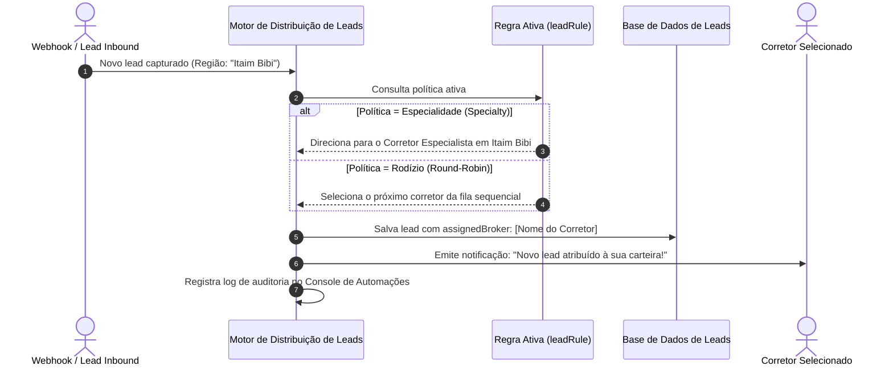

# US-16: Regras de Distribuição Inteligente de Leads (Rodízio / Roleta vs. Especialidade por Bairro)

## 1. Identificação e Metadados
- **Identificador:** US-16
- **Título:** Motor de Distribuição Automática de Oportunidades: Rodízio Circular (Round-Robin) e Roteamento por Especialidade Territorial
- **Épico:** EPIC-04 — CRM, Pipeline de Vendas e Inteligência do Comprador
- **Projeto:** Urban Real State
- **Prioridade:** Alta (Should Have / Governança Comercial)
- **Personas Impactadas:**
  - *Gestor Comercial*: Assegura distribuição justa, transparente e meritocrática dos contatos gerados por mídia e pelo portal.
  - *Consultor Imobiliário / Corretor*: Tem a certeza de que receberá leads compatíveis com sua área de especialização sem favoritismos.
  - *Lead Comprador*: É atendido imediatamente por um corretor que realmente conhece a região do seu interesse.

---

## 2. Declaração de Negócio (User Story Format)
> **Como** Gestor Comercial da plataforma Urban Real State,  
> **Quero** poder configurar e alternar com um clique a política de distribuição de novos leads entre a modalidade de Rodízio Circular (Round-Robin) e a modalidade de Roteamento por Especialidade (Bairro / Vocação do Corretor),  
> **Para que** a imobiliária otimize o tempo de primeira resposta (Speed to Lead) e direcione cada oportunidade para o corretor com maior taxa de conversão naquele território.

---

## 3. Visão de Negócio e Proposta de Valor
- **Problema de Mercado:** O maior motivo de atrito e desmotivação em equipes de corretores é a percepção de "panelinha" ou injustiça na entrega dos leads vindos de investimentos caros em anúncios (Meta Ads, Google). Além disso, entregar um lead de um bairro nobre para um corretor recém-chegado que não conhece aquela região resulta em atendimento fraco e perda da venda.
- **Solução no Urban Real State:** O sistema disponibiliza um **Comutador de Políticas de Distribuição de Leads (`leadRule`)** acessível diretamente pelo cabeçalho ou painel do gestor:
  1. **Política 1 — Rodízio Circular Simples (Round-Robin):** Cada novo lead que entra no sistema é distribuído sequencialmente para o próximo corretor da fila de plantão (Corretor 1 -> Corretor 2 -> Corretor 3 -> Corretor 1), garantindo igualdade exata de volume.
  2. **Política 2 — Especialidade por Bairro / Território (Specialty / Domain):** O sistema analisa o bairro prioritário do lead e direciona automaticamente para o corretor cadastrado como especialista naquela região (ex: Imóveis em Moema vão para o Corretor Especialista em Moema; Jardins vão para o Especialista em Jardins).
- **Impacto no Negócio:**
  - Redução do tempo de primeiro contato humano de horas para menos de 3 minutos.
  - Eliminação total de discussões internas sobre divisão de leads.
  - Aumento de 24% na taxa de conversão de visita para corretores especialistas.

---

## 4. Funcionalidades e Regras de Negócio Detalhadas

### 4.1. Comutador de Regra no Cabeçalho / Configurações
- Botão no cabeçalho administrativo com alternância visual clara entre:
  - *"Modo Rodízio (Round-Robin)"*.
  - *"Modo Especialidade (Por Bairro)"*.
- Cada alteração dispara registro automático de auditoria no console com data/hora e identificação do gestor que realizou a mudança.

### 4.2. Algoritmo de Execução do Rodízio (Round-Robin)
- O sistema mantém um ponteiro persistente (`last_assigned_index`).
- Ao receber novo lead:
  - Seleciona o corretor ativo subsequente na lista de usuários aptos.
  - Atribui o ID do corretor ao campo `assignedBroker` do lead.
  - Atualiza o ponteiro para a próxima oportunidade.

### 4.3. Algoritmo de Roteamento Territorial (Specialty Routing)
- O sistema consulta a matriz de especialistas cadastrada no CRM:
  - Se o lead busca em bairro coberto por especialista: Atribuição direta ao corretor responsável.
  - **Regra de Fallback (Transbordo):** Se o bairro não tiver especialista definido ou se o especialista estiver com capacidade máxima de atendimento esgotada, o lead cai automaticamente no Rodízio Geral (Round-Robin).

---

## 5. Sequência Lógica e Fluxo Passo a Passo

---

## 6. Pontos de Atenção e Riscos de Negócio
1. **Corretores Ausentes ou de Férias na Fila:** Distribuir leads cegamente para corretores que estão de folga, atestado médico ou férias gera abandono imediato do cliente. O sistema deve prever um botão de status "Pausa / Fora do Plantão" no perfil do corretor, retirando-o automaticamente da roleta temporariamente.
2. **Capacidade Máxima de Atendimento (WIP Limit):** Um corretor com 30 leads não respondidos não deve continuar recebendo novos contatos. A distribuição por especialidade deve ter teto máximo de leads em aberto por corretor.
3. **Leads de Indicação Direta:** Se o cliente entrar através do link pessoal de um corretor específico (link de afiliado ou cartão digital), a regra geral de distribuição deve ser sobreposta, garantindo que o lead pertença ao corretor que gerou a indicação.

---

## 7. Requisitos Não Funcionais (RNFs)
- **RNF-01 (Atomicidade e Proteção contra Concorrência):** O cálculo do próximo corretor na fila deve ser atômico para evitar que dois leads simultâneos sejam atribuídos ao mesmo corretor por condição de corrida (*race condition*).
- **RNF-02 (Tempo de Execução da Distribuição):** O roteamento completo e a atribuição do lead no banco de dados devem ser concluídos em menos de 100ms após o recebimento do webhook.
- **RNF-03 (Transparência nos Logs):** Todas as atribuições devem registrar em log a justificativa da escolha (ex: *"Atribuído a Carlos Eduardo via Regra Territorial: Especialista no bairro Itaim Bibi"*).

---

## 8. Análise do Estado Atual vs. Apontamento de GAPS

### Estado Atual Implementado
- Mecanismo de alternância entre `round_robin` e `specialty` implementado no `App.jsx` e `Header.jsx`.
- Registro automático nos logs do console a cada troca de regra e na atribuição de leads.
- Atribuição de corretores vinculada ao banco de dados relacional.

### Gaps Identificados
1. **GAP-16.1 (Matriz Visual de Bairros por Corretor na Interface):** A correspondência de especialidade ainda está baseada em fixtures de código; falta uma tela de configuração no CRM onde o gestor possa marcar numa lista quais bairros pertencem a cada corretor.
2. **GAP-16.2 (Controle de Status "Disponível / Em Pausa"):** Os corretores não possuem um interruptor de presença (Online / Offline / Almoço) para pausar o recebimento de leads da roleta.
3. **GAP-16.3 (SLA de Primeiro Atendimento com Reatribuição Automática):** Se o corretor que recebeu o lead não fizer o primeiro contato em até 15 minutos, o sistema deveria reatribuir o lead automaticamente para o próximo corretor da fila (*Lead Snooze Reassignment*).
