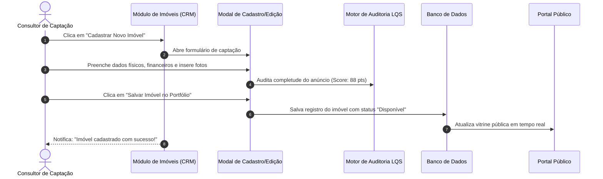

# US-17: Gestão do Inventário de Imóveis, Cadastro de Ativos e Auditoria LQS

## 1. Identificação e Metadados
- **Identificador:** US-17
- **Título:** Gestão do Estoque de Imóveis (CRUD), Controle de Disponibilidade e Auditoria Contínua de Qualidade
- **Épico:** EPIC-05 — Gestão de Inventário, Simuladores e Comissões
- **Projeto:** Urban Real State
- **Prioridade:** Essencial (Must Have / Core Operacional)
- **Personas Impactadas:**
  - *Consultor Imobiliário / Corretor de Captação*: Cadastra novos imóveis, atualiza fotos e altera status de negociação.
  - *Gestor Comercial / Diretor de Estoque*: Monitora o envelhecimento dos imóveis (Days on Market) e audita a qualidade dos anúncios.
  - *Lead Proprietário*: Confia que seu patrimônio está cadastrado com rigor e anunciado com fidelidade.

---

## 2. Declaração de Negócio (User Story Format)
> **Como** Consultor Imobiliário ou Gestor de Estoque da plataforma Urban Real State,  
> **Quero** uma central completa de gestão de imóveis com filtros por status (Disponível, Reservado, Vendido), buscador avançado, formulário rico de inclusão/edição e cálculo em tempo real da pontuação LQS,  
> **Para que** o acervo da imobiliária permaneça 100% atualizado, saneado e pronto para abastecer tanto o portal público quanto os canais externos sem anúncios desatualizados.

---

## 3. Visão de Negócio e Proposta de Valor
- **Problema de Mercado:** O maior causador de frustração e processos éticos no mercado imobiliário é o anúncio desatualizado: o cliente se apaixona por um imóvel na internet, agenda visita e descobre no local que o imóvel já foi vendido há duas semanas. Além disso, cadastros incompletos ou com erros cadastrais geram retrabalho contínuo para a equipe.
- **Solução no Urban Real State:** O **Módulo de Gestão de Propriedades (`PropertiesModule.jsx`)** oferece:
  - Painel de controle de inventário com cartões resumidos de métricas (Total de Imóveis, Disponíveis, Reservados, Vendidos e VGV Total em Estoque).
  - Tabela gerencial e visão em cartões com ordenação por data de captação, dias no mercado e preço/m².
  - Formulário completo de inclusão/edição abrangendo dados físicos, financeiros (IPTU, condomínio), vocações subjetivas, orientação solar e URLs de imagem.
  - Alteração rápida de status de negociação em 1 clique (Disponível ➔ Reservado ➔ Vendido).
- **Impacto no Negócio:**
  - Redução a zero de visitas marcadas para imóveis já comercializados.
  - Visibilidade clara sobre quais imóveis estão "encalhados" há mais de 90 dias para renegociação de preço com o proprietário.
  - Facilidade de exportação limpa de dados para os portais externos integrados.

---

## 4. Funcionalidades e Regras de Negócio Detalhadas

### 4.1. Painel de Controle de Estoque
- Filtros rápidos por:
  - Status operacional: `Disponível`, `Reservado`, `Vendido`.
  - Tipo de imóvel: `Apartamento`, `Cobertura`, `Casa em Condomínio`, `Studio/Loft`, `Comercial`.
  - Bairro e Corretor captador responsável.
  - Faixas de preço e dias no mercado (Days on Market).

### 4.2. Modal de Cadastro e Edição de Imóvel
- Formulário modular organizado por seções:
  - **Identificação Básica:** Título comercial do anúncio, tipo, status e corretor captador.
  - **Localização e Endereço:** Bairro, cidade, CEP e orientação solar predominante.
  - **Dimensões e Cômodos:** Área útil privativa (m²), área total, dormitórios, suítes, banheiros e vagas de garagem.
  - **Dados Financeiros:** Preço de venda pretendido, taxa de condomínio mensal e parcela mensal de IPTU.
  - **Galeria Visual:** URLs das imagens com foto de capa destacada.
  - **Descrição e Vocações Subjetivas:** Descrição detalhada e seleção de tags de estilo de vida (Sol da Manhã, Pet Friendly, Home Office, etc.).

### 4.3. Alteração Ágil de Status e Impacto no Ecossistema
- Ao alterar o status de um imóvel para **"Reservado"**:
  - O imóvel recebe tarja de reserva visual no portal público.
- Ao alterar para **"Vendido"**:
  - O imóvel é removido das buscas ativas do portal público.
  - O sistema dispara gatilho de criação de transação no módulo financeiro de comissões.
  - Registra a data de fechamento para cálculo do tempo total de venda.

---

## 5. Sequência Lógica e Fluxo Passo a Passo

---

## 6. Pontos de Atenção e Riscos de Negócio
1. **Controle de Exclusividade e Validade da Captação:** Anúncios captados sem contrato de exclusividade podem ser vendidos por imobiliárias concorrentes sem aviso prévio. O sistema deve prever alerta de "Revalidação de Disponibilidade a cada 15 dias" com o proprietário.
2. **Duplicidade de Cadastro do Mesmo Imóvel:** Corretores diferentes podem tentar cadastrar o mesmo apartamento no mesmo condomínio com pequenas variações de título. O sistema deve alertar se houver cadastro com mesmo condomínio, metragem e número de unidade.
3. **Imagens com Direitos Autorais / Marcas d'Água:** O sistema deve alertar o corretor para não subir fotos com logotipos de outras imobiliárias concorrentes.

---

## 7. Requisitos Não Funcionais (RNFs)
- **RNF-01 (Validação de Integridade de Dados):** Nenhum imóvel pode ser salvo com valor de venda zerado, metragem negativa ou sem ao menos uma foto principal válida.
- **RNF-02 (Suporte a Grande Escala de Estoque):** A listagem de estoque no CRM deve suportar paginação virtual ou rolagem infinita com até 5.000 imóveis sem perda de fluidez.
- **RNF-03 (Backup e Histórico de Preços):** Qualquer alteração no valor de venda do imóvel deve ser arquivada em tabela de histórico para alimentar relatórios de reajuste de preço.

---

## 8. Análise do Estado Atual vs. Apontamento de GAPS

### Estado Atual Implementado
- Módulo `PropertiesModule.jsx` completo com CRUD funcional integrado ao `db.js`.
- Filtros por status, tipologia e barra de busca de estoque operacional.
- Alteração instantânea de status (Disponível / Reservado / Vendido) refletida no portal.
- Registro de logs de estoque no console de automações.

### Gaps Identificados
1. **GAP-17.1 (Upload Direto de Arquivos de Imagem / Armazenamento em Nuvem):** O cadastro atual exige a colagem de URLs externas de imagens; falta componente de upload com *drag-and-drop* de arquivos locais para bucket de armazenamento (ex: Supabase Storage / AWS S3).
2. **GAP-17.2 (Histórico de Reajustes de Preço no Imóvel):** O sistema não exibe um gráfico interno de flutuação de preço (ex: "Cadastrado por 1.8M, reduzido para 1.65M há 10 dias").
3. **GAP-17.3 (Exportação em Lote para Portais):** Falta botão de seleção múltipla de imóveis para publicação/despublicação em lote com os portais parceiros.
