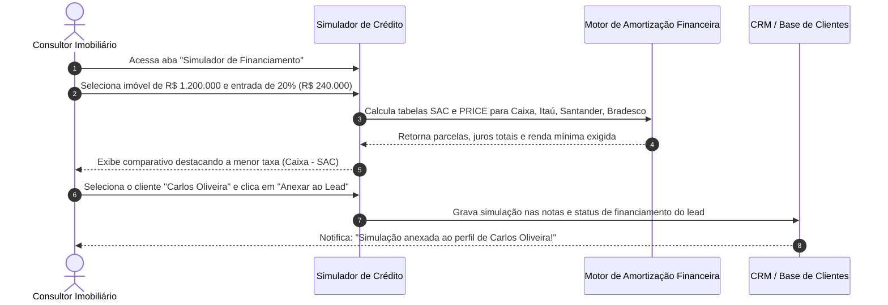

# US-18: Simulador de Crédito Imobiliário MultiBanco (SAC vs. PRICE e Anexação ao Lead)

## 1. Identificação e Metadados
- **Identificador:** US-18
- **Título:** Simulador de Financiamento Habitacional MultiBanco com Amortização SAC / PRICE e Vinculação ao Perfil do Comprador
- **Épico:** EPIC-05 — Gestão de Inventário, Simuladores e Comissões
- **Projeto:** Urban Real State
- **Prioridade:** Essencial (Must Have / Viabilidade Financeira)
- **Personas Impactadas:**
  - *Lead Comprador*: Descobre na hora se a parcela cabe no seu orçamento mensal e qual banco oferece a menor taxa de juros.
  - *Consultor Imobiliário / Corretor*: Quebra a objeção de "não tenho dinheiro à vista" na hora da visita, demonstrando a viabilidade do parcelamento.
  - *Analista Financeiro / Correspondente Bancário*: Recebe a simulação estruturada com renda e entrada para dar entrada no processo de aprovação de crédito.

---

## 2. Declaração de Negócio (User Story Format)
> **Como** Consultor Imobiliário ou Lead Comprador na plataforma Urban Real State,  
> **Quero** poder simular as condições reais de financiamento de qualquer imóvel comparando os principais bancos do país (Caixa, Itaú, Bradesco, Santander), alternando entre tabelas SAC e PRICE com cálculo de entrada e renda mínima requerida,  
> **Para que** eu viabilize a compra com segurança matemática e possa anexar a simulação oficial diretamente ao cadastro do cliente no CRM em um clique.

---

## 3. Visão de Negócio e Proposta de Valor
- **Problema de Mercado:** Mais de 70% das compras imobiliárias no Brasil dependem de financiamento bancário. No entanto, o processo tradicional é burocrático: o corretor pede dias para um correspondente bancário simular, enquanto o cliente fica inseguro quanto ao valor das parcelas e acaba desistindo da proposta.
- **Solução no Urban Real State:** O **Módulo de Simulação Financeira (`FinanceSimulatorModule.jsx`)**:
  - Parâmetros flexíveis em tempo real: Valor do Imóvel, Entrada disponível (R$ e %), Prazo de amortização (até 420 meses / 35 anos) e Idade do proponente.
  - Tabela comparativa dinâmica entre os principais bancos com suas taxas de juros nominais médias de mercado (Caixa Econômica, Itaú, Santander, Bradesco).
  - Alternância de sistemas de amortização:
    - **SAC (Sistema de Amortização Constante):** Parcelas decrescentes (primeira parcela mais alta, última parcela bem menor).
    - **PRICE (Tabela Francesa):** Parcelas fixas ao longo de todo o contrato.
  - Cálculo automático da **Renda Bruta Mínima Familiar Exigida** (comprometimento máximo legal de 30% da renda).
  - Ação *"Anexar Simulação ao Lead"*: Salva os dados financeiros diretamente nas notas e no campo `financingStatus` do comprador no CRM.
- **Impacto no Negócio:**
  - Redução do tempo de validação de crédito de 5 dias para menos de 2 minutos.
  - Fechamento imediato de propostas na fase de visita.
  - Alinhamento de expectativas financeiras reais antes do envio da proposta ao proprietário.

---

## 4. Funcionalidades e Regras de Negócio Detalhadas

### 4.1. Controles e Parâmetros da Simulação
- Sliders interativos e campos numéricos para ajuste fino:
  - **Valor do Imóvel:** Puxado automaticamente do imóvel selecionado ou editável livremente.
  - **Entrada (Down Payment):** Mínimo legal de 20% do valor do imóvel com cálculo automático do valor financiado (80%).
  - **Prazo de Pagamento:** De 60 a 420 meses (35 anos).
  - **Sistema de Amortização:** Toggle entre `SAC` e `PRICE`.

### 4.2. Tabela de Comparação MultiBanco em Tempo Real
- Exibição de cards para cada instituição financeira contendo:
  - Logotipo e nome do banco.
  - Taxa de juros anual efetiva estimada (ex: 9.99% a.a., 10.49% a.a.).
  - Valor da Primeira Parcela.
  - Valor da Última Parcela (no modelo SAC).
  - Total de Juros Pagos no período.
  - Renda Familiar Mínima Comprovada necessária (Parcela / 0.30).

### 4.3. Vinculação Direta com o CRM (Anexar ao Lead)
- Dropdown para selecionar o cliente comprador ativo na base.
- Botão *"Anexar esta Simulação ao Perfil do Cliente"*:
  - Atualiza o campo `financingStatus` do cliente para *"Aprovado / Simulado [Nome do Banco]"*.
  - Anexa nas notas do lead o resumo contábil (Valor financiado, primeira parcela e banco escolhido).
  - Registra a ação no Console de Automações do CRM.

---

## 5. Sequência Lógica e Fluxo Passo a Passo

---

## 6. Pontos de Atenção e Riscos de Negócio
1. **Flutuação de Taxas e Índices de Correção (TR / IPCA / Poupança):** As taxas bancárias variam frequentemente de acordo com a taxa Selic. O sistema deve deixar explícito que os valores são referenciais e sujeitos a análise de crédito oficial e inclusão de seguros obrigatórios (MIP e DFI).
2. **Limite de Idade do Proponente (Regra dos 80 anos e 6 meses):** No Brasil, a soma da idade do proponente mais o prazo do financiamento não pode ultrapassar 80 anos e 6 meses. O simulador deve alertar caso o prazo selecionado viole esta restrição para a idade informada.
3. **Uso de FGTS na Entrada:** O sistema deve prever a possibilidade de abater saldo de FGTS do valor de entrada necessário quando o imóvel for residencial e enquadrado nas regras do SFH.

---

## 7. Requisitos Não Funcionais (RNFs)
- **RNF-01 (Cálculo Financeiro Instantâneo):** O recálculo das matrizes de amortização SAC e PRICE para todos os bancos deve ser executado em menos de 50ms a cada movimento dos sliders.
- **RNF-02 (Precisão Matemática Rigorosa):** As fórmulas financeiras de amortização devem replicar exatamente as calculadoras dos bancos centrais, sem desvios de centavos.
- **RNF-03 (Exportação para PDF / Impressão Limpa):** A tela deve disponibilizar layout de impressão limpo (*Print CSS*) ou geração de PDF da proposta de simulação com logotipo corporativo para entrega ao cliente.

---

## 8. Análise do Estado Atual vs. Apontamento de GAPS

### Estado Atual Implementado
- Módulo `FinanceSimulatorModule.jsx` operacional com suporte a cálculo SAC e PRICE.
- Comparativo entre grandes bancos (Caixa, Itaú, Bradesco, Santander).
- Funcionalidade de anexar simulação diretamente à ficha do cliente com registro no console de automações.

### Gaps Identificados
1. **GAP-18.1 (Inclusão de Custos Cartorários e ITBI no Financiamento):** O simulador calcula apenas o valor do imóvel, sem permitir incluir os custos de ITBI (geralmente 3%) e custas de cartório de registro (1.5% a 2%) no saldo a financiar.
2. **GAP-18.2 (Simulação de Financiamento Direto com a Construtora):** Falta modalidade de simulação de tabela direta com a incorporadora (série de intermediárias semestrais/anuais + saldo nas chaves corrigido pelo INCC).
3. **GAP-18.3 (Integração via API com Correspondente Bancário):** Não há envio automático da proposta simulada para a esteira de crédito do banco para emissão de carta de crédito pré-aprovada.
