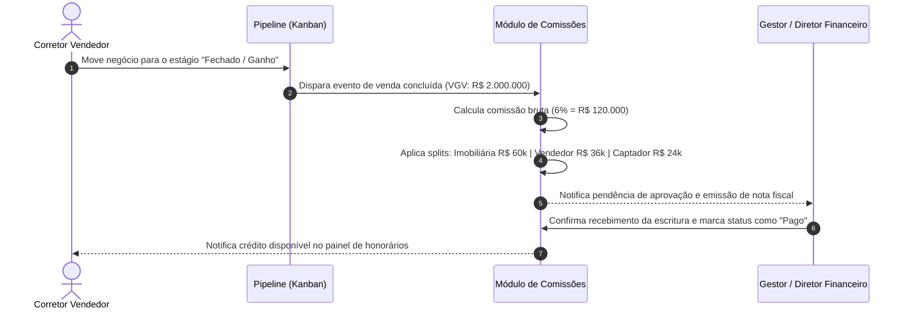

# US-19: Gestão de Comissões, Divisão de Honorários (Splits) e Ranking de Performance

## 1. Identificação e Metadados
- **Identificador:** US-19
- **Título:** Motor de Gestão Financeira de Comissões, Divisão de Honorários (Splits Imobiliária / Corretores) e Ranking de Performance
- **Épico:** EPIC-05 — Gestão de Inventário, Simuladores e Comissões
- **Projeto:** Urban Real State
- **Prioridade:** Média-Alta (Should Have / Gestão Financeira)
- **Personas Impactadas:**
  - *Consultor Imobiliário / Corretor*: Visualiza exatamente quanto tem a receber em comissões por cada venda realizada ou em fase de fechamento.
  - *Gestor Comercial / Diretor Imobiliário*: Controla o fluxo de caixa de honorários da casa, repasses devidos e ranking de vendas da equipe.
  - *Administrador do Sistema*: Garante conformidade fiscal e regras parametrizáveis de comissionamento.

---

## 2. Declaração de Negócio (User Story Format)
> **Como** Consultor Imobiliário ou Gestor Comercial da plataforma Urban Real State,  
> **Quero** uma área dedicada para visualização de comissões calculadas por negócio, com divisão automática entre taxa da imobiliária (House Split), corretor captador e corretor vendedor,  
> **Para que** haja transparência financeira absoluta, eliminação de erros de cálculo de honorários e motivação contínua da equipe comercial através de rankings de resultado.

---

## 3. Visão de Negócio e Proposta de Valor
- **Problema de Mercado:** O cálculo de comissões imobiliárias é historicamente complexo e gera frequentes atritos judiciais e desconfiança entre corretores e imobiliárias. Negócios envolvem múltiplos atores (quem captou o imóvel, quem atendeu o comprador, quem coordenou a gerência e a taxa da casa). Planilhas manuais geram atrasos no repasse, erros de arredondamento e falta de previsão para os corretores.
- **Solução no Urban Real State:** O **Módulo de Comissões (`CommissionModule.jsx`)**:
  - Consolida todas as transações concluídas e em andamento.
  - Aplica o percentual contratual padrão (ex: 6% de comissão sobre o VGV da transação).
  - Executa a divisão automática de splits:
    - **Fatia da Imobiliária (House Fee):** Ex: 40% a 50% dos honorários brutos.
    - **Fatia do Corretor Vendedor (Selling Broker):** Ex: 30% a 35%.
    - **Fatia do Corretor Captador (Listing Broker):** Ex: 15% a 20%.
    - **Fatia do Gerente / Coordenação:** Ex: 5%.
  - Demonstração de valores líquidos a receber e histórico de pagamentos.
  - Leaderboard / Ranking de vendas da equipe para estímulo de performance.
- **Impacto no Negócio:**
  - Transparência 100% auditável nos pagamentos da equipe.
  - Redução de tempo do departamento financeiro no fechamento do mês de 3 dias para 15 minutos.
  - Retenção dos melhores corretores na imobiliária por clareza de remuneração.

---

## 4. Funcionalidades e Regras de Negócio Detalhadas

### 4.1. Visão de Resumo Financeiro
- Indicadores principais:
  - **Total de Comissões Faturadas no Ano:** Volume bruto recebido.
  - **Comissões a Receber (Em Trânsito / Jurídico):** Honorários vinculados a contratos em fase de escritura.
  - **Repasses Pagos aos Corretores:** Total já liquidado no período.
  - **Receita Líquida da Imobiliária:** Margem retida pela casa após todos os splits.

### 4.2. Tabela de Transações e Splits por Negócio
- Cada linha de transação deve exibir:
  - Código da transação e identificação do Imóvel.
  - Data de fechamento e valor total de venda (VGV).
  - Comissão Bruta negociada (ex: R$ 90.000 para imóvel de R$ 1.5M a 6%).
  - Identificação dos corretores envolvidos (Captador e Vendedor).
  - Valores exatos de repasse para cada parte envolvida.
  - Status do pagamento (`Pendente`, `Aprovado`, `Pago`).

### 4.3. Leaderboard e Performance Individual por Corretor
- Ranking dinâmico dos corretores com maior volume de VGV vendido e comissão gerada.
- No perfil do corretor logado, visualização restrita de suas próprias comissões (privacidade financeira garantida pelo RBAC).

---

## 5. Sequência Lógica e Fluxo Passo a Passo

---

## 6. Pontos de Atenção e Riscos de Negócio
1. **Desconto de Tributos na Fonte (Retenção de IR / Emissão de NF):** O cálculo deve prever se o corretor atua como autônomo (RPA com retenção de IR e INSS) ou como pessoa jurídica (PJ com emissão de nota fiscal), evitando passivos trabalhistas e fiscais para a imobiliária.
2. **Desistência Após Assinatura com Devolução de Sinal:** Se um contrato for distratado antes da liquidação financeira definitiva, o sistema deve permitir o estorno ou cancelamento da comissão projetada no pipeline.
3. **Privacidade Salarial:** Corretores não devem ter visibilidade dos rendimentos acumulados de outros colegas, a não ser no ranking percentual de metas atingidas.

---

## 7. Requisitos Não Funcionais (RNFs)
- **RNF-01 (Auditoria e Imutabilidade Financeira):** Transações marcadas como "Pagas" não podem ser editadas ou excluídas diretamente, exigindo lançamento de estorno justificado por usuário com perfil de Administrador.
- **RNF-02 (Precisão Decimal em Moeda Nacional):** Valores de comissão e splits devem ser arredondados para duas casas decimais no padrão bancário ABNT NBR 5891.
- **RNF-03 (Exportação Contábil):** A tabela de splits deve permitir exportação em formato compatível com sistemas contábeis (CSV/Excel).

---

## 8. Análise do Estado Atual vs. Apontamento de GAPS

### Estado Atual Implementado
- Módulo `CommissionModule.jsx` presente na navegação do CRM.
- Cálculo de honorários a partir de transações e valores brutos de venda.
- Respeito aos temas visuais claro e escuro.

### Gaps Identificados
1. **GAP-19.1 (Configuração Flexível de Tabela de Splits por Contrato):** Os percentuais de split estão atualmente fixos no código; falta uma tela de configuração onde o gestor possa ajustar as porcentagens por tipo de imóvel (ex: lançamentos vs. terceiros) ou por plano de carreira do corretor.
2. **GAP-19.2 (Controle de Status de Pagamento / Data de Liberação):** Falta fluxo formal de aprovação bancária e campo para anexar o comprovante de PIX/TED do repasse feito ao corretor.
3. **GAP-19.3 (Relatório de Rendimentos para Declaração de IR):** Falta emissão de informe de rendimentos consolidado anual para o corretor anexar à sua declaração de imposto de renda.
