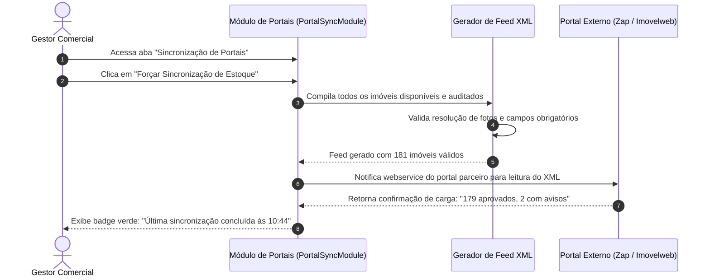

# US-20: Sincronização com Portais Imobiliários Externos (Feeds XML/API)

## 1. Identificação e Metadados
- **Identificador:** US-20
- **Título:** Central de Sincronização Multicanal com Portais Imobiliários Externos (Feeds XML, Validação e Status de Carga)
- **Épico:** EPIC-06 — Integrações Multicanal, Webhooks e Automações
- **Projeto:** Urban Real State
- **Prioridade:** Média-Alta (Should Have / Alcance de Mídia)
- **Personas Impactadas:**
  - *Gestor Comercial*: Acompanha o retorno de visibilidade dos portais contratados e status das cargas de anúncios.
  - *Consultor de Captação*: Cadastra o imóvel apenas uma vez no CRM e tem seu anúncio replicado automaticamente em todos os portais do mercado.
  - *Administrador do Sistema*: Monitora integridade de feeds, rejeições técnicas e consumo de cotas de destaque.

---

## 2. Declaração de Negócio (User Story Format)
> **Como** Consultor Imobiliário ou Gestor Comercial da plataforma Urban Real State,  
> **Quero** uma central unificada de sincronização com os principais portais imobiliários do país (Zap Imóveis, VivaReal, Imovelweb, OLX, Chaves na Mão) com status em tempo real de carga, data do último envio e log de inconsistências cadastrais,  
> **Para que** a imobiliária amplie a exposição do seu catálogo sem retrabalho de digitação manual, garantindo que alterações de preço ou status sejam replicadas com rapidez em todos os canais de mídia.

---

## 3. Visão de Negócio e Proposta de Valor
- **Problema de Mercado:** Cadastrar manualmente um imóvel com 20 fotos e dezenas de especificações em 4 ou 5 portais imobiliários diferentes consome mais de 2 horas de trabalho por captação. Quando o preço é alterado ou o imóvel é vendido, a atualização costuma ser esquecida em algum portal, gerando anúncios fantasmas, clientes irritados e desperdício de verba de mídia em anúncios desatualizados.
- **Solução no Urban Real State:** O **Módulo de Sincronização de Portais (`PortalSyncModule.jsx`)**:
  - Centraliza o status de integração de cada portal parceiro.
  - Gera feeds padronizados (formato XML padrão ZAP/VivaReal ou JSON API).
  - Exibe data e hora da última sincronização bem-sucedida.
  - Alerta sobre cotas de anúncios simples e destaques super/premium contratados.
  - Painel de auditoria de rejeições (ex: *"Imóvel IMP-104 rejeitado pelo portal: foto com resolução inferior a 800x600"*).
- **Impacto no Negócio:**
  - Economia de mais de 100 horas/mês da equipe administrativa.
  - Sincronização pontual de preços e baixas de estoque em toda a internet.
  - Maximização do retorno sobre investimento (ROI) dos pacotes de portais contratados.

---

## 4. Funcionalidades e Regras de Negócio Detalhadas

### 4.1. Painel de Status dos Portais Parceiros
- Cards de conexão individual para os portais integrados:
  - **Portal 1:** Zap Imóveis & VivaReal (Grupo OLX) — Status: Conectado.
  - **Portal 2:** Imovelweb (Navent) — Status: Conectado.
  - **Portal 3:** Casa Mineira / OLX Direto — Status: Conectado.
  - **Portal 4:** Mercado Livre Imóveis — Status: Em Configuração.
- Contadores de anúncios: `Ativos`, `Em Análise`, `Com Pendência/Erro`.
- Botão *"Forçar Sincronização Imediata"* para reenvio prioritário do feed.

### 4.2. Geração e Validação de Feeds Automatizados
- O sistema gera endpoints de feed públicos protegidos por token de segurança (ex: `https://api.urbanrealstate.com/feeds/zap.xml?token=...`).
- O gerador de feed aplica validação prévia de higiene:
  - Não exporta imóveis com status diferente de "Disponível".
  - Não exporta imóveis com score LQS abaixo do limite mínimo aceito pelo portal parceiro.
  - Converte as tags de vocação para as categorias rígidas aceitas pela taxonomia do portal.

### 4.3. Central de Alertas e Tratamento de Rejeições
- Log analítico exibindo as inconsistências retornadas pelo webhook de processamento do portal:
  - Código do Imóvel afetado.
  - Motivo da rejeição emitido pelo portal.
  - Link direto para a tela de edição do imóvel para saneamento do cadastro em 1 clique.

---

## 5. Sequência Lógica e Fluxo Passo a Passo

---

## 6. Pontos de Atenção e Riscos de Negócio
1. **Consumo Inadvertido de Cotas de Destaque:** Portais cobram valores expressivos por "Destaques Super" ou "Destaques Diamante". O sistema deve exigir confirmação explícita do gestor antes de marcar a flag de destaque de um imóvel no feed.
2. **Tempo de Processamento do Portal Externo:** Portais grandes costumam demorar entre 2 a 6 horas para processar feeds XML volumosos. A interface deve explicar com clareza ao corretor que o envio foi feito com sucesso pela imobiliária e está na fila de processamento do parceiro.
3. **Mapeamento de Tipologias Divergentes:** Cada portal utiliza um vocabulário ligeiramente diferente (ex: "Apartamento Padrão" vs. "Apartamento Tipo" vs. "Flat"). A camada de integração deve conter um adaptador (*Adapter Pattern*) robusto para mapear as categorias sem corromper os dados.

---

## 7. Requisitos Não Funcionais (RNFs)
- **RNF-01 (Desempenho na Geração do Feed XML):** A compilação do arquivo de feed para 1.000 imóveis com todas as fotos e tags não deve demorar mais de 3 segundos no servidor.
- **RNF-02 (Cache HTTP e ETag):** O endpoint do feed deve suportar cabeçalhos `ETag` e `Last-Modified` para que os robôs dos portais baixem o arquivo apenas quando houver alterações reais no acervo (*304 Not Modified*).
- **RNF-03 (Segurança e Ofuscação de Endereço):** O feed XML enviado aos portais não deve conter o número do apartamento ou telefone pessoal do proprietário, respeitando a privacidade e a exclusividade da imobiliária.

---

## 8. Análise do Estado Atual vs. Apontamento de GAPS

### Estado Atual Implementado
- Módulo `PortalSyncModule.jsx` presente no CRM com interface de status e métricas dos principais portais.
- Listagem dos canais integrados (Zap, VivaReal, Imovelweb) com indicadores visuais de integridade.
- Suporte a temas visuais claro e escuro.

### Gaps Identificados
1. **GAP-20.1 (Geração Dinâmica Real de Arquivo XML):** A interface atual exibe a camada de apresentação do painel de sync; falta a rota de backend real (`/api/feeds/integracao.xml`) gerando a árvore XML conforme o padrão nacional OpenImob / ZapData.
2. **GAP-20.2 (Seleção Individual de Imóveis por Portal):** O corretor não consegue marcar se determinado imóvel deve ir apenas para o Zap ou apenas para o Imovelweb, publicando atualmente em bloco no feed global.
3. **GAP-20.3 (Webhook de Retorno com Relatório de Impressões e Cliques):** Não há captura automática dos dados de desempenho fornecidos pelos portais (quantas visualizações e cliques o imóvel teve no VivaReal durante a semana).
