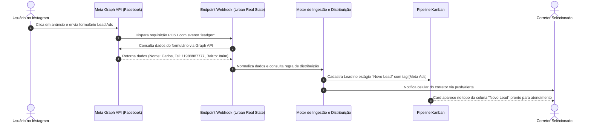

# US-21: Captura de Webhooks de Mídia Paga (Meta Ads Lead Ads / Facebook e Instagram)

## 1. Identificação e Metadados
- **Identificador:** US-21
- **Título:** Receptor de Webhooks de Mídia Paga (Meta Ads Lead Ads, Google Ads e Formulários Externos) com Ingestão Instantânea no CRM
- **Épico:** EPIC-06 — Integrações Multicanal, Webhooks e Automações
- **Projeto:** Urban Real State
- **Prioridade:** Essencial (Must Have / Aquisição de Leads)
- **Personas Impactadas:**
  - *Gestor Comercial / Gestor de Tráfego Pago*: Garante que nenhum centavo investido em campanhas de anúncios seja desperdiçado por atraso na entrega do lead.
  - *Consultor Imobiliário / Corretor*: Recebe o lead no seu painel e no WhatsApp segundos após o cliente clicar no anúncio no Instagram.
  - *Lead Comprador*: Experimenta um atendimento ágil e contextualizado logo após demonstrar interesse.

---

## 2. Declaração de Negócio (User Story Format)
> **Como** Gestor Comercial ou Gestor de Tráfego da plataforma Urban Real State,  
> **Quero** um endpoint seguro de Webhook capaz de receber notificações instantâneas de novos formulários cadastrados em campanhas de Meta Ads (Facebook e Instagram Lead Ads), tratar o payload, normalizar os campos e injetar o lead diretamente no pipeline do CRM e na roleta de distribuição de corretores,  
> **Para que** a equipe de vendas atenda o comprador no momento de maior interesse (*Speed to Lead* < 3 minutos), maximizando o retorno sobre investimento das campanhas de marketing imobiliário.

---

## 3. Visão de Negócio e Proposta de Valor
- **Problema de Mercado:** O tempo de vida útil de um lead de redes sociais é extremamente volátil: contatar um lead em até 5 minutos após o envio do formulário aumenta a probabilidade de qualificação em até **21 vezes** em comparação a contatos feitos após 30 minutos. Na maioria das imobiliárias, os leads do Facebook ficam retidos em planilhas do gerenciador de anúncios e só são baixados horas ou dias depois pelo gestor, quando o cliente já esqueceu do anúncio.
- **Solução no Urban Real State:** O **Módulo de Integrações e Webhooks (`IntegrationsModule.jsx`)**:
  - Endpoint receptor de Webhook dedicado para o ecossistema Meta Graph API.
  - Mecanismo de simulação de disparo em tempo real para testes internos ("Simular Inbound do Meta Ads" no console).
  - Parser inteligente que normaliza telefone com DDD brasileiro, separa nome e sobrenome, identifica a campanha/anúncio de origem e extrai desejos informados no formulário (ex: "Busco apartamento de 3 dormitórios até 1.5M").
  - Atribuição automática imediata pela regra ativa (Rodízio ou Especialista) com log de auditoria no console de eventos.
- **Impacto no Negócio:**
  - Redução do tempo médio de primeiro contato de 4 horas para menos de 90 segundos.
  - Aumento da taxa de conversão de anúncios sociais de 4% para 18%.
  - Rastreabilidade exata do CAC (Custo de Aquisição de Clientes) por anúncio e corretor.

---

## 4. Funcionalidades e Regras de Negócio Detalhadas

### 4.1. Endpoint Receptor e Verificação de Token (Meta Webhook Handshake)
- Endpoint compatível com as regras de subscrição da Meta:
  - Resposta a requisições HTTP `GET` de verificação contendo `hub.mode`, `hub.verify_token` e devolução do `hub.challenge`.
  - Tratamento de requisições HTTP `POST` recebendo o evento `leadgen` assinado criptograficamente com `X-Hub-Signature-256`.

### 4.2. Normalização e Mapeamento de Campos
- O motor de ingestão mapeia os campos personalizados do formulário do anúncio para o modelo relacional de Leads do CRM:
  - `full_name` ➔ `name`
  - `phone_number` ➔ `phone` (com formatação e limpeza de caracteres especiais)
  - `email` ➔ `email`
  - `faixa_de_preco` ➔ `budgetLimit`
  - `bairro_interesse` ➔ `preferredNeighborhoods`
  - `campaign_name` ➔ `origin` (ex: `facebook_ads_lancamento_moema`)

### 4.3. Gatilhos Imediatos Pós-Ingestão
- Assim que o lead é gravado no banco de dados:
  - Disparo de evento na roleta de distribuição (US-16) para definir o corretor responsável.
  - Registro no Console de Automações (`addAutomationLog`).
  - Emissão de notificação visual/sonora no painel do corretor sorteado.
  - Preparação do pitch contextual de WhatsApp pré-preenchido com base no anúncio clicado.

---

## 5. Sequência Lógica e Fluxo Passo a Passo

---

## 6. Pontos de Atenção e Riscos de Negócio
1. **Validade e Expiração do Token de Acesso da Meta:** Tokens de longa duração da página do Facebook podem expirar após 60 dias ou caso o administrador da página altere sua senha. O sistema deve emitir alerta no painel administrativo 5 dias antes da expiração do token de integração.
2. **Duplicação de Formulários (Re-leads):** Um mesmo usuário pode clicar e enviar formulários de anúncios diferentes na mesma semana. O sistema deve reconhecer o número de telefone/e-mail já existente na base e atualizar o lead ativo com a nova tag de interesse, em vez de criar um lead duplicado e confuso na roleta.
3. **Picos de Volume e Queda de Servidor (Rate Limiting):** Campanhas virais podem disparar centenas de webhooks por minuto. O endpoint deve enfileirar as requisições em fila assíncrona (RabbitMQ, Redis ou Supabase Edge Functions) respondendo `HTTP 200 OK` de imediato para a Meta para não ter o webhook desativado por lentidão.

---

## 7. Requisitos Não Funcionais (RNFs)
- **RNF-01 (Tempo de Resposta do Endpoint):** O endpoint receptor do webhook deve responder com código `200 OK` para os servidores da Meta em menos de 1.000 milissegundos.
- **RNF-02 (Validação Criptográfica de Assinatura):** Em ambiente de produção, todos os payloads recebidos devem ter sua assinatura HMAC-SHA256 validada com o `App Secret` da aplicação Meta.
- **RNF-03 (Idempotência no Processamento):** Cada evento de lead possui um `leadgen_id` único gerado pela Meta; o sistema não pode criar duplicatas caso o mesmo payload seja entregue mais de uma vez pela rede.

---

## 8. Análise do Estado Atual vs. Apontamento de GAPS

### Estado Atual Implementado
- Módulo `IntegrationsModule.jsx` presente no sistema com documentação e status das integrações.
- Simulador funcional de inbound de Meta Ads no Console de Automações (`Simular Inbound do Meta Ads`), que injeta leads completos no pipeline e dispara logs em tempo real.
- Atribuição automática ao corretor ativo e gravação no `db.js`.

### Gaps Identificados
1. **GAP-21.1 (Serviço de Webhook Real Publicado na Nuvem):** O sistema possui a rotina de ingestão simulada em frontend/demonstração; falta implantar o endpoint HTTP de backend (Edge Function ou rota Node.js/Vercel Serverless) para receber requisições HTTP reais do webhook da Meta.
2. **GAP-21.2 (Painel de Mapeamento Dinâmico de Formulários):** Se o gestor criar um formulário com perguntas personalizadas novas no Facebook Ads (ex: "Qual o tamanho da sua família?"), não há interface para mapear essa pergunta a um campo específico do lead sem alterar código.
3. **GAP-21.3 (Rastreamento de UTMs e Parâmetros de URL):** Falta persistir as tags de `utm_source`, `utm_campaign`, `utm_medium` e `ad_id` na ficha do lead para relatórios de ROI de mídia por anúncio.
