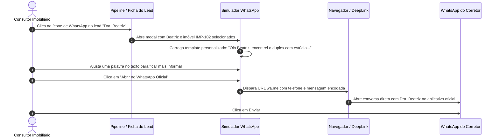

# US-22: Simulador de Conversação e Integração com WhatsApp Business Cloud API

## 1. Identificação e Metadados
- **Identificador:** US-22
- **Título:** Simulador Interativo de Atendimento por Mensagens e Integração com a API Oficial do WhatsApp Business
- **Épico:** EPIC-06 — Integrações Multicanal, Webhooks e Automações
- **Projeto:** Urban Real State
- **Prioridade:** Média-Alta (Should Have / Canal de Vendas Principal)
- **Personas Impactadas:**
  - *Consultor Imobiliário / Corretor*: Pratica argumentos, valida mensagens automáticas e envia propostas direto pelo WhatsApp.
  - *Lead Comprador*: Recebe atendimento rápido, transparente e no canal de comunicação onde passa a maior parte do dia.
  - *Gestor Comercial*: Supervisiona a qualidade das mensagens enviadas pelos corretores e a conformidade da comunicação da imobiliária.

---

## 2. Declaração de Negócio (User Story Format)
> **Como** Consultor Imobiliário da plataforma Urban Real State,  
> **Quero** poder testar mensagens de pitch, simular fluxos de conversa com leads e enviar mensagens estruturadas através de um simulador fiel do WhatsApp integrado à API oficial do WhatsApp Business,  
> **Para que** eu aprimore a qualidade do atendimento da equipe, valide templates de abordagem antes de disparar para clientes reais e mantenha histórico centralizado de conversas no CRM.

---

## 3. Visão de Negócio e Proposta de Valor
- **Problema de Mercado:** O WhatsApp é o canal onde 95% das transações imobiliárias no Brasil acontecem de fato. No entanto, imobiliárias sofrem com dois extremos: ou os corretores usam WhatsApp pessoal (a empresa não tem controle de dados, perde o cliente quando o corretor sai da imobiliária e corre risco de ações trabalhistas), ou usam chatbots corporativos excessivamente frios e robotizados que afastam clientes de alto padrão.
- **Solução no Urban Real State:** O **Simulador e Integrador de WhatsApp (`WhatsAppSimulatorModal.jsx`)**:
  - Réplica interativa em alta fidelidade do aplicativo do WhatsApp (balões de fala verdes e cinzas, status de visualização com tique azul duplo, data/hora e foto do contato).
  - Capacidade de simular diálogos bidirecionais (respostas simuladas do cliente para treinamento de corretores novatos).
  - Botão de envio real via deep link `wa.me` ou integração com a API Oficial da Meta (Cloud API).
  - Inclusão rápida de leads cadastrados no CRM a partir de conversas simuladas.
- **Impacto no Negócio:**
  - Treinamento acelerado de novos corretores em roteiros de alta conversão.
  - Centralização e governança corporativa sobre o canal de WhatsApp da empresa.
  - Maior adesão dos corretores ao uso do CRM, já que a ferramenta conversa diretamente com o WhatsApp.

---

## 4. Funcionalidades e Regras de Negócio Detalhadas

### 4.1. Ambiente Visual de Simulação de Conversa
- Modal responsivo com interface gráfica inspirada no WhatsApp Desktop/Web:
  - Cabeçalho com foto do cliente, nome, número de telefone e status ("online").
  - Área de rolagem de histórico com balões de mensagem estilizados e espaçamento ergonômico.
  - Campo de digitação com suporte a quebras de linha (`Shift + Enter`), emojis e botão de microfone/áudio.

### 4.2. Carregamento Automático de Contexto (Lead + Imóvel)
- Quando o modal é acionado a partir de um card de lead ou imóvel no CRM:
  - O cabeçalho é preenchido automaticamente com os dados daquele cliente.
  - Uma mensagem inicial de pitch altamente relevante é pré-carregada na caixa de texto com dados do imóvel de interesse.
  - O corretor pode editar a mensagem livremente antes de despachar.

### 4.3. Opção de Transição para o WhatsApp Real
- Botão destacado *"Abrir no WhatsApp Oficial"* que constrói a URL padronizada:
  - `https://api.whatsapp.com/send?phone=55[DDD][NUMERO]&text=[MENSAGEM_ENCODADA]`.
- Ao clicar, o navegador abre automaticamente o WhatsApp Web ou o aplicativo nativo instalado no computador ou celular do corretor.

---

## 5. Sequência Lógica e Fluxo Passo a Passo

---

## 6. Pontos de Atenção e Riscos de Negócio
1. **Regra de Janela de Atendimento de 24 Horas da Meta:** Ao usar a API Oficial do WhatsApp Business (Cloud API), mensagens iniciadas pela empresa fora da janela de 24 horas após o último contato do cliente exigem o uso obrigatório de **Templates Aprovados** (HSM - Highly Structured Messages). Mensagens livres fora da janela são rejeitadas pela Meta.
2. **Armazenamento de Conversas e LGPD:** Se o sistema capturar o histórico de conversas trocadas no WhatsApp, deve haver termo claro de consentimento assinado pelo cliente e pelo corretor informando que a comunicação no canal corporativo é monitorada para fins de qualidade e auditoria.
3. **Números Fixos vs. Móveis:** O simulador e gerador de link deve formatar corretamente o DDI do Brasil (+55) e validar a presença do nono dígito obrigatório nos celulares de todos os estados.

---

## 7. Requisitos Não Funcionais (RNFs)
- **RNF-01 (Fidelidade Visual e Conforto nos Dois Temas):** A interface do simulador deve manter alto contraste, legibilidade de texto em balões verdes escuros no tema escuro e balões verdes claros no tema claro.
- **RNF-02 (Suporte a Mensagens Longas sem Truncamento):** A geração do link universal do WhatsApp deve suportar textos de até 2.000 caracteres sem estouro de buffer de URL no navegador.
- **RNF-03 (Tamanho Reduzido de Componente):** O modal deve ser carregado com consumo mínimo de memória RAM, sem atrasar o uso geral do CRM.

---

## 8. Análise do Estado Atual vs. Apontamento de GAPS

### Estado Atual Implementado
- Componente `WhatsAppSimulatorModal.jsx` completo com layout clássico do WhatsApp, simulador de respostas e envio via deep link `wa.me`.
- Pré-carregamento automático de clientes e imóveis selecionados em qualquer tela do CRM.
- Cadastro rápido de leads a partir do chatbot de simulação.

### Gaps Identificados
1. **GAP-22.1 (Envio Silencioso em Segundo Plano via API Cloud):** O corretor ainda precisa abrir a aba do WhatsApp Web para disparar a mensagem; falta a opção de "Disparo em 1 Clique em Segundo Plano" via token corporativo da Meta Graph API.
2. **GAP-22.2 (Disparo de Imagens e Catálogo em Anexo):** O link atual envia apenas texto; falta a capacidade de anexar automaticamente o cardápio de fotos e PDF do dossiê do imóvel no corpo da mensagem do WhatsApp.
3. **GAP-22.3 (Webhook de Recebimento de Respostas Reais do Cliente no CRM):** Quando o cliente responde no WhatsApp real, a resposta vai apenas para o celular do corretor, sem sincronizar automaticamente na timeline de mensagens do CRM.
