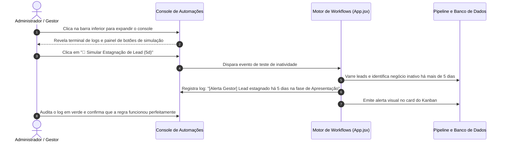

# US-23: Console de Automações, Workflows Reativos e Gatilhos em Tempo Real

## 1. Identificação e Metadados
- **Identificador:** US-23
- **Título:** Console Central de Automações, Observabilidade de Eventos e Gatilhos Reativos de CRM
- **Épico:** EPIC-06 — Integrações Multicanal, Webhooks e Automações
- **Projeto:** Urban Real State
- **Prioridade:** Média-Alta (Should Have / Confiabilidade e Governança)
- **Personas Impactadas:**
  - *Gestor Comercial*: Acompanha em tempo real tudo o que acontece no funil da imobiliária (leads chegando, propostas recusadas, estagnações).
  - *Consultor Imobiliário*: Recebe sugestões e gatilhos de automação na hora certa para avançar negociações.
  - *Administrador do Sistema*: Audita a integridade dos disparos, sincronizações com banco de dados e webhooks.

---

## 2. Declaração de Negócio (User Story Format)
> **Como** Gestor Comercial ou Administrador da plataforma Urban Real State,  
> **Quero** um console retrátil de automações e eventos em tempo real, com terminal de logs e botões de simulação de gatilhos operacionais (Inbound de leads, alertas de estagnação de 5 dias e recusa de proposta),  
> **Para que** eu tenha visibilidade total sobre as engrenagens automáticas do CRM, teste fluxos complexos antes de colocá-los em produção e garanta que nenhuma automação falhe silenciosamente.

---

## 3. Visão de Negócio e Proposta de Valor
- **Problema de Mercado:** Automações em CRMs tradicionais funcionam como "caixas pretas": o gestor configura uma regra e nunca sabe se ela realmente disparou, se falhou por erro de webhook ou se o corretor recebeu a notificação. A ausência de observabilidade gera desconfiança na tecnologia e faz a equipe voltar para o controle manual em papel.
- **Solução no Urban Real State:** O **Console de Automações & Workflows (`App.jsx`)**:
  - Painel retrátil na base da tela com visual moderno tipo terminal de telemetria.
  - Linha do tempo de eventos com carimbo de data/hora (Timestamp preciso) em fonte monoespaçada verde/esmeralda.
  - Painel de controle para simulação e teste de gatilhos corporativos:
    - *"Simular Inbound do Meta Ads"*: Injeta lead completo com perfil de compra para auditar a roleta.
    - *"Simular Estagnação de Lead (5 dias)"*: Dispara o alerta de advertência e sugestão de novos imóveis.
    - *"Simular Proposta Recusada"*: Testa o fluxo de recuo de estágio no Kanban e reset de filtros.
    - *"Limpar Logs do Console"*: Higienização rápida do terminal.
- **Impacto no Negócio:**
  - Redução a zero de dúvidas sobre o funcionamento de regras de distribuição e automação.
  - Facilidade de diagnóstico de falhas em minutos, sem necessidade de consultar logs complexos de servidores de nuvem.
  - Ferramenta poderosa para treinamento e demonstrações comerciais de alta credibilidade.

---

## 4. Funcionalidades e Regras de Negócio Detalhadas

### 4.1. Interface Retrátil e Indicador Ativo
- Barra horizontal permanente na parte inferior da tela com ícone de raio pulsante (`Zap`) e texto *"Console de Automações & Workflows (Gatilhos do CRM)"*.
- Clique em qualquer parte da barra para expandir/recolher suavemente entre altura compacta (44px) e painel expandido (256px).
- Estado de visualização nos modos claro e escuro.

### 4.2. Terminal de Logs em Tempo Real
- Exibição de eventos cronológicos descendentes:
  - Formato padronizado: `[HH:MM:SS] Origem / Ação: Detalhes descritivos`.
  - Exemplos de logs reais capturados:
    - `[10:44:12] Sistema inicializado. Banco de dados relacional (localStorage/Supabase) ativo.`
    - `[10:45:03] CRM: Novo Lead qualificado cadastrado: Carlos Oliveira (CLI-801).`
    - `[10:45:15] Configuração: Regra de distribuição alterada para: Por Bairro (Especialidade).`
    - `[10:46:22] Pipeline: Lead #CLI-802 avançou para a fase: APRESENTAÇÃO.`
    - `[10:47:01] Finanças: Simulação de crédito (Caixa) anexada ao perfil do cliente.`

### 4.3. Gatilhos Simuláveis para Validação Operacional
- Botões de teste no painel lateral do console:
  - **Inbound Social:** Cria um novo lead randômico com dados realistas simulando entrada de formulário do Facebook/Instagram.
  - **Estagnação de 5 Dias:** Dispara rotina de inspeção do pipeline, localiza negócios inativos e emite a notificação de reativação.
  - **Recusa de Proposta:** Simula o retorno negativo do proprietário, movendo o lead de volta para a coluna de Apresentação e sugerindo novas alternativas.

---

## 5. Sequência Lógica e Fluxo Passo a Passo

---

## 6. Pontos de Atenção e Riscos de Negócio
1. **Acúmulo de Logs em Sessões Prolongadas:** Em sessões ativas por muitos dias, a lista de logs em memória pode crescer excessivamente se não houver um limite máximo (ex: reter os últimos 100 eventos e descartar os mais antigos automaticamente).
2. **Separação de Logs de Produção vs. Teste:** Em ambiente de produção real com dados sigilosos, eventos disparados por botões de simulação devem conter a tag explícita `[SIMULAÇÃO]` para não confundir o fechamento financeiro oficial da imobiliária.
3. **Visibilidade por Papel de Acesso:** O console de automações é uma ferramenta voltada para gestores e administradores, devendo permanecer oculto ou bloqueado para corretores comuns para evitar distrações na operação de atendimento.

---

## 7. Requisitos Não Funcionais (RNFs)
- **RNF-01 (Impacto Nulo na Performance da UI):** O registro e renderização de novos logs no console não deve causar recálculos em cascata (*re-renders*) nas outras abas do CRM.
- **RNF-02 (Rolagem Automática do Terminal):** O painel de logs deve manter rolagem automática acompanhando a mensagem mais recente, a menos que o usuário tenha rolado o mouse para cima para inspecionar um log antigo.
- **RNF-03 (Facilidade de Cópia e Diagnóstico):** O texto dos logs deve ser selecionável e copiável para facilitar o envio a equipes de suporte técnico.

---

## 8. Análise do Estado Atual vs. Apontamento de GAPS

### Estado Atual Implementado
- Console retrátil completamente implementado na base do `App.jsx`.
- Terminal estilizado com carimbo de data/hora em verde esmeralda e botão de limpar logs.
- 4 gatilhos de simulação funcionais: Inbound Meta Ads, Alerta de Estagnação, Proposta Recusada e Limpeza de Logs.

### Gaps Identificados
1. **GAP-23.1 (Exportação de Logs de Auditoria para Arquivo de Texto / JSON):** Falta um botão "Baixar Logs da Sessão" para arquivamento externo em caso de investigação técnica de incidentes.
2. **GAP-23.2 (Filtro por Categoria de Log):** O terminal exibe todos os logs misturados; seria útil ter filtros rápidos por tipo (ex: apenas logs de `Estoque`, apenas de `CRM/Pipeline` ou apenas de `Segurança`).
3. **GAP-23.3 (Persistência em Tabela de Auditoria do Supabase):** Atualmente os logs ficam apenas no estado React do cliente; falta persistir eventos críticos de negócio em uma tabela `audit_logs` no backend.
