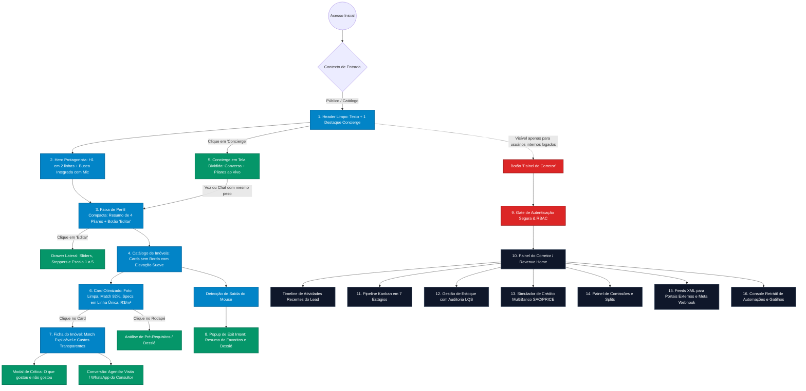

# Hierarquia de Desenvolvimento, Jornadas de UX e Plano de Execução — Urban Real State

## 1. Visão Geral da Arquitetura de Experiência
A plataforma **Urban Real State** organiza sua experiência em duas grandes trilhas de negócio perfeitamente sincronizadas, agora refinadas com base nas diretrizes do relatório de UX e interface:
1. **Jornada do Comprador (Portal Público):** Focada em elegância visual, fotos limpas, busca protagonista, faixa de perfil compacta (devolvendo espaço para o catálogo), linguagem acolhedora (*sem jargões internos*) e atendimento multimodal equilibrado (Voz e Chat com mesmo peso).
2. **Jornada do Consultor / Gestor (Painel do Corretor / CRM):** Focada em velocidade de atendimento (*Speed to Lead*), visualização de atividades recentes em linha do tempo (Timeline), cálculo de VGV e motor de comissões com separação estrita de papéis (RBAC).

---

## 2. Diagrama de Navegação e Hierarquia de Telas Otimizada

---

## 3. Passo a Passo da Experiência e Alinhamentos de UX

### Trilha A: Jornada do Lead Comprador (Portal Público)
1. **Header Limpo (Ref. UX Tópico 01):**
   - Links de navegação em texto (*Imóveis*, *Match Explicável*, *Busca Guiada*).
   - Um único botão de destaque visual na cor de acento (`--accent: #C8431F`) dedicado ao **Concierge**.
   - Ícones de CRM removidos para o público geral, evitando ruído de backoffice.
   - Selo `[DEMO / SIMULATION]` discreto e neutro ao lado do logotipo.
2. **Hero com Busca Protagonista (Ref. UX Tópico 02):**
   - H1 em 2 linhas com peso 600, eliminando a pílula institucional redundante.
   - Campo de busca amplo, acima da dobra, com atalho de microfone embutido no próprio campo.
3. **Faixa de Perfil Compacta (Ref. UX Tópico 05):**
   - Substituição de 600px de filtros verticais por uma faixa única de ~60px:
     `Orçamento: até 1.8M · 3+ Quartos · Varanda Gourmet × · 24 de 181 imóveis · [Editar]`
   - Devolve cerca de **450px de altura diretamente para o catálogo de fotos**.
4. **Drawer Lateral de Edição Completa:**
   - Ao clicar em "Editar", abre gaveta lateral ergonômica com sliders de preço, steppers de quartos (`− 2 +`) e escala de 1 a 5 para importância de estilo de vida.
   - Recálculo 100% automático com debounce (300ms a 500ms), sem botão manual de recálculo.
5. **Concierge Multimodal em Tela Dividida (Ref. UX Tópico 06):**
   - Voz e Chat com o mesmo peso visual.
   - Conversa à esquerda e os 4 Pilares preenchendo em tempo real à direita com edição manual.
   - Exemplos reais em estados vazios (*"ex.: Batel, Curitiba"*) e indicador de progresso (*"2 de 4 pilares"*).
6. **Cards de Imóveis Otimizados (Ref. UX Tópico 04):**
   - Foto sem badges escuras cobrindo a imagem.
   - Selo *"Match 92%"* exibido apenas se houver perfil ativo; no hover, explica os critérios.
   - Specs em texto neutro em linha única com plural correto (`1 vaga`, `1 quarto`).
   - Preço acompanhado de **R$/m²** e bairro posicionado abaixo do valor.
   - Link discreto no rodapé: *"Analisar pré-requisitos →"*.
7. **Linguagem Focada no Comprador (Ref. UX Tópico 07):**
   - O comprador vê *"Perfil salvo e compartilhado com seu consultor"*, nunca termos como "CRM", "Lead" ou "Qualificado".

---

### Trilha B: Jornada do Usuário Interno (Painel do Corretor / CRM)
1. **Acesso Autenticado e RBAC (Ref. UX Tópicos 01 e 07):**
   - O botão "Painel do Corretor" aparece no cabeçalho ou menu de avatar apenas para usuários com login de Corretor, Gestor ou Admin.
2. **Torre de Controle — Revenue Home com Timeline de Eventos:**
   - KPIs de VGV, honorários previstos e alertas de estagnação de 5 dias.
   - Feed cronológico de interações do lead (imóveis favoritados, pré-requisitos analisados e simulações).
3. **Pipeline Kanban em 7 Estágios:**
   - Movimentação ágil de oportunidades com atalho direto para disparo de pitch via WhatsApp.
4. **Perfil 3D do Comprador com 4 Pilares Padronizados:**
   - Mesma taxonomia de 4 pilares do portal (Localização, Tipologia, Orçamento, Estilo de Vida).
   - Dados Declarados, Observados e Inferidos com detecção de divergência orçamentária.
5. **Inventário, Financiamento e Comissões:**
   - Gestão de estoque com auditoria LQS e fotos limpas.
   - Calculadora multi-banco SAC/PRICE com vinculação direta à ficha do lead.
   - Controle de honorários e splits de vendas.

---

## 4. Plano de Execução Priorizado por Impacto e Esforço (Ref. UX Tópico 10)

O plano de evolução da plataforma Urban Real State organiza as melhorias em **8 entregas estratégicas priorizadas**:

| Ordem | Entrega Estratégica de UX e Produto | Tópicos de UX | Esforço Técnico | Impacto Comercial |
| :---: | :--- | :---: | :---: | :---: |
| **1** | **Header limpo, rótulos e tooltips nos ícones, Concierge como único destaque e rebaixamento do selo de demo.** | 01, 09 | Baixo | **Muito Alto** |
| **2** | **Cards de imóveis otimizados: Score de match na foto, specs em texto em linha única com plural correto, R$/m² e link no rodapé.** | 04, 09 | Baixo a Médio | **Muito Alto** |
| **3** | **Faixa de perfil compacta (devolve ~450px ao catálogo) com drawer lateral de edição e recálculo automático com debounce.** | 05, 03 | Médio | **Muito Alto** |
| **4** | **Modelo único de perfil (mesmos 4 pilares nas duas telas) e separação de linguagem de comprador vs. corretor.** | 07 | Médio | **Alto** |
| **5** | **Concierge em tela dividida (conversa + pilares ao vivo editáveis), com Voz e Chat com o mesmo peso e fallback sem erros.** | 06 | Médio a Alto | **Alto** |
| **6** | **Hero e busca revisados (H1 em 2 linhas, peso 600, microfone embutido na busca) e filtros de cidades em fileira única.** | 02, 03 | Baixo | **Médio a Alto** |
| **7** | **Sistema de design tokens, tema claro como padrão, cards com elevação sutil sem bordas pesadas e um acento por função.** | 08 | Médio | **Alto** |
| **8** | **Painel do corretor completo com linha do tempo de eventos do lead (Timeline) e alertas de próximo passo sugerido.** | 07 | Alto | **Alto** |
