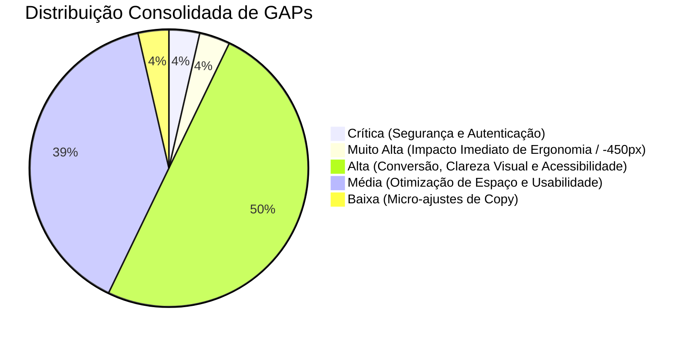

# Matriz Consolidada de GAPs de Negócio, UX e Roadmap Evolutivo — Urban Real State

## 1. Visão Executiva de Diagnóstico Integrado
A plataforma **Urban Real State** foi auditada sob duas óticas complementares:
1. **Auditoria de Negócio e Arquitetura:** Avaliação da integridade de dados relacionais, segurança por papéis (RBAC), motor de cálculo de comissões, sustentação de estoque e integrações com canais externos.
2. **Auditoria Especializada de UX e Interface:** Análise minuciosa de hierarquia visual, ergonomia, acessibilidade (WCAG), sobrecarga cognitiva e separação estrita da linguagem de comprador vs. corretor.

O resultado consolida **28 apontamentos de GAPs** classificados por impacto na conversão e esforço técnico de engenharia.

---

## 2. Matriz Consolidada de GAPs (Negócio + Engenharia + UX)

| Código GAP | Área / Módulo | Tópico UX | Descrição do GAP Identificado | Gravidade / Impacto | Esforço |
| :--- | :--- | :---: | :--- | :---: | :---: |
| **GAP-01.1** | Header & Navegação | 01 | Ícones sem legenda/tooltip (sparkle, documento, grade). Acesso ao CRM exposto como menu de apps genérico. | **Alta** | Baixo |
| **GAP-01.2** | Header & Navegação | 01 | Tagline longo e selo `[DEMO / SIMULATION]` com peso visual excessivo competindo com o logotipo. | **Média** | Baixo |
| **GAP-02.1** | Hero & Busca | 02 | H1 em 3 linhas com peso 800/900 e pill repetitiva empurrando o campo de busca para baixo da dobra. | **Média** | Baixo |
| **GAP-02.2** | Hero & Busca | 02 | Múltiplas formas concorrentes de iniciar busca dividindo a atenção do visitante. | **Média** | Baixo |
| **GAP-03.1** | Filtros & Sugestões | 03 | Duas fileiras de chips empilhadas (sugestões e cidades) parecendo a mesma coisa; corte de texto na borda. | **Média** | Baixo |
| **GAP-04.1** | Cards de Imóveis | 04 | Badge "Pré-Requisitos p/ Match" cobrindo a foto do imóvel em pílula escura. | **Alta** | Baixo |
| **GAP-04.2** | Cards de Imóveis | 04 | Erros gramaticais de plural ("1 Vagas", "1 Quartos") e ícones alternando vermelho/verde sem semântica. | **Alta** | Baixo |
| **GAP-04.3** | Cards de Imóveis | 04 | Ausência de preço por metro quadrado (R$/m²) e nome do bairro sobreposto à imagem sem contraste. | **Alta** | Baixo |
| **GAP-04.4** | Cards de Imóveis | 04 | Repetição idêntica das mesmas 4 tags de estilo de vida em imóveis de tipologias completamente distintas. | **Média** | Baixo |
| **GAP-05.1** | Perfil & Métricas | 05 | Obesidade de controles: 5 blocos empilhados consumindo ~600px de altura antes do primeiro imóvel. | **Muito Alta** | Médio |
| **GAP-05.2** | Perfil & Métricas | 05 | Ações duplicadas: "Redefinir Perfil" vs. "Nova Consulta"; "Editar" vs. "Personalizar Match" vs. "Recalcular". | **Alta** | Baixo |
| **GAP-05.3** | Perfil & Métricas | 05 | Estados desonestos: exibição de "Perfil Qualificado" quando teto é "Sem Limite" e 176 de 181 imóveis aparecem. | **Alta** | Baixo |
| **GAP-05.4** | Perfil & Métricas | 05 | Teto orçamentário como texto puro sem slider de faixa; specs em chips de 11px em vez de steppers (`− 2 +`). | **Média** | Médio |
| **GAP-05.5** | Perfil & Métricas | 05 | Ponderação de afinidade em percentual incompreensível "(100%)" em vez de escala intuitiva de 1 a 5. | **Média** | Baixo |
| **GAP-06.1** | Concierge Digital | 06 | Chat de texto secundarizado como link humilde de 13px em relação ao botão de voz. | **Alta** | Médio |
| **GAP-06.2** | Concierge Digital | 06 | Os 4 pilares ficam abaixo da dobra; ausência de tela dividida em tempo real com edição manual ao vivo. | **Alta** | Médio |
| **GAP-06.3** | Concierge Digital | 06 | Estado vazio com status frio em caixa alta "AGUARDANDO" em vez de exemplos úteis ("ex: Batel"). | **Média** | Baixo |
| **GAP-06.4** | Concierge Digital | 06 | Título corporativo ("Atendimento Consultivo Personalizado") em vez de copy direta ("Conte o que procura"). | **Baixa** | Baixo |
| **GAP-07.1** | Modelo de Perfil | 07 | Divergência de taxonomia: Concierge fala em Localização e Desejos; Catálogo fala em Teto, Specs e Afinidades. | **Alta** | Médio |
| **GAP-07.2** | Comunicação / Copy | 07 | Vazamento de termos internos: o comprador vê "atualiza seu perfil no CRM", "lead" e "qualificado". | **Alta** | Baixo |
| **GAP-07.3** | Painel do Corretor | 07 | Falta de visão de timeline de eventos do comprador (imóveis favoritados e pré-requisitos analisados). | **Alta** | Alto |
| **GAP-08.1** | Sistema Visual | 08 | Convivência caótica de laranja, verde, azul, roxo e vermelho na mesma tela sem função semântica. | **Alta** | Médio |
| **GAP-08.2** | Sistema Visual | 08 | Cards com bordas pesadas e fundo azul saturado em vez de elevação suave sobre tema claro de alto padrão. | **Média** | Médio |
| **GAP-09.1** | Acessibilidade | 09 | Botões de ícones sem atributo `aria-label` e alvos de toque inferiores a 44px (não conformidade WCAG). | **Alta** | Baixo |
| **GAP-09.2** | Acessibilidade | 09 | Rótulos de 11px em cinza sobre fundo escuro reprovados no teste de contraste mínimo de 4.5:1. | **Alta** | Baixo |
| **GAP-10.1** | Autenticação RBAC | 10 | Autenticação em memória na demo; necessidade de integração formal com Supabase Auth / JWT. | **Crítica** | Médio |
| **GAP-15.1** | Integração WhatsApp | 15 | Disparos via deep link `wa.me`; necessidade de envio em lote via WhatsApp Business Cloud API oficial. | **Alta** | Médio |
| **GAP-21.1** | Webhooks de Mídia | 21 | Webhook do Meta Ads opera via simulação de console; ausência de rota HTTP Serverless publicada. | **Alta** | Médio |

---

## 3. Classificação dos GAPs por Severidade e Impacto

---

## 4. Roadmap de Execução Integrado (Plano de 8 Entregas)

Alinhado rigorosamente com o **Tópico 10 do Relatório de UX** e as prioridades técnicas da plataforma:

### Onda 1: Ganhos Imediatos de Clareza e Acessibilidade (Entrega Rápida — 1 a 2 Semanas)
- [ ] **Entrega 1 (Header Limpo & Acessibilidade):**
  - Implementar navegação em texto (*Imóveis*, *Match Explicável*, *Busca Guiada*).
  - Rótulos e tooltips em todos os ícones com `aria-label` e alvo mínimo de 44px.
  - Rebaixar selo `[DEMO / SIMULATION]` para tag neutra ao lado do logo.
  - "Painel do corretor" visível exclusivamente para perfis autenticados com esse papel (GAP-01.1, GAP-01.2, GAP-09.1, GAP-09.2).
- [ ] **Entrega 2 (Cards de Imóveis Otimizados):**
  - Remover pílula "Pré-Requisitos p/ Match" sobre a foto; adicionar "Match 92%" na foto com hover explicativo.
  - Migrar link "Analisar pré-requisitos →" para o rodapé do card.
  - Corrigir erros de plural ("1 vaga", "1 quarto"), uniformizar cor neutra das specs e adicionar R$/m² (GAP-04.1, GAP-04.2, GAP-04.3, GAP-04.4).
- [ ] **Entrega 6 (Hero e Busca Protagonista):**
  - H1 em 2 linhas, peso 600, eliminando a pill institucional redundante.
  - Campo de busca amplo com microfone embutido e único botão primário (GAP-02.1, GAP-02.2, GAP-03.1).

### Onda 2: Reestruturação da Experiência Central e Consistência (Semanas 3 a 5)
- [ ] **Entrega 3 (Faixa de Perfil Compacta & Drawer):**
  - Substituir os 5 blocos (~600px) por uma faixa compacta de ~60px, devolvendo 450px ao catálogo de imóveis.
  - Implementar drawer lateral de edição com sliders de faixa, steppers (`− 2 +`) e escala de afinidade de 1 a 5.
  - Recálculo 100% automático com debounce (300-500ms), sem botão manual de recálculo (GAP-05.1, GAP-05.2, GAP-05.3, GAP-05.4, GAP-05.5).
- [ ] **Entrega 4 (Taxonomia Unificada e Separação de Linguagem):**
  - Adotar exatamente os mesmos 4 Pilares nas duas telas (Localização, Tipologia, Orçamento, Estilo de Vida).
  - Substituir "Perfil Qualificado" e "atualiza no CRM" por "Perfil salvo e compartilhado com seu consultor" (GAP-07.1, GAP-07.2).
- [ ] **Entrega 5 (Concierge em Tela Dividida):**
  - Conceder o mesmo peso visual para Voz e Chat.
  - Implementar tela dividida: conversa à esquerda e os 4 pilares preenchendo e editáveis ao vivo à direita.
  - Estados vazios com exemplos educativos ("ex: Batel, Curitiba") e progresso "0/4 pilares" (GAP-06.1, GAP-06.2, GAP-06.3, GAP-06.4).

### Onda 3: Design Tokens, Backoffice e Escala Enterprise (Semanas 6 a 8)
- [ ] **Entrega 7 (Sistema Visual e Tokens):**
  - Implementar tokens formais (`--bg: #FAFAF8`, `--accent: #C8431F`, `--shadow-card`).
  - Adotar a regra "Um Acento, Uma Função", eliminando o conflito de cores e adotando tema claro como padrão (GAP-08.1, GAP-08.2).
- [ ] **Entrega 8 (Painel do Corretor, Linha do Tempo e Infraestrutura):**
  - Implementar feed de Timeline de eventos do comprador no CRM com "Next Best Action" sugerido.
  - Conectar Supabase Auth seguro (JWT) e Webhooks de produção para Meta Ads e WhatsApp Cloud API (GAP-07.3, GAP-10.1, GAP-15.1, GAP-21.1).
